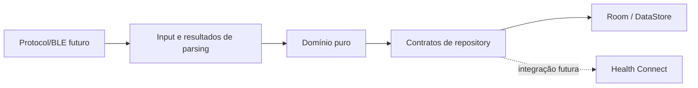
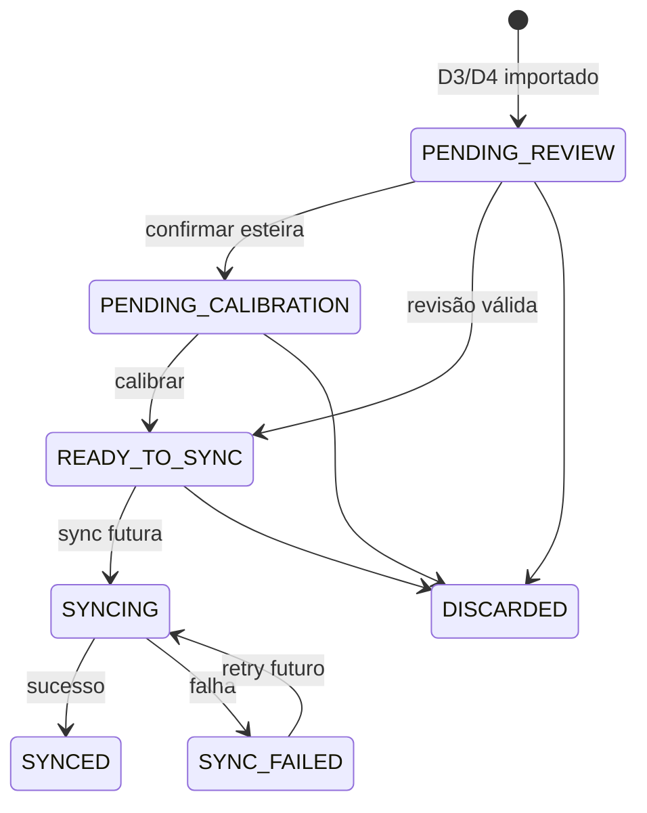
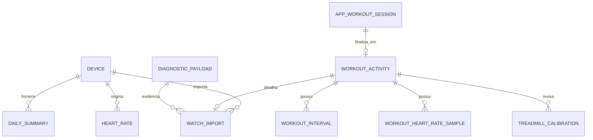

# Spec 003 — Domínio e persistência local

## Contexto

Champion Companion é aplicativo Android nativo independente do MotionLog e dedicado ao Champion C001. A Fase 03 cria fundação de domínio e persistência local. Artefatos Fase 00 são referência funcional, nunca schema a copiar.

Documentos autoritativos:

- `docs/roadmap/champion-companion-roadmap.md`
- `docs/decisions/adr-001-native-rewrite.md`
- `docs/specs/_inputs/phase-03-domain-persistence-direction.md`

Referências obrigatórias: `docs/baseline/database-reference.md`, `docs/baseline/feature-inventory.md`, `docs/baseline/health-connect-mapping.md`, `docs/baseline/gaps-and-open-questions.md`, `docs/protocol/history-d1.md`, `docs/protocol/workouts-d3-d4.md` e `docs/protocol/diagnostics-d8-a8.md`.

## Objetivo

Criar domínio e persistência local para dispositivo, resumo diário, BPM, D3/D4, revisão, calibração de esteira, sessões iniciadas pelo aplicativo, perfil, preferências, sincronização futura e diagnóstico. Não implementar BLE, Health Connect, GPS ou exercício funcional.

## Arquitetura e limites

- Domínio não conhece `BluetoothGatt`, characteristics, payload binário, Room, Health Connect, Compose ou `Context`.
- Domínio, Room, entradas de parser, UI e records externos usam tipos separados; mapeadores explícitos fazem conversão.
- Banco Champion Companion começa vazio em V1. Não acessa, importa, migra ou mantém compatibilidade com MotionLog.
- Migrations futuras ocorrem somente entre versões Champion Companion.
- Room é fonte operacional. Health Connect futuro é destino derivado.
- Preferências simples usam DataStore; perfil, saúde, sessões, filas e payloads usam Room.

## Modelos conceituais e agregados

- `Device`: identificador interno, identificador permitido pela plataforma, nome, modelo C001, firmware, associação, última conexão e metadados de importação. Estados BLE efêmeros não persistem.
- `DailySummary`: data local, passos, distância/calorias estimadas, origem, coleta, atualização, validade e dispositivo aplicável.
- `HeartRateMeasurement`: timestamp, BPM, origem, validade, dispositivo, importação, versão de parser e sync individual derivado.
- `WorkoutActivity`: atividade revisável, tipo sugerido/confirmado, origem, métricas e fluxo de revisão/sincronização.
- `WatchWorkoutImport`: extensão D3/D4 com CRC, bloco, validade de parser, intervalos, referência diagnóstica e dados originais.
- `AppWorkoutSession`: ciclo persistente de caminhada, corrida, treino livre e esteira; gera atividade ao finalizar.
- `TreadmillCalibration`, `HealthSyncOperation`, `DiagnosticPayload`, `UserProfile`, `WeightMeasurement` e `AppPreferences` completam limites de domínio.

## Estados e invariantes

`ActivityWorkflowState`: `PENDING_REVIEW`, `PENDING_CALIBRATION`, `READY_TO_SYNC`, `SYNCING`, `SYNCED`, `SYNC_FAILED`, `DISCARDED`.

`ParserValidity`: `VALID`, `PARTIAL`, `INVALID`, separado do estado de produto.

- D3/D4 inicia sempre `PENDING_REVIEW`; atividade `PARTIAL` ou `INVALID` não alcança `READY_TO_SYNC`.
- Tipo sugerido nunca substitui tipo confirmado. Menos de 1.000 passos sugere treino livre; 1.000 ou mais sugere corrida.
- `DISCARDED` é terminal e nunca sincroniza. Esteira exige calibração antes de ficar pronta.
- `SyncOperationState`: `PENDING`, `SYNCING`, `SYNCED`, `FAILED`. BPM D1 possui operação individual; falha parcial mantém somente registros afetados pendentes. Não há seleção manual por registro.
- `AppWorkoutSessionState`: `CREATED`, `ACTIVE`, `PAUSED`, `AWAITING_RECOVERY`, `FINISHED`, `DISCARDED`. Após interrupção, usuário pode retomar, finalizar com agregados persistidos ou descartar.

## Room e relacionamentos

Room V1 terá entidades separadas para dispositivos, perfil, peso, resumos diários, BPM, atividades, importações, sessões, intervalos, amostras BPM, calibrações, operações de sincronização e payloads diagnósticos.

- Entidades usam PK, FK, `NOT NULL`, índices de consulta e índices únicos.
- Constraints físicas cobrem identidade, nulidade, FK e unicidade. Invariantes cruzadas e transições usam domínio e updates condicionais em transações.
- Relações polimórficas de sync não usam FK falsa; repository valida sujeito e grava operação na mesma transação.
- DAOs expõem consultas de resumo diário, BPM válido pendente, revisão pendente, sessão recuperável, payload expirado e sync falho.

## IDs, deduplicação e transações

- IDs técnicos usam UUIDv7. Autoincremento nunca é única identidade ou deduplicação.
- Dispositivo: identificador permitido pela plataforma, único.
- Resumo diário: dispositivo + origem + data local.
- D1: dispositivo + origem + instante resolvido/chave do registro.
- BPM manual/stream: identificador estável da sessão de medição, sem colapsar medições intencionais distintas.
- D3/D4: dispositivo + origem + CRC. Sessão: UUID antes de iniciar. Calibração: atividade + revisão. Sync: agregado + tipo de record. Payload: UUID da captura.
- Não definir hash de protocolo sem evidência. Reprocessamento usa vínculo único `payload + tipo de saída + ordinal` e transação.
- Reimportação D3/D4 atualiza parser, mas preserva tipo confirmado, revisão, calibração e descarte do usuário.

Transações: payload e derivados; atividade e intervalos; revisão e métricas; calibração; finalização/recuperação; sucesso/falha parcial de sync; reprocessamento sem duplicação ou perda de edição do usuário.

## Tempo, calibração e sessões

- Domínio usa `Instant`, `LocalDate`, `LocalDateTime`, `ZoneId`/offset e estado de resolução. Room armazena forma canônica, nunca texto de UI.
- Dados do relógio sem timezone preservam horário observado e contexto de resolução; não inventar instante absoluto.
- Distinguir data local, coleta, instante do relógio, importação, criação, atualização, início e fim.
- Calibração preserva distância original, estimada, informada e calibrada.
- Para importação, fator = distância informada / distância original. Sessão de esteira sem estimativa positiva aceita distância calibrada, mas fator fica ausente com motivo explícito; nunca inventar `1.0`.
- Ritmo, velocidade e métricas derivadas registram proveniência. Health Connect futuro usa somente distância calibrada.
- GPS de caminhada/corrida existe apenas em memória; persistir somente agregados.

## Diagnóstico, segurança e privacidade

- Payload diagnóstico binário local contém comando/fluxo, dispositivo, firmware, parser, resultado, erro e vínculos derivados.
- Retenção: 14 dias ou 10 MiB globais; limpeza remove mais antigos primeiro. Exclusão não remove dados de domínio derivados.
- Reprocessamento distingue concluído, parcial, inválido e erro técnico; não duplica registros.
- Nunca registrar payloads, identificadores, dados de saúde ou pessoais no Logcat. Release não expõe detalhes diagnósticos.
- Auto Backup Android fica desativado nesta fase. Backup/restauração próprios permanecem fora de escopo.
- Proibido em modelos, entidades, DAOs, mapeadores, logs, fixtures e testes: latitude, longitude, altitude por ponto, coordenadas, rota, polyline, segmentos de rota, GPX, TCX, FIT e `ExerciseRoute`.

## Repositories e contratos

Repositories específicos por agregado, não espelhos genéricos de DAO:

- observar dispositivo associado;
- consultar/gravar resumo diário;
- importar e consultar BPM pendente;
- persistir, revisar e descartar atividade;
- registrar calibração;
- recuperar/finalizar sessão interrompida;
- consultar/marcar operações de sync;
- armazenar, reprocessar e limpar payload;
- observar/atualizar preferências.

## Testes e critérios de aceite

- Unitários: invariantes, transições, mapeadores, IDs, deduplicação, timezone/DST, calibração e falha parcial BPM.
- Room: entidades, FKs, índices únicos, DAOs, transações, reprocessamento e retenção diagnóstica.
- Dados determinísticos; fixtures entram quando existirem.
- Busca automatizada garante ausência de latitude, longitude, rota, polyline e `ExerciseRoute` em domínio, Room, mapeadores, logs e testes.
- Executar testes afetados, `./gradlew testDebugUnitTest`, e na validação `./gradlew lint testDebugUnitTest assembleDebug assembleRelease`.

## Fora do escopo

BLE, handshake, D0/D1/D3/D4, Health Connect, sync real, GPS, exercícios funcionais, foreground services, backup/restauração, MotionLog, outros relógios, rotas e coordenadas.

## ADRs recomendadas, não criar automaticamente

- Política futura de `clientRecordId`, `clientRecordVersion`, conflitos remotos e escrita parcial Health Connect.
- Política definitiva de timestamp do relógio sem timezone, DST e mudança de fuso.
- Mecanismo de constraints físicas extras se Room exigir triggers além de FKs, índices e validação de domínio.

## Definition of Done

Fase concluída quando domínio e Room V1 próprios existem, modelos e entidades estão separados, estados não são contraditórios, BPM D1 suporta sync individual futura, D3/D4 inicia pendente de revisão, calibração preserva origem, payloads têm retenção/reprocessamento seguro, testes cobrem invariantes e não há migração, dependência ou acesso MotionLog nem persistência de rota.
