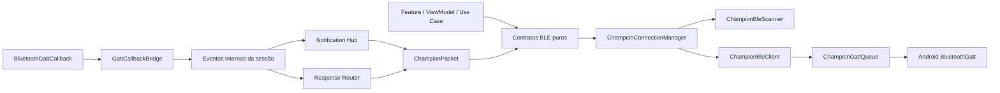
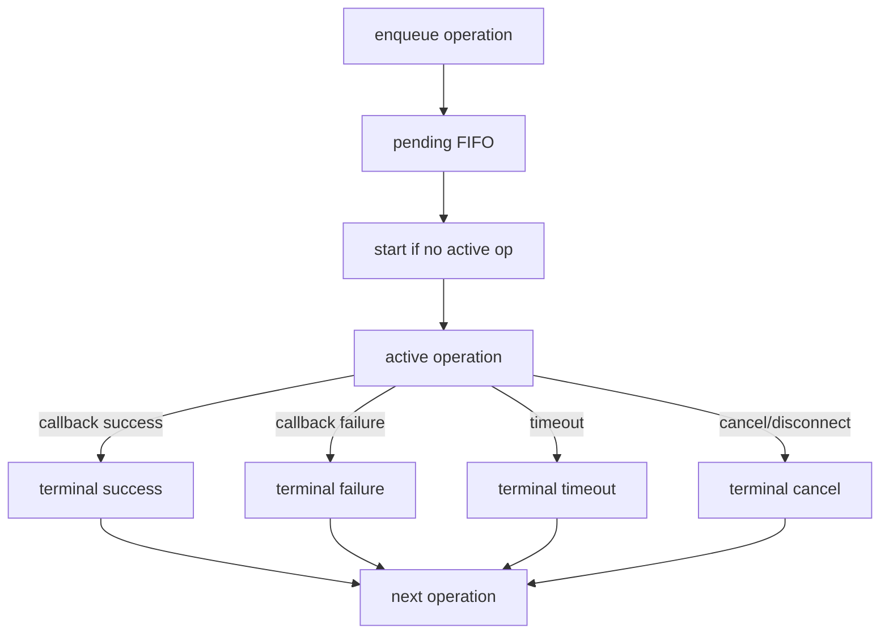
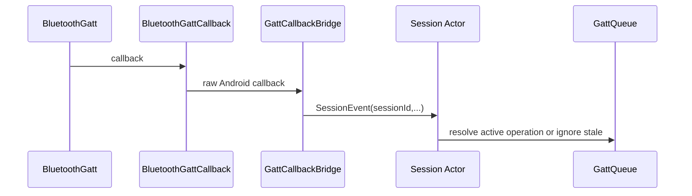
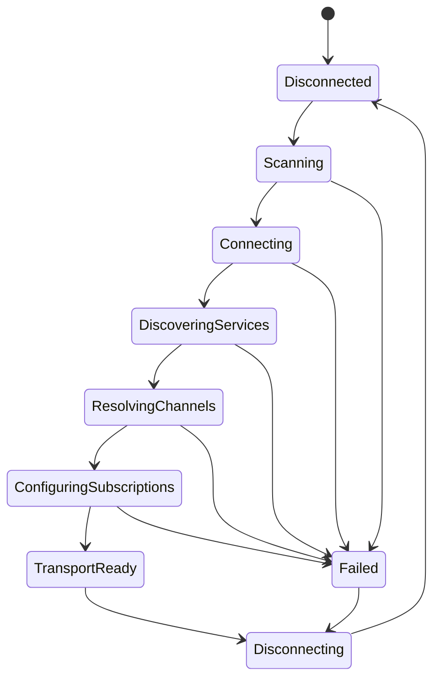
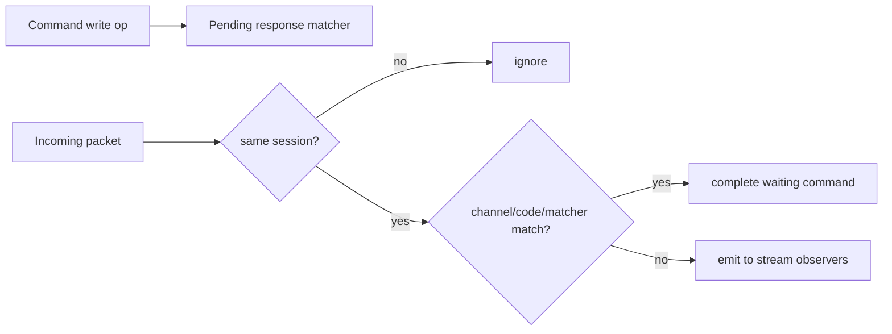
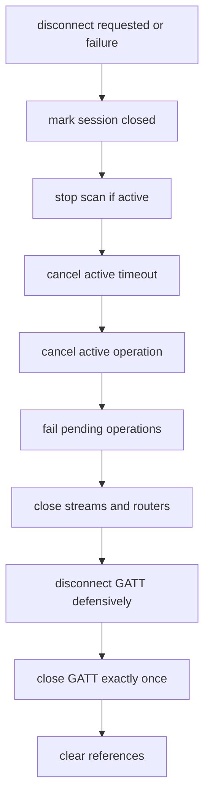

# Spec 004 — Núcleo BLE nativo

## Contexto

Champion Companion já possui fundação Android nativa, design system, Hilt, Room V1, DataStore e contratos de domínio. A Fase 04 introduz infraestrutura BLE reutilizável e independente da UI para o Champion C001.

Documentos autoritativos:

- `AGENTS.md`
- `docs/core/current-project-baseline.md`
- `docs/specs/_inputs/phase-04-native-ble-core-direction.md`
- `docs/protocol/champion-c001.md`
- `docs/protocol/ble-transport.md`
- `docs/protocol/ble-command-mapping.md`
- `docs/protocol/handshake-a1.md`
- `docs/protocol/heart-rate-d0-f002.md`
- `docs/protocol/history-d1.md`
- `docs/protocol/workouts-d3-d4.md`
- `docs/protocol/diagnostics-d8-a8.md`
- `docs/baseline/gaps-and-open-questions.md`
- `docs/baseline/source-map.md`
- `docs/baseline/feature-parity-checklist.md`
- ADRs `001` a `005`

Referências das fases concluídas:

- `docs/specs/000-phase-zero-baseline-handoff.md`
- `docs/specs/001-android-foundation.md`
- `docs/specs/002-design-system.md`
- `docs/specs/003-domain-and-persistence-foundation.md`

## Objetivo

Criar camada BLE nativa previsível, testável e desacoplada da interface, responsável por:

- verificar pré-requisitos de Bluetooth e permissões aplicáveis;
- localizar dispositivos Champion C001 por filtro seguro;
- abrir e encerrar sessões GATT;
- descobrir services e characteristics;
- manter catálogo central de UUIDs e capabilities;
- serializar todas as operações GATT em fila única por sessão;
- configurar notifications e indications via CCCD enfileirado;
- expor pacotes recebidos e respostas roteadas por fronteira segura;
- controlar timeout, cancelamento, retry e cleanup;
- representar estados e erros de transporte;
- registrar somente metadados seguros em debug.

## Requisitos Funcionais

1. Existir uma única fronteira de acesso às APIs Android BLE.
2. Scan deve suportar timeout, cancelamento, cleanup e exclusão mútua.
3. Filtro Champion deve usar `name` ou `localName` iniciando com `champion`, case-insensitive.
4. Conexão deve descobrir services, registrar characteristics e resolver capabilities da sessão.
5. Toda operação GATT deve passar por fila serial única por sessão.
6. Deve existir no máximo uma operação ativa por vez.
7. Toda operação deve ter timeout explícito.
8. Timeout deve concluir ou cancelar operação e liberar fila.
9. Disconnect deve cancelar operação ativa, falhar pendentes e invalidar sessão.
10. Callbacks de sessão antiga devem ser ignorados.
11. Cada operação deve ser concluída no máximo uma vez.
12. CCCD deve ser escrita pela fila; `setCharacteristicNotification` sozinho não basta.
13. Deve existir uma subscription física por characteristic, com multiplexação para múltiplos consumidores lógicos.
14. Commands futuros devem aguardar resposta por roteamento controlado, sem alterar callback Android por feature.
15. `TransportReady` deve significar somente transporte pronto, nunca handshake concluído.

## Requisitos Não Funcionais

- Sem dependências BLE externas.
- Sem `BluetoothGatt` ou tipos Android BLE expostos para domínio, repositories de negócio, features, ViewModels ou Compose.
- Sem acesso BLE a Room, DataStore de produto, Health Connect ou GPS.
- Payloads e arrays recebidos/escritos devem ser copiados defensivamente.
- Logs debug devem omitir bytes brutos, hex, MAC, dados de saúde e IDs persistentes.
- Estratégia deve favorecer JVM tests sempre que possível; instrumentados só quando Android BLE for indispensável.
- Implementação deve respeitar `org.gradle.configuration-cache=true`.

## Limites Da Fase

Incluído:

- contratos BLE puros;
- scanner nativo;
- fila GATT e modelo de operação;
- bridge de callbacks;
- descoberta de services e registro de capabilities;
- subscriptions F008/F002/FEA1 conforme criticidade definida;
- packet envelope, command envelope e roteamento estrutural;
- connection manager e cleanup;
- logging seguro;
- bindings Hilt e doubles de teste.

Fora do escopo:

- handshake A1 funcional;
- D0, D1, D3, D4;
- parser funcional de FEA1;
- persistência automática de dispositivos, pacotes ou estado efêmero;
- Health Connect;
- GPS;
- foreground service;
- background BLE;
- auto-connect;
- reconexão infinita;
- tela funcional completa de dispositivo;
- suporte a outros relógios;
- alteração do schema Room.

## Arquitetura



### Fronteiras

- `core/bluetooth`: contratos puros, estados, erros, UUID catalog, session model, queue model, packet/command envelopes.
- `core/bluetooth/android`: acesso concreto a `BluetoothManager`, `BluetoothAdapter`, `BluetoothLeScanner`, `BluetoothGatt`, `BluetoothGattCallback`, `BluetoothDevice`, `BluetoothStatusCodes` e correlatos.
- `core/model`: continua sem dependência BLE.
- `data/`: continua sem dependência BLE.
- `feature/*`: consome somente contratos puros e estados seguros.

## Componentes E Responsabilidades

### `ChampionBleScanner`

- validar pré-requisitos antes de iniciar scan;
- impedir scan simultâneo;
- iniciar scan foreground;
- aplicar filtro Champion local;
- deduplicar resultados adequadamente;
- parar scan em sucesso, timeout, cancelamento ou erro;
- nunca conectar diretamente.

### `ChampionBleClient`

- encapsular tipos Android BLE;
- abrir/encerrar sessão GATT;
- receber callbacks Android e convertê-los em eventos;
- executar operações concretas pedidas pela fila;
- desconectar e chamar `close()` de forma controlada.

### `ChampionGattQueue`

- uma fila por sessão;
- uma operação ativa por vez;
- iniciar próxima operação só após terminal da atual;
- controlar timeout por operação;
- aplicar retry explícito quando permitido;
- cancelar tudo em disconnect;
- ignorar callbacks tardios/duplicados;
- garantir conclusão única.

### `ChampionGattOperation`

Representa:

- discovery de services;
- read characteristic;
- write characteristic;
- write descriptor;
- request MTU;
- configure notification;
- configure indication;
- disconnect controlado;
- wait for protocol response.

Cada operação declara:

- `operationId`;
- `sessionId`;
- tipo;
- alvo;
- payload copiado, quando houver;
- timeout;
- retry policy;
- condição de conclusão;
- tentativa atual.

### `GattCallbackBridge`

- traduzir `BluetoothGattCallback` em eventos internos serializáveis;
- anexar `sessionId` a cada evento;
- nunca executar regra de negócio ou parser funcional.

### `ChampionCapabilityRegistry`

- resolver services e characteristics descobertas;
- classificar canais obrigatórios e opcionais;
- validar properties necessárias;
- produzir snapshot imutável de capabilities por sessão.

### `ChampionNotificationHub`

- manter uma subscription física por characteristic;
- multiplexar para múltiplos consumidores lógicos;
- encerrar streams em disconnect;
- impedir emissão após fechamento da sessão.

### `ChampionPacketRouter`

- classificar pacote por sessão, channel alias e código inicial;
- casar resposta com comando aguardando matcher;
- deixar pacotes não consumidos disponíveis para observers de stream.

### `ChampionConnectionManager`

- orquestrar scan, conexão, discovery, subscriptions obrigatórias, `TransportReady`, disconnect e cleanup;
- expor estado único de conexão;
- não conter parser funcional de A1, D0, D1, D3 ou D4.

### `ChampionProtocolLogger`

- emitir logs debug de metadados seguros;
- nunca escrever payload, hex, bytes, BPM, passos, MAC ou senha;
- opcionalmente encaminhar bytes copiados para sink privado desacoplado do Logcat.

## Estratégia De Permissões

Fase 04 modela permissões e pré-requisitos, mas não cria UI de solicitação.

Representação tipada mínima:

- BLE não suportado;
- Bluetooth desligado;
- permissão de scan ausente;
- permissão de conexão ausente;
- permissões legadas aplicáveis ausentes;
- localização requerida pela combinação de SDK e estratégia;
- operação indisponível pelo estado atual.

Regras:

- núcleo informa o que falta;
- núcleo não solicita permissão;
- núcleo não inicia scan sem autorização;
- negação não vira loop.

## Pré-Requisitos De Bluetooth

- `BluetoothManager` presente;
- adapter disponível;
- adapter habilitado;
- permissões compatíveis com SDK atual;
- scanner e conexão só quando estado permitir.

## Catálogo De Canais

Catálogo único obrigatório.

### Obrigatórios para caminho crítico de transporte

```text
F008 service  f0080001-0451-4000-b000-000000000000
F008 notify   f0080002-0451-4000-b000-000000000000
F008 write    f0080003-0451-4000-b000-000000000000
CCCD          00002902-0000-1000-8000-00805f9b34fb
```

### Opcionais confirmados como capabilities não bloqueantes

```text
F002 service  f0020001-0451-4000-b000-000000000000
F002 notify   f0020002-0451-4000-b000-000000000000

FEE7 service  0000fee7-0000-1000-8000-00805f9b34fb
FEA1 notify   0000fea1-0000-1000-8000-00805f9b34fb
```

### Catalogados sem obrigatoriedade

```text
F002 write    f0020003-0451-4000-b000-000000000000
FEA2          0000fea2-0000-1000-8000-00805f9b34fb
FEC8          0000fec8-0000-1000-8000-00805f9b34fb
```

Regras:

- FEA2, FEC8 e F002 write não bloqueiam `TransportReady`;
- não assinar FEA2/FEC8 por padrão;
- canal opcional não pode bloquear transporte sem evidência nova.

## Scan

- foreground manual, sem auto-start ao abrir app;
- um scan por vez;
- timeout específico;
- cancelável;
- sucesso encerra scan;
- erro encerra scan e limpa recursos.

### Filtro Do Champion C001

- usar `name` ou `localName`;
- normalizar `trim()` + lower-case seguro;
- aceitar somente prefixo `champion`;
- rejeitar `null` ou nomes incompatíveis;
- não exigir service UUID no filtro inicial.

## Conexão

- sem auto-connect;
- sessão efêmera com `sessionId` próprio;
- conexão seguida por discovery;
- sem handshake automático nesta fase;
- sem reconexão infinita.

## Descoberta De Services E Registro De Characteristics

Sequência:

1. conectar;
2. descobrir services;
3. localizar channels do catálogo;
4. validar properties;
5. gerar `CapabilitySnapshot`;
6. configurar subscriptions obrigatórias;
7. emitir `TransportReady`.

### Capabilities Obrigatórias

- F008 write presente e gravável;
- F008 notify presente e notificável;
- CCCD acessível para F008 notify.

### Capabilities Opcionais

- F002 notify presente e notificável;
- FEA1 notify presente e notificável;
- FEA2/FEC8 presentes sem habilitação padrão.

## Notifications, Indications E CCCD

Regras:

- `setCharacteristicNotification` + write de CCCD;
- write de descriptor sempre enfileirado;
- aguardar callback correspondente;
- distinguir notify de indicate pela property;
- não duplicar subscription física;
- remover consumidor lógico sem desligar canal compartilhado por padrão;
- streams fecham em disconnect.

## Fila GATT



### Estratégia De Serialização

Recomendada: actor/event loop dedicado por sessão, em dispatcher BLE dedicado.

Motivos:

- estado mutável centralizado;
- disputa determinística entre callback, timeout e cancelamento;
- cleanup simplificado;
- testabilidade alta em JVM.

### Operações Suportadas

- discovery;
- characteristic read;
- characteristic write;
- descriptor write;
- request MTU;
- enable notification;
- enable indication;
- protocol response wait;
- disconnect controlado.

### Lifecycle De Operação

1. enfileirar;
2. ativar;
3. armar timeout;
4. iniciar chamada Android;
5. aguardar callback ou timeout;
6. resolver resultado terminal uma única vez;
7. cancelar timeout;
8. liberar fila.

### Timeout

Centralizados e ajustáveis por tipo:

- scan;
- conexão;
- discovery;
- descriptor write;
- characteristic read;
- characteristic write;
- MTU;
- disconnect;
- espera de resposta.

### Cancelamento

- explícito por consumidor;
- implícito por disconnect;
- timeout converte em terminal e libera fila;
- callback tardio após cancelamento é ignorado.

### Retry

- limitado e explícito;
- cancelado ao desconectar;
- proibido após sessão encerrada;
- padrão de comandos de protocolo: sem retry automático;
- proibido retry cego para comandos com potencial de efeito duplicado.

### Concorrência

- uma autoridade de mutação da sessão;
- callbacks Android viram eventos;
- timeout e callback competem no mesmo actor;
- disconnect tem prioridade de encerramento.

## Bridge De `BluetoothGattCallback`



## Identidade De Sessão E Proteção Contra Callbacks Antigos

- cada conexão recebe `sessionId`/generation única;
- toda operação e todo evento carrega `sessionId`;
- callback com sessão antiga não altera estado, não conclui operação, não emite pacote e não dispara retry;
- disconnect marca sessão encerrada antes de limpar GATT.

## Estados De Conexão



`TransportReady` não significa:

- handshake concluído;
- autenticação confirmada;
- disponibilidade funcional de D0, D1, D3 ou D4.

## Modelo De Erros

Categorias mínimas:

- BLE não suportado;
- Bluetooth desligado;
- permissão ausente;
- scan já em andamento;
- scan falhou;
- scan expirou;
- dispositivo não encontrado;
- conexão falhou;
- desconectado inesperadamente;
- discovery falhou;
- service obrigatório ausente;
- characteristic obrigatória ausente;
- property incompatível;
- operação rejeitada;
- callback com status de falha;
- timeout;
- fila encerrada;
- operação cancelada;
- subscription falhou;
- payload estruturalmente inválido;
- erro interno inesperado.

Erros expostos para UI futura devem ser seguros e sem detalhe técnico sensível.

## Command Envelope E Packet Envelope

### `ChampionCommand`

- imutável;
- `commandCode`;
- `payload` copiado;
- write channel alias;
- write type;
- `responseMatcher`;
- timeout sugerido;
- retry policy.

### `ChampionPacket`

- `sessionId`;
- `channelAlias`;
- characteristic UUID;
- direção;
- instante monotônico ou `Instant` de recepção;
- bytes copiados;
- código inicial quando identificável.

## Roteamento De Respostas



Não implementar nesta fase:

- acumulador multipart D1;
- acumulador multipart D3;
- acumulador multipart D4;
- condição final específica de handshake A1.

## Streams De Notification

- por alias de canal;
- multiplexadas;
- sem duplicar CCCD;
- fechadas em disconnect;
- protegidas contra emissão pós-encerramento.

## Cleanup E Disconnect



Regras:

- `close()` controlado e idempotente;
- scan ativo para no disconnect;
- fila não reabre após encerramento da sessão;
- streams e roteadores encerram com causa segura.

## Logging Seguro

Resolução explícita da divergência entre roadmap antigo e regras atuais:

- roadmap antigo mencionava payload hexadecimal em debug;
- Fase 04 segue `AGENTS.md`, ADR-004 e input da fase;
- portanto, Logcat debug registra somente metadados seguros.

Permitido no debug:

- `session_id` efêmero;
- `operation_id`;
- direção;
- alias do canal;
- tipo de operação;
- código do comando;
- quantidade de bytes;
- timestamp/início/duração;
- resultado;
- status GATT sanitizado;
- categoria de erro.

Proibido no Logcat:

- payload hexadecimal;
- bytes brutos;
- endereço MAC;
- ID persistente do dispositivo;
- dados de saúde;
- passos;
- BPM;
- senha do handshake;
- credenciais.

Pode existir contrato opcional para futura captura diagnóstica privada, mas:

- desacoplado de Room nesta fase;
- inativo por padrão;
- copiando bytes defensivamente;
- sem retenção indefinida em memória.

## Integração Hilt

Preparar bindings para:

- scanner;
- client BLE;
- queue/factory por sessão;
- connection manager;
- dispatcher BLE dedicado;
- monotonic clock/scheduler de timeout;
- logger seguro;
- wrappers de plataforma necessários;
- fakes de teste.

`BluetoothGatt` nunca deve virar singleton global exposto.

## Test Doubles

Planejados:

- `FakeChampionBleScanner`;
- `FakeChampionBleClient`;
- `FakeGattCallbackSource` ou equivalente estreito;
- `FakeMonotonicClock`/`FakeTimeoutScheduler`;
- `RecordedChampionPacketSource`.

## Testes JVM

Obrigatórios:

- filtro do dispositivo;
- catálogo UUID;
- fila FIFO;
- exclusão mútua;
- timeout;
- callback antes do timeout;
- timeout antes do callback;
- cancelamento;
- retry permitido;
- retry proibido;
- callback duplicado;
- callback atrasado;
- sessão antiga;
- disconnect com fila pendente;
- capabilities obrigatórias e opcionais;
- response matcher;
- cópia defensiva;
- sanitização de logs;
- transições de estado.

## Testes Instrumentados

Somente quando dependente de framework Android BLE, por exemplo:

- wrappers de `BluetoothManager`/`BluetoothAdapter`;
- mapeamento de permissões por SDK;
- detalhes impossíveis de simular em JVM pura.

Validação física com Champion C001 não pertence a esta fase.

## Segurança E Privacidade

- nenhum componente BLE acessa Room ou Health Connect;
- nenhum backup/captura pública é criado;
- nenhum tipo BLE sensível chega à UI;
- nenhum payload BLE aparece em erro exposto ao usuário;
- sem latitude/longitude/rota;
- sem MAC em logs.

## Critérios De Aceite

- fronteira única Android BLE existe;
- scan tem timeout, cancelamento e exclusão mútua;
- filtro Champion não depende de service UUID;
- catálogo UUID está centralizado;
- fila serial existe por sessão;
- no máximo uma operação ativa;
- toda operação tem timeout;
- timeout libera fila;
- disconnect limpa recursos e encerra fila;
- callbacks antigos não afetam sessão nova;
- discovery produz capabilities tipadas;
- CCCD é configurado via fila;
- existe uma subscription física por characteristic;
- packets são copiados defensivamente;
- retries são limitados e explícitos;
- não há reconexão infinita;
- `TransportReady` não é handshake concluído;
- logs não contêm bytes, hex, MAC ou dados de saúde;
- testes JVM cobrem fila, estado, timeout, retry e cleanup;
- não há implementação funcional de A1, D0, D1, D3 ou D4;
- não há dependência de Room, Health Connect ou UI dentro do núcleo BLE.

## Definition Of Done

Fase 04 conclui quando núcleo BLE reutilizável, independente da UI e protegido por testes existir no repositório, pronto para ser usado pela PoC física da Fase 05 sem depender desta conversa.

## Matriz De Rastreabilidade

| Requisito | Tasks |
| --- | --- |
| Contexto, checklist e ordem da fase | `004-00` |
| Auditoria de fronteiras e lacunas BLE | `004-01` |
| Contratos puros, estados e erros | `004-02` |
| Permissões e pré-requisitos tipados | `004-03` |
| Catálogo UUID e filtro Champion | `004-04` |
| Scan nativo com timeout/cancelamento | `004-05` |
| Fila serial, operação única, timeout e retry | `004-06` |
| Bridge de callbacks e client concreto | `004-07` |
| Discovery e capability registry | `004-08` |
| Notifications, indications e CCCD multiplexados | `004-09` |
| Command envelope, packet envelope e response routing | `004-10` |
| Connection manager, estados, disconnect e cleanup | `004-11` |
| Logging seguro e sink diagnóstico opcional | `004-12` |
| Hilt, dispatcher BLE e fakes | `004-13` |
| JVM tests e instrumentados mínimos | `004-14` |
| Validação final e consolidação do checklist | `004-15` |

## ADRs A Avaliar

Decisões ainda não cobertas claramente por ADR vigente:

- serialização da fila GATT;
- ownership da sessão GATT;
- separação entre transporte e protocolo;
- multiplexação de notifications;
- política geral de timeout e retry;
- política de logging e captura diagnóstica privada.

Para cada uma, a Fase 04 deve registrar questão, alternativas, impactos e recomendação de ADR, sem aprová-la automaticamente.
