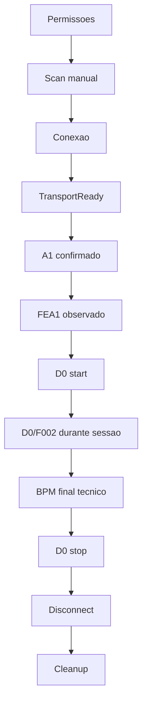
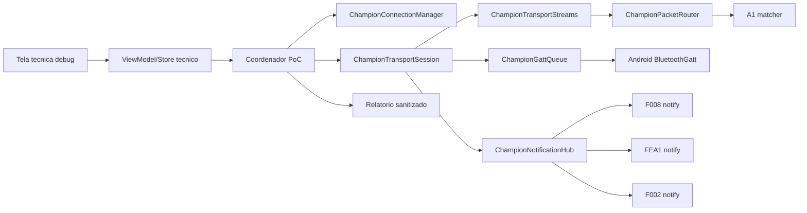
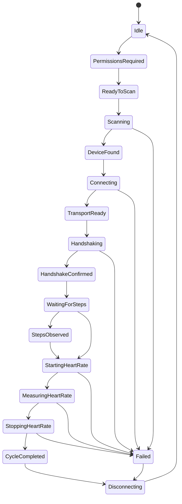
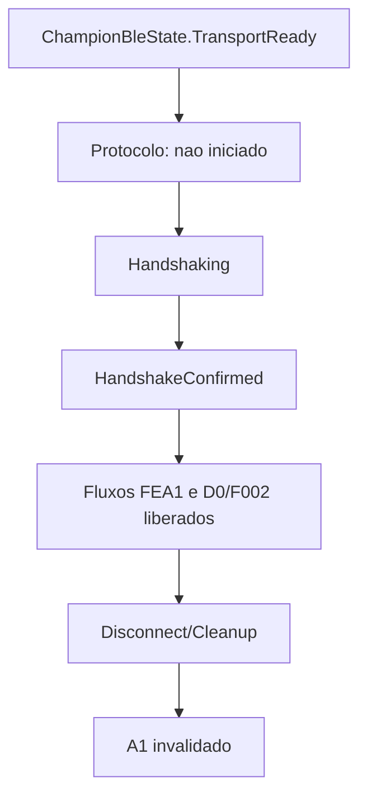
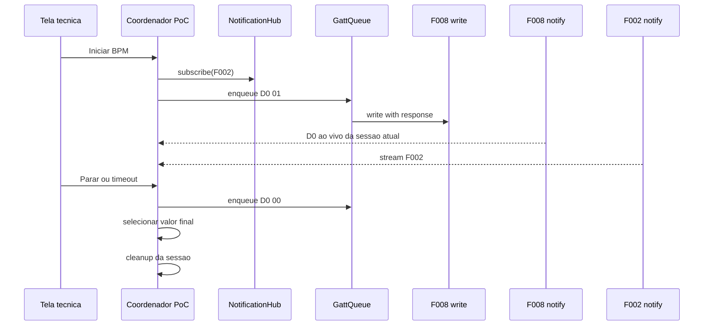
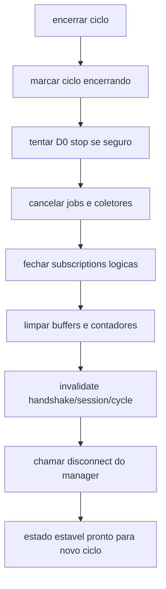
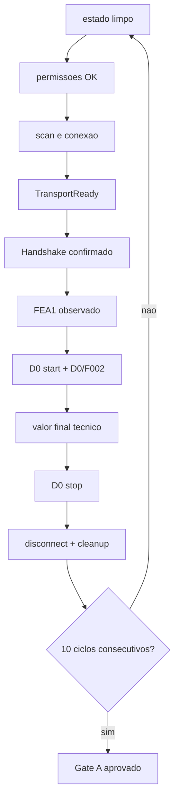

# Spec 005 — Prova de conceito BLE nativa

## Contexto

Champion Companion já possui fundação Android nativa, design system, Room V1, DataStore, Hilt e núcleo BLE reutilizável criado na Fase 04. A Fase 05 valida fisicamente, no Galaxy S22 com Champion C001, se esse núcleo suporta fluxo mínimo reproduzível de permissões, scan, conexão, handshake, passos e BPM manual técnico sem abrir escopo de produto definitivo.

Documentos autoritativos:

- `AGENTS.md`
- `docs/core/current-project-baseline.md`
- ADRs `001` a `005`
- `docs/specs/_inputs/phase-05-native-ble-poc-direction.md`
- `docs/specs/004-native-ble-core.md`
- `docs/tasks/004-native-ble-core/004-00-overview.md`
- `docs/protocol/champion-c001.md`
- `docs/protocol/ble-transport.md`
- `docs/protocol/ble-command-mapping.md`
- `docs/protocol/handshake-a1.md`
- `docs/protocol/heart-rate-d0-f002.md`
- `docs/baseline/gaps-and-open-questions.md`
- `docs/baseline/source-map.md`
- `docs/baseline/feature-parity-checklist.md`

Referências das fases concluídas:

- `docs/specs/000-phase-zero-baseline-handoff.md`
- `docs/specs/001-android-foundation.md`
- `docs/specs/002-design-system.md`
- `docs/specs/003-domain-and-persistence-foundation.md`
- `docs/specs/004-native-ble-core.md`

## Estado Atual Após a Fase 04

- Núcleo BLE existe em `core/bluetooth`, `core/bluetooth/android` e `core/bluetooth/internal`.
- `ChampionConnectionManager` já orquestra scan, conexão, discovery, resolução de capabilities, subscription obrigatória F008 e `TransportReady`.
- `ChampionGattQueue` já serializa operações GATT por sessão.
- `ChampionNotificationHub` já centraliza CCCD e multiplexação de subscriptions lógicas.
- `ChampionPacketRouter` já roteia respostas estruturais por sessão/canal/matcher.
- `ChampionProtocolLogger` já restringe Logcat a metadados seguros.
- `feature/device` ainda é placeholder.
- `AndroidManifest.xml` ainda não declara permissões BLE nem `android.hardware.bluetooth_le`.
- Há gap estrutural remanescente para PoC física: wiring concreto de discovery/capability/command path ainda precisa fechar caminho real até `TransportReady` físico com Hilt e wrappers Android.

## Objetivo

Validar tecnicamente, no Galaxy S22 e no Champion C001, o fluxo físico:

```text
Permissões
    ↓
Scan manual
    ↓
Conexão
    ↓
TransportReady
    ↓
Handshake A1
    ↓
Passos FEA1
    ↓
D0 start
    ↓
D0/F002
    ↓
BPM final técnico
    ↓
D0 stop
    ↓
Disconnect
```

Resultado esperado: prova técnica reproduzível, com evidências sanitizadas, sem persistência funcional e sem ampliar escopo para gerenciamento definitivo de dispositivo, resumo diário ou medição manual pronta para produção.

## Gate A

A Fase 05 representa Gate A do roadmap. Avança somente após dez ciclos completos e consecutivos no Galaxy S22 com Champion C001, sem reiniciar aplicativo entre ciclos, com cleanup confirmado e sem retry automático oculto.

Não encerra fase apenas com:

- build verde;
- testes unitários;
- fakes;
- emulador;
- sucesso de write sem confirmação do relógio;
- fluxo parcial;
- evidência herdada do MotionLog.

## Requisitos Funcionais

1. Declarar e solicitar permissões BLE necessárias por versão do Android.
2. Permitir scan manual iniciado pelo usuário, sem scanner paralelo.
3. Permitir conexão manual e atingir `TransportReady` reutilizando núcleo da Fase 04.
4. Separar estado de transporte do estado de protocolo da PoC.
5. Executar handshake A1 via fila GATT, com confirmação por notify F008.
6. Assinar FEA1 via `ChampionNotificationHub` e interpretar pacote de passos em memória.
7. Assinar F002 antes de enviar `D0 01`.
8. Iniciar e parar D0 via fila GATT.
9. Interpretar D0 ao vivo e stream F002 da sessão atual.
10. Calcular estimativa técnica de BPM baseada em F002.
11. Selecionar valor final da sessão sem reaproveitar estado anterior.
12. Gerar relatório sanitizado exportável por ação explícita do usuário.
13. Limpar estado efêmero, subscriptions lógicas e buffers ao encerrar ciclo.
14. Suportar validação física exploratória, casos negativos e gate de dez ciclos.

## Requisitos Não Funcionais

- Nenhuma feature acessa `BluetoothGatt`.
- Nenhum comando é enviado fora de `ChampionGattQueue`.
- FEA1 e F002 usam `ChampionNotificationHub`.
- Respostas usam `ChampionPacketRouter`.
- Não existe scanner paralelo.
- Não existe callback paralelo sem guarda de sessão.
- `TransportReady` permanece separado de A1 confirmado.
- A1 invalida no disconnect e cleanup.
- Sucesso de escrita não confirma handshake.
- Buffer F002 é limitado, efêmero e só em memória.
- Nenhum dado de saúde, payload, hex, bytes, senha ou MAC vai para Logcat.
- Room e Health Connect não são usados.
- Não há reconexão infinita.
- Testes devem privilegiar JVM e usar instrumentados só quando Android framework for indispensável.

## Limites Da Fase

Incluído:

- fechamento de gaps mínimos do core para PoC física;
- permissões BLE e decisão de hardware BLE no manifesto;
- runtime permission request;
- tela técnica debug;
- coordenador da PoC;
- A1;
- FEA1;
- D0 start/stop;
- F002;
- estimador técnico;
- relatório sanitizado;
- fixtures sintéticas ou sanitizadas;
- validação física e documentação de evidências.

Fora do escopo:

- gerenciamento definitivo do dispositivo;
- salvar dispositivo principal;
- persistir passos, BPM ou estado da PoC;
- `DailySummary`;
- Room schema novo;
- Health Connect;
- D1, D3, D4;
- background BLE;
- foreground service;
- suporte a outros wearables;
- UX final de saúde ou dispositivo.

## Arquitetura

### Fluxo Completo Da PoC





### Fronteiras

- `core/bluetooth`: contratos, fila, sessão, packet/command, router, hub, estados e erros de transporte.
- `core/bluetooth/android`: única fronteira com BLE Android.
- camada PoC: orquestração técnica acima do transporte, sem `BluetoothGatt`, sem Room, sem Health Connect.
- `feature/device`: apenas superfície técnica debug e estado seguro.

## Reutilização Obrigatória Do Núcleo BLE

Toda implementação da PoC deve reutilizar:

- `ChampionConnectionManager`
- `ChampionTransportSession`
- `ChampionGattQueue`
- `ChampionCommand`
- `ChampionPacket`
- `ChampionPacketRouter`
- `ChampionNotificationHub`
- `ChampionCapabilityRegistry`
- `ChampionBleState`
- `ChampionBleError`
- `ChampionProtocolLogger`
- bindings Hilt e fakes existentes

Proibido:

- escrever diretamente em `BluetoothGatt`;
- acessar callback Android a partir da feature;
- criar segundo scanner;
- subscriptions fora de `ChampionNotificationHub`;
- comando fora da fila;
- timeout implementado só na UI.

## Extensão Permitida Dos Contratos Existentes

Pequenas extensões são permitidas se preservarem fronteiras e vierem com testes:

- fechar `ChampionCapabilityResolver` concreto no Hilt;
- enriquecer snapshot de discovery vindo da fronteira Android;
- adicionar adaptador de envio de `ChampionCommand` para operação GATT + espera de resposta;
- adicionar estado/protocolo da PoC acima de `ChampionBleState`, sem redefinir `TransportReady`;
- adicionar guardas para subscriptions físicas e callbacks tardios.

Não permitido:

- reescrever Fase 04 como stack paralelo;
- mover lógica de protocolo para `feature/device`;
- abrir dependência do núcleo BLE para Compose, Room ou Activity.

## Permissões Por Versão Do Android

### Android 12 ou superior

Declarar e solicitar:

```text
android.permission.BLUETOOTH_SCAN
android.permission.BLUETOOTH_CONNECT
```

`BLUETOOTH_SCAN` deve usar:

```text
android:usesPermissionFlags="neverForLocation"
```

### Android 11 ou inferior

Declarar compatibilidade com:

```text
android.permission.BLUETOOTH
android.permission.BLUETOOTH_ADMIN
android.permission.ACCESS_FINE_LOCATION
```

Permissões legadas aplicáveis devem usar `android:maxSdkVersion="30"`.

### Não declarar

- `BLUETOOTH_ADVERTISE`
- `ACCESS_BACKGROUND_LOCATION`
- foreground service permissions
- localização no Android 12+
- permissões não utilizadas

## Alterações Previstas No Manifesto

- adicionar permissões BLE necessárias por SDK;
- manter `android:allowBackup="false"`;
- preservar `backup_rules.xml` e `data_extraction_rules.xml`;
- declarar `android.hardware.bluetooth_le` como `required="true"`, porque app é dedicado ao Champion C001 e fluxo principal depende de BLE.

## Solicitação Runtime

Solicitação deve:

- ocorrer somente após ação explícita do usuário;
- usar Activity Result API;
- refletir permissões ausentes no estado da tela;
- explicar motivo da solicitação;
- permitir retry manual;
- não entrar em loop;
- não iniciar scan antes da concessão;
- não interpretar negação como erro interno.

Camada BLE continua apenas reportando pré-requisitos ausentes.

## Tela Técnica

Tela técnica, preferencialmente `debug` only, dentro da área de dispositivo.

Deve apresentar:

- permissões;
- Bluetooth habilitado/desabilitado;
- estado do scan;
- candidato encontrado;
- estado da conexão;
- capabilities disponíveis;
- estado do transporte;
- estado do handshake;
- disponibilidade de FEA1 e F002;
- último valor técnico de passos;
- estado da sessão D0;
- último BPM D0 da sessão;
- quantidade de pacotes F002;
- BPM estimado F002;
- valor final selecionado;
- duração da sessão;
- erro sanitizado;
- ações válidas.

Ações esperadas:

```text
Conceder permissões
Iniciar scan
Cancelar scan
Conectar
Executar handshake
Aguardar passos
Iniciar BPM
Parar BPM
Desconectar
Reiniciar ciclo
Exportar relatório sanitizado
```

Não exibir:

- MAC;
- payload;
- hex;
- bytes;
- senha;
- stack trace;
- identificadores persistentes.

## Coordenador Da PoC

Camada técnica acima do núcleo BLE.

Responsabilidades:

- controlar fluxo da PoC;
- expor estado observável;
- validar pré-condições;
- executar ações na ordem correta;
- gerenciar handshake;
- gerenciar subscriptions FEA1/F002;
- gerenciar sessão D0/F002;
- resetar estado efêmero por ciclo;
- limpar estado ao desconectar;
- gerar evidência sanitizada;
- impedir comandos incompatíveis concorrentes.

Não deve:

- acessar `BluetoothGatt`;
- acessar Room/DAOs;
- acessar Health Connect;
- conter Compose;
- manter referência longa de Activity ou Context sem necessidade.

## State Machine



Estados podem carregar dados técnicos, mas não devem virar mar de booleans paralelos.

## Estados De Transporte Versus Estados De Protocolo



Regras:

- `TransportReady` não implica handshake.
- A1 confirmado só existe enquanto sessão atual estiver viva.
- disconnect, falha de transporte, nova sessão ou cleanup invalidam A1.

## Handshake A1

### Canal

- write: `F008 write`
- confirmação: `F008 notify`
- write type: `WITH_RESPONSE`

### Ordem

Handshake só pode iniciar depois de:

1. conexão;
2. discovery;
3. resolução de capabilities;
4. F008 notify ativa;
5. `TransportReady`.

### Payload de 20 bytes

```text
Offset  Conteúdo
0       0xA1
1       senha low byte
2       senha high byte
3       0x00
4       ano high byte
5       ano low byte
6       mês
7       dia
8       hora
9       minuto
10      segundo
11      0x01
12      0x01
13      timezone em blocos de 15 minutos
14      0x00
15-19   0x00
```

Regras:

- senha fixa inicial `0000`;
- senha interpretada em decimal e escrita little-endian;
- ano em big-endian;
- data/hora locais;
- timezone baseado no offset vigente do sistema, em blocos de 15 minutos;
- payload copiado defensivamente;
- senha nunca logada nem exportada.

## Builder A1

Builder A1 deve ser puro e testável.

Entradas:

- `LocalDateTime` ou equivalente explícito;
- timezone offset vigente;
- senha sintética/configurada para testes, fixa `0000` em produção da PoC.

Saídas:

- `ByteArray` de exatamente 20 bytes;
- sem efeito colateral;
- sem dependência de Android UI.

## Response Matcher A1

Confirmação de sucesso somente quando pacote F008 satisfizer:

```text
packet.size >= 20
packet[0] == 0xA1
packet[19] == 0x01
```

Pacote malformado, curto ou com byte final diferente não promove estado para confirmado.

## Timeout E Retry

- A1 deve possuir timeout explícito.
- Durante Gate A, preferir nenhuma repetição automática.
- Nova tentativa deve partir do usuário.
- Qualquer retry aprovado futuramente deve ser visível em evidência, nunca oculto.
- Não há reconexão automática nesta fase.

## Subscription FEA1

- obrigatoriamente via `ChampionNotificationHub`;
- capability opcional para transporte, obrigatória para ciclo vencedor;
- ausência deve falhar etapa de passos com erro específico, sem reclassificar `TransportReady` como falho.

## Parser FEA1

Formato inicial aceito:

```text
01 XX XX XX
```

Regras:

- tamanho exato 4 bytes;
- `byte0 == 0x01`;
- passos em 24-bit little-endian;
- armazenamento somente em memória;
- sem atualizar `DailySummary`;
- sem calcular distância ou calorias;
- sem persistir.

## D0 Start

Enviar:

```text
D0 01
```

Regras:

- somente após A1 confirmado;
- `WITH_RESPONSE`;
- F002 já subscribed antes do start;
- sem retry automático cego;
- limpar estado anterior da sessão;
- registrar instante inicial da medição;
- iniciar buffer limitado F002;
- iniciar observação D0 da sessão atual.

## D0 Stop

Enviar:

```text
D0 00
```

Deve ser tentado em:

- parada do usuário;
- fim do tempo da sessão;
- cancelamento;
- erro recuperável;
- encerramento normal.

Quando transporte ainda estiver disponível, enviar antes do disconnect. Falha de stop não pode travar UI, fila ou cleanup.

## Parser D0

- observar pacotes F008 com código `0xD0`;
- ignorar byte de comando;
- localizar primeiro valor subsequente entre 35 e 220;
- aceitar somente se recebido após início da sessão atual;
- armazenar valor e timestamp monotônico ou equivalente da sessão;
- nunca reutilizar valor de sessão anterior.

## Subscription F002

- obrigatoriamente via `ChampionNotificationHub`;
- deve ocorrer antes de `D0 01`;
- ausência deve gerar evidência física e bloquear ciclo vencedor do Gate A.

## Parser F002

- decodificar stream em pares `uint16 little-endian`;
- ignorar byte ímpar final;
- copiar bytes defensivamente;
- nenhuma amostra bruta vai para Logcat;
- nenhuma amostra bruta é persistida automaticamente.

## Sessão D0/F002



## Buffer Da Sessão

- somente em memória;
- limitado explicitamente;
- reiniciado a cada ciclo;
- descartado em stop, cancelamento, erro ou disconnect.

## Estimador F002

Portar ou reimplementar baseline em forma pura e testável.

Parâmetros mínimos definidos para PoC:

- usar somente amostras positivas;
- mínimo 250 amostras positivas;
- `sampleRate = positiveSamples / durationSeconds`;
- descartar início instável usando `min(25% das amostras, 6s)`;
- exigir novamente pelo menos 250 amostras após descarte inicial;
- remover baseline por média móvel;
- suavizar sinal;
- threshold inicial `mean + std * 0.35`;
- distância mínima entre picos `sampleRate * 0.4`;
- intervalos válidos `0.4..1.6s`;
- mínimo 3 intervalos válidos;
- BPM = `round(60 / mediana(intervalos))`;
- rejeitar BPM fora de `35..220`.

## Qualidade Do Sinal

Score inicial 100, com penalidades:

- sem BPM calculado: `-50`
- menos de 2500 amostras positivas: `-25`
- duração menor que 20s: `-20`
- menos de 12 picos: `-20`
- `intervalCv > 0.28`: `-30`
- `intervalCv > 0.18`: `-15`
- `dynamicRange < 250`: `-15`

Classificação:

- `boa`: score >= 75
- `media`: score >= 45
- `baixa`: score < 45

## Seleção Do BPM Final

Separar explicitamente:

- BPM D0 ao vivo;
- BPM estimado por F002;
- BPM final da sessão.

Regra inicial da PoC:

```text
1. usar D0 válido recebido durante a sessão atual;
2. caso ausente, usar estimativa F002 válida;
3. caso ambos ausentes, resultado indisponível.
```

## Duração De Teste

- baseline funcional de referência: 60 segundos;
- Gate A deve incluir pelo menos um ciclo comparável de 60s;
- debug pode permitir duração configurável para repetição técnica;
- duração reduzida nunca pode ficar abaixo do mínimo para estimativa confiável;
- as dez execuções finais devem usar mesma configuração.

## Reset De Sessão

Ao iniciar ciclo novo:

- criar `cycleId` efêmero;
- limpar passos anteriores;
- limpar D0 anterior;
- limpar timestamp D0 anterior;
- limpar buffer F002;
- zerar contadores;
- limpar erro técnico anterior;
- invalidar resultado final anterior.

## Disconnect

Disconnect deve:

- cancelar jobs da sessão PoC;
- parar coleta;
- tentar `D0 00` quando seguro;
- fechar subscriptions lógicas;
- limpar buffer;
- invalidar handshake;
- invalidar `sessionId` e `cycleId` correntes;
- delegar cleanup de transporte a `ChampionConnectionManager`.

## Cleanup



Cleanup não depende do sucesso do stop.

## Tratamento De Callbacks Tardios

- nenhum callback tardio pode atualizar ciclo novo;
- toda atualização deve verificar `sessionId` e `cycleId` ativos;
- packets de sessão antiga devem ser descartados silenciosamente ou convertidos em evidência técnica segura, sem corromper estado.

## Relatório Sanitizado

Cada execução deve gerar evidência em memória e permitir export explícito.

Pode incluir:

- `cycleId` efêmero;
- versão do app;
- versão do Android;
- modelo geral do aparelho;
- início, fim e duração;
- transições de estado;
- permissões concedidas;
- scan/conexão/discovery/handshake/stop/disconnect/cleanup;
- booleans de capabilities;
- quantidades de pacotes FEA1, D0 e F002;
- presença de passos, D0 e estimativa, sem valores;
- qualidade categórica;
- categorias de erro;
- resultado do ciclo.

Não pode incluir:

- MAC;
- payload;
- hex;
- bytes;
- senha;
- passos exatos;
- BPM exato;
- sinal F002;
- identificadores pessoais;
- stack trace.

## Fixtures Sintéticas

Fixtures versionadas devem ser:

- sintéticas;
- sanitizadas;
- mínimas;
- documentadas;
- sem MAC, senha real, data pessoal, passos reais ou BPM real.

Payload A1 de testes deve usar data, hora e senha sintéticas.

## Validação Física

Pré-condições físicas obrigatórias:

```text
Galaxy S22 conectado por ADB
Champion C001 disponível e carregado
build debug instalado
Bluetooth habilitado
```

Se hardware não estiver disponível, task física deve ficar bloqueada.

## Casos Negativos

Executar fisicamente pelo menos:

- permissão negada;
- Bluetooth desligado;
- cancelamento de scan;
- relógio fora de alcance;
- disconnect durante BPM;
- nova conexão após disconnect;
- duas execuções seguidas sem reiniciar o app.

## Gate De Dez Ciclos



Regras de aprovação:

- dez ciclos completos consecutivos;
- nenhuma operação GATT concorrente;
- nenhuma fila presa;
- nenhum timeout residual;
- nenhum callback antigo atualizando ciclo novo;
- nenhum crash;
- nenhum ANR;
- nenhum retry infinito;
- nenhum dado de saúde no Logcat;
- relatório sanitizado por ciclo.

## Documentação De Evidências

Após validação física, atualizar documentos relevantes para registrar:

- valores confirmados fisicamente;
- divergências do MotionLog;
- properties GATT observadas;
- comportamento real de A1, FEA1, D0 e F002;
- timeout eficaz;
- necessidade ou não de retry;
- comportamento do stop e disconnect;
- fixtures criadas;
- limitações conhecidas.

Sempre distinguir inferido de confirmado fisicamente.

## Testes

### JVM

- builder A1;
- endianess do ano;
- senha;
- timezone positivo e negativo;
- arredondamento em blocos de 15 minutos;
- matcher A1;
- rejeição A1 incompleta;
- parser FEA1;
- passos 24-bit;
- parser D0;
- rejeição de BPM inválido;
- parser F002;
- byte ímpar;
- buffer limitado;
- reset entre sessões;
- estimador sintético;
- dados insuficientes;
- qualidade do sinal;
- seleção de BPM final;
- stop em finalização e erro;
- cleanup;
- state machine da PoC;
- callback tardio;
- relatório sanitizado.

### Integração com fakes

- fluxo completo de sucesso;
- falha de permissão;
- scan expirado;
- capability FEA1 ausente;
- capability F002 ausente;
- timeout A1;
- A1 rejeitado;
- disconnect durante handshake;
- disconnect durante D0;
- nenhum BPM disponível;
- falha de D0 stop;
- repetição de ciclo sem estado antigo.

### Instrumentados

- solicitação de permissões;
- UI Compose da tela técnica;
- compartilhamento seguro do relatório;
- integração mínima com framework Android quando necessário.

## Segurança E Privacidade

- nenhum componente BLE da PoC acessa Room ou Health Connect;
- nenhum backup automático é habilitado;
- nenhum dado de saúde vai para Logcat;
- nenhum payload ou bytes crus entram em erro exposto ao usuário;
- nenhuma rota/coordenada entra no escopo;
- relatório exportado fica em diretório privado ou cache privado até compartilhamento explícito.

## Critérios De Aceite

- permissões BLE declaradas corretamente;
- runtime permission request funciona no Galaxy S22;
- scan só inicia por ação do usuário;
- Champion C001 é encontrado;
- conexão atinge `TransportReady`;
- F008 notify está ativa;
- handshake A1 usa fila existente;
- A1 é confirmado por resposta do relógio;
- write success não é confundido com handshake success;
- FEA1 é recebida e interpretada;
- passos permanecem apenas em memória;
- F002 é assinada antes do D0 start;
- D0 start e stop passam pela fila;
- D0 só vale para sessão atual;
- F002 é decodificado em memória;
- estimador possui testes sintéticos;
- valor final não reutiliza dados antigos;
- relatório sanitizado não contém dados sensíveis;
- casos negativos são exercitados;
- dez ciclos consecutivos são concluídos;
- cleanup funciona entre ciclos;
- Gate A é aprovado formalmente.

## Fora Do Escopo

- dispositivo principal persistido;
- auto-connect;
- BLE em background;
- foreground service;
- Room e Health Connect;
- D1, D3, D4;
- resumo diário;
- sincronização automática;
- feature final de saúde/dispositivo.

## Definition Of Done

Fase 05 conclui quando PoC física usa núcleo BLE existente com extensões mínimas, produz evidência sanitizada reproduzível, valida A1/FEA1/D0/F002 no Champion C001 e fecha Gate A com dez ciclos consecutivos, sem depender desta conversa.

## Matriz De Rastreabilidade

| Requisito | Tasks |
| --- | --- |
| Overview, ordem, checklist e riscos | `005-00` |
| Auditoria pós-Fase 04 e lacunas físicas | `005-01` |
| Fechar gaps estruturais do core para PoC física | `005-02` |
| Permissões, manifesto e entrypoint técnico | `005-03` |
| Coordenador PoC, state machine e cleanup | `005-04` |
| Dispatch de comandos e handshake A1 | `005-05` |
| Subscription e parser FEA1 | `005-06` |
| Sessão D0/F002, start/stop e buffer | `005-07` |
| Estimador F002, qualidade e valor final | `005-08` |
| Tela técnica debug | `005-09` |
| Relatório sanitizado e fixtures | `005-10` |
| Testes JVM, integração e UI | `005-11` |
| Primeira validação física exploratória | `005-12` |
| Correção de achados físicos e atualização protocolar | `005-13` |
| Casos negativos físicos | `005-14` |
| Gate de dez ciclos consecutivos | `005-15` |
| Validação final e fechamento da fase | `005-16` |

## ADRs A Avaliar

Decisões que podem exigir ADR, mas não devem ser aprovadas automaticamente nesta execução:

- ownership do estado de handshake;
- coordenador de protocolo acima de `ChampionTransportSession`;
- política de permissões BLE com `neverForLocation`;
- decisão de `android.hardware.bluetooth_le` obrigatório;
- estratégia do estimador F002;
- estratégia de armazenamento/exportação de evidências sanitizadas;
- alterações duradouras nos contratos da Fase 04.
