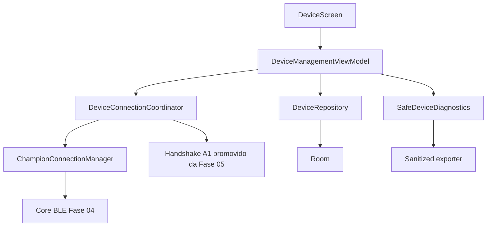
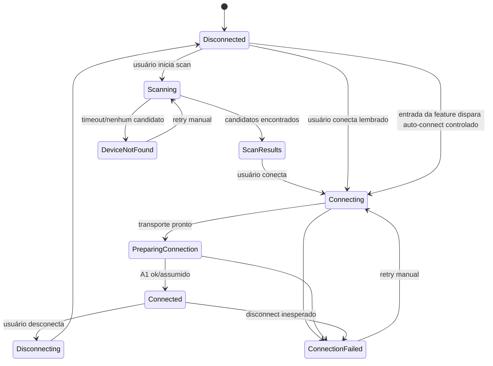
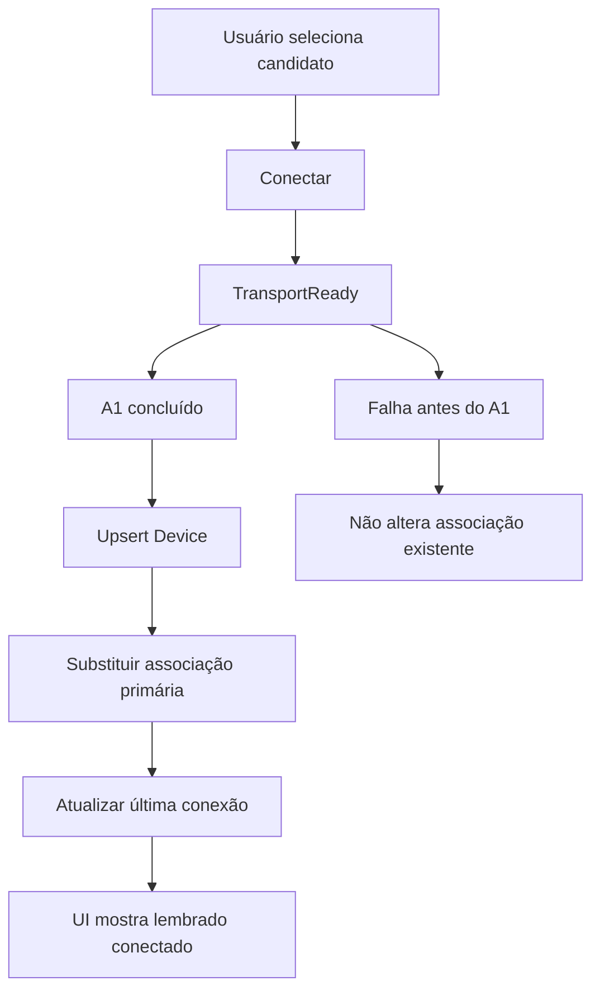
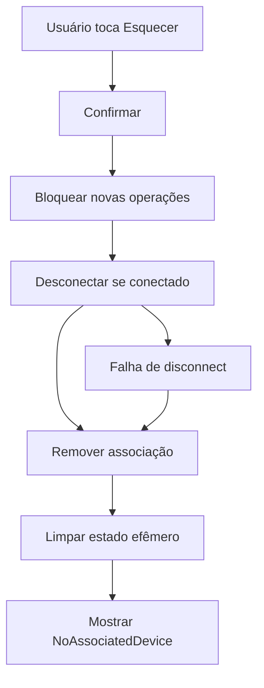
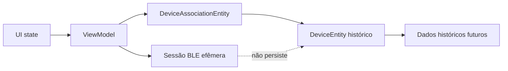

# Spec 006 — Gerenciamento do dispositivo

## Contexto

A Fase 06 transforma a PoC BLE validada na Fase 05 em uma feature utilizável de gerenciamento do Champion C001. O usuário deve controlar scan, conexão, retry, disconnect, esquecimento, diagnóstico e exportação sanitizada. A fase entrega funcionalidade, não campanha ampla de testes.

Documentos autoritativos:

- `AGENTS.md`
- `docs/specs/_inputs/phase-06-device-management-direction.md`
- ADRs vigentes em `docs/decisions/`
- `docs/specs/006-device-management.md`
- `docs/specs/005-native-ble-poc.md`
- `docs/tasks/005-native-ble-poc/005-00-overview.md`
- `docs/specs/004-native-ble-core.md`
- `docs/tasks/004-native-ble-core/004-00-overview.md`
- `docs/specs/003-domain-and-persistence-foundation.md`
- `docs/tasks/003-domain-and-persistence-foundation/003-00-overview.md`
- `docs/protocol/*.md`
- `docs/roadmap/champion-companion-roadmap.md`
- `docs/baseline/current-baseline.md` apenas como referência; pode estar desatualizado após Fase 05.

O alinhamento visual posterior da tela de Dispositivo está planejado
separadamente na [Spec 017](017-alinhamento-visual-margens-cabecalhos.md). Esse
refinamento não reabre esta fase nem altera seus contratos BLE, estados ou
critérios funcionais.

## Estado Atual Após Fase 05

- Núcleo BLE da Fase 04 existe em `core/bluetooth`, `core/bluetooth/android` e `core/bluetooth/internal`.
- `ChampionConnectionManager` orquestra scan, conexão, discovery, capabilities, subscriptions default e `TransportReady`.
- Fase 05 adicionou coordenador técnico, handshake A1, FEA1, D0/F002, estimador F002, relatório sanitizado e tela técnica debug.
- Gate A foi aprovado em 2026-07-21 por confirmação explícita de dez ciclos físicos consecutivos no Galaxy S22 com Champion C001.
- Validação final Fase 05: `./gradlew lint` verde; `./gradlew assembleDebug assembleRelease` verde; `./gradlew testDebugUnitTest` ainda vermelho por falha antiga em `ChampionBleConnectionManagerTest`; comando agregado sujeito a falha de tooling em `:app:lintAnalyzeDebugUnitTest`.
- `DeviceScreen` release ainda mostra placeholder.
- `DeviceScreen` debug constrói scanner, GATT client, resolver e connection manager dentro do Composable. Esta fase deve remover esse padrão da feature final.
- Hilt já fornece bindings BLE em `ChampionBleModule`.
- `DeviceRepository` só expõe `observeAssociatedDevice()`.
- `DeviceEntity` existe, mas mistura identidade histórica do dispositivo com associação por `associatedAtEpochMillis` obrigatório.
- Baseline em `docs/baseline/current-baseline.md` não deve ser alterada durante planejamento; atualização dela entra no fechamento da Fase 06.

## Objetivo

Entregar tela de dispositivo utilizável para listar dispositivos encontrados, selecionar Champion C001, conectar com handshake A1, salvar associação, exibir dispositivo lembrado, tentar auto-conexão controlada do dispositivo associado ao abrir app ou tela quando pré-requisitos já estiverem satisfeitos, desconectar, tentar novamente, esquecer, abrir diagnóstico e exportar relatório sanitizado.

## Fechamento Da Fase

Fechamento factual registrado em 2026-07-22:

- `006-01` a `006-12` concluídas.
- `DeviceScreen` release deixou de ser placeholder e passou a usar `DeviceManagementViewModel` como fronteira única de estado e intents.
- Associação persistida foi separada da sessão BLE efêmera por tabela dedicada, preservando histórico ao esquecer.
- Auto-conexão controlada do dispositivo associado foi entregue com tentativa única por entrada visível da feature e sem prompt automático de permissão.
- Diagnóstico seguro e exportação sanitizada ficaram disponíveis por ação explícita do usuário.
- Validação manual da fase foi confirmada no Galaxy S22 com Champion C001, incluindo permissões, scan, conexão, retorno à tela, reconnect, Bluetooth desligado/ligado com retry, esquecer, nova associação, diagnóstico e exportação.
- Dívidas antigas de testes automatizados permanecem adiadas para Fase 21 e não bloquearam fechamento da fase.

## Requisitos Funcionais

1. Mostrar estado sem dispositivo associado.
2. Solicitar permissões BLE somente após ação do usuário.
3. Iniciar scan somente por ação explícita.
4. Listar candidatos Champion encontrados.
5. Permitir cancelar scan.
6. Permitir selecionar candidato e conectar manualmente.
7. Executar conexão, discovery, subscriptions default e handshake A1 como parte da ação `Conectar`.
8. Reutilizar handshake A1 da Fase 05.
9. Salvar associação somente após conexão funcional bem-sucedida.
10. Manter somente um dispositivo associado nesta fase.
11. Exibir dispositivo lembrado após reinício, recriação de Activity e retorno à tela.
12. Ao abrir app ou tela de dispositivo com associação persistida e pré-requisitos já satisfeitos, tentar conectar automaticamente o dispositivo associado.
13. Limitar auto-conexão a tentativa finita e única por entrada visível da feature.
14. Não solicitar permissão runtime automaticamente durante auto-conexão.
15. Exibir nome, modelo e identificador seguro.
16. Exibir estado real da conexão.
17. Exibir última conexão bem-sucedida.
18. Exibir última sincronização/importação somente quando existir.
19. Permitir desconectar.
20. Permitir retry manual conforme erro atual.
21. Permitir esquecer com confirmação.
22. Ao esquecer, remover associação sem apagar `devices` nem dados históricos.
23. Refletir disconnect inesperado e Bluetooth desligado.
24. Abrir diagnóstico seguro.
25. Exportar relatório sanitizado por ação explícita.

## Requisitos Não Funcionais

- Não iniciar scan ao abrir a tela.
- Auto-connect só é permitido para dispositivo já associado e de forma controlada.
- Não pedir permissão runtime automaticamente ao abrir a tela.
- Não fazer auto-connect para dispositivo diferente do associado.
- Não fazer reconexão infinita.
- Não manter BLE permanente.
- Não criar segundo scanner, segundo GATT client ou segundo connection manager fora de Hilt.
- Nenhum Composable constrói scanner, GATT client ou connection manager.
- Dependências vêm por Hilt.
- Estado da feature é exposto por ViewModel.
- Telas não acessam Room, DAO, DataStore direto, `BluetoothGatt` ou fila GATT.
- Associação persistida é separada de conexão efêmera.
- Erros de UI e relatórios são sanitizados.
- Relatórios não contêm dados de saúde, payload BLE, bytes, hex, MAC completo, senha, stack trace, credenciais ou identificadores pessoais.
- Testes automatizados extensos ficam adiados para Fase 21.

## Limites

Incluído:

- gerenciamento de um Champion C001;
- scan manual;
- lista de candidatos;
- conexão manual;
- auto-conexão controlada do dispositivo associado;
- handshake A1;
- associação persistida;
- disconnect, retry e esquecimento;
- diagnóstico seguro e exportação sanitizada;
- validação de build e smoke test manual no Galaxy S22.

Fora da fase:

- passos na Home;
- persistência de passos;
- distância;
- calorias;
- BPM de produção;
- D1;
- D3;
- D4;
- Health Connect;
- GPS;
- background BLE;
- foreground service;
- auto-connect amplo ou agressivo para qualquer Champion;
- suporte a outros dispositivos;
- exclusão de histórico ao esquecer;
- campanha ampla de testes.

## Arquitetura



Regras:

- `DeviceScreen` renderiza estado e emite eventos.
- `DeviceManagementViewModel` combina associação persistida, ambiente BLE, estado da conexão e operação ativa.
- Coordinator de conexão reutiliza `ChampionConnectionManager` e handshake A1 promovido da PoC.
- `DeviceRepository` é contrato de domínio; feature não acessa DAO.
- Diagnóstico e exportação reutilizam sanitização da PoC, ajustada para feature final.

## Estado Da Feature

Estado mínimo planejado:

```text
Loading
NoAssociatedDevice
PermissionsRequired
BluetoothDisabled
ReadyToScan
Scanning
ScanResults
Connecting
PreparingConnection
Connected
Disconnecting
Disconnected
DeviceNotFound
ConnectionFailed
Forgetting
Error
```

O estado deve evitar booleanos contraditórios. Deve incluir, quando aplicável:

- dispositivo associado;
- candidato selecionado;
- lista efêmera de candidatos;
- conexão efêmera;
- operação em andamento;
- erro sanitizado;
- última ação retryable.

## Estado De Conexão

Estados de conexão expostos à UI:

- desconectado;
- procurando;
- conectando;
- preparando conexão;
- conectado;
- desconectando;
- falha.

`Connected` só vale quando conexão funcional concluiu: transporte pronto e handshake A1 confirmado ou assumido pela política validada na Fase 05. `TransportReady` isolado nunca é conexão funcional.



## Fluxo Sem Dispositivo

1. Tela abre e observa associação.
2. Se não há associação, mostra estado vazio.
3. Ação principal: `Adicionar dispositivo`.
4. Ao tocar, verifica permissões e Bluetooth.
5. Se faltar permissão, solicita após explicação.
6. Se Bluetooth estiver desligado, mostra orientação e ação do sistema quando aplicável.
7. Não inicia scan antes da ação.

## Fluxo De Auto-Conexão Controlada

1. App abre ou usuário entra na tela de dispositivo.
2. ViewModel observa associação persistida.
3. Se existir dispositivo associado e permissões/Bluetooth já estiverem OK, inicia uma tentativa automática única de conexão.
4. Tentativa prioriza reconexão do `platformIdentifier` associado.
5. Se resolução direta não bastar, pode executar scan curto e direcionado somente para o dispositivo associado.
6. Se auto-conexão falhar, UI mostra estado seguro e permite retry manual.
7. Se faltar permissão ou Bluetooth estiver desligado, não abre prompt automático de permissão; mostra estado apropriado.
8. Não entra em loop entre recomposição, retorno de tela e falha.

## Fluxo De Scan

- Scan inicia somente por ação do usuário.
- Scan mostra loading e ação cancelar.
- Resultados são efêmeros e não são persistidos.
- Lista mostra apenas candidatos compatíveis com filtro Champion.
- Impedir scans simultâneos.
- Timeout, erro e cancelamento deixam tela navegável e retry manual.
- Planejar evolução do scanner atual, que hoje encerra ao primeiro Champion, para acumular lista durante janela de scan.

## Seleção

- Usuário escolhe candidato na lista.
- Cada item mostra nome, identificador seguro e estado selecionado/conectando quando aplicável.
- Não mostrar payload, UUID, bytes, MAC completo ou detalhe GATT.
- Se já houver associação, procurar outro dispositivo é ação secundária e substituir exige confirmação.

## Conexão

Fluxo após `Conectar`:

```text
validar permissões
validar Bluetooth
resolver candidato ou dispositivo lembrado
conectar transporte
descobrir services
resolver capabilities
subir subscriptions default disponíveis
atingir TransportReady
executar A1
marcar conexão funcional
persistir associação/última conexão
```

Não conectar outro Champion automaticamente se dispositivo lembrado não for encontrado.
Auto-conexão usa mesmo pipeline funcional, apenas com gatilho de entrada da feature em vez de toque manual, respeitando limites de tentativa única e pré-requisitos já satisfeitos.

## Handshake

- Reutilizar A1 da Fase 05.
- Promover builder/matcher/política para contrato reutilizável fora da tela técnica.
- Enviar A1 após `TransportReady` e subscriptions default disponíveis.
- Preferir ACK `A1 ... 01` em F008 notify.
- Aceitar handshake assumido quando regra da Fase 05 permitir: write concluído, sessão íntegra e janela curta sem erro.
- Falha no handshake não associa nem substitui dispositivo.

## Associação

Associação ocorre somente após conexão funcional bem-sucedida.



## Substituição

- Apenas uma associação primária existe.
- Se já há dispositivo associado, conectar candidato diferente exige confirmação.
- Substituição é transacional após conexão funcional.
- Falha de conexão não substitui dispositivo associado.
- Histórico futuro continua vinculado ao `DeviceEntity` correspondente.

## Conexão De Dispositivo Lembrado

1. Mostrar dispositivo lembrado.
2. Ao abrir app/tela, se pré-requisitos já estiverem OK, iniciar tentativa automática única; usuário também pode tocar `Conectar` manualmente.
3. Verificar permissões e Bluetooth.
4. Usar `platformIdentifier` persistido como `transportKey` para resolver/conectar.
5. Se resolução direta falhar, procurar o identificador lembrado por scan curto e direcionado.
6. Se não encontrar, mostrar `DeviceNotFound`.
7. Não conectar a outro Champion automaticamente.
8. Não entrar em loop.
9. Não pedir permissão runtime automaticamente durante tentativa automática.

## Última Conexão

- Campo: `lastSuccessfulConnectionAt` no dispositivo persistido.
- Atualizar apenas após conexão funcional.
- Não atualizar por scan, `openSession`, GATT conectado, discovery isolado, write aceito ou handshake falho.
- Exibir data/hora local e acessível.

## Última Sincronização

- Usar `DeviceImportMetadata.lastImportedAt` quando existir.
- Enquanto sync/import não existir, mostrar `Nunca sincronizado` ou `Ainda não disponível`.
- Não copiar última conexão para última sincronização.
- Não inventar timestamp.

## Disconnect

- Ação explícita do usuário.
- Cancela operação ativa quando necessário.
- Fecha subscriptions lógicas e sessão.
- Invalida handshake efêmero.
- Atualiza UI.
- Preserva associação e histórico.
- Não inicia reconnect.

Disconnect inesperado:

- Atualiza estado para falha/desconectado.
- Mostra erro seguro.
- Permite retry manual.
- Não bloqueia navegação.

## Retry

`Tentar novamente` repete somente ação adequada ao erro atual:

- permissão ausente: solicitar/orientar;
- Bluetooth desligado: reavaliar ambiente;
- scan expirado: novo scan manual;
- dispositivo lembrado não encontrado: procurar novamente;
- conexão falhou: nova conexão;
- handshake falhou: nova tentativa controlada;
- disconnect inesperado: conectar novamente.

Não existe retry automático infinito.

## Esquecimento



Regras:

- Exige confirmação.
- Remove associação persistida.
- Não apaga `devices`.
- Não apaga histórico futuro.
- Permite associar novamente.

## Lifecycle

- Recomposition não cria BLE infra.
- ViewModel mantém ownership de estado da feature.
- Hilt fornece dependencies.
- Ao sair da tela, não iniciar operação nova.
- Ao entrar na tela com dispositivo associado, tentativa automática única é permitida quando pré-requisitos já estiverem satisfeitos.
- Recriação de tela não pode gerar loop de tentativas; política de deduplicação por entrada deve ser explícita.
- Sem foreground service, sessão BLE não deve ser tratada como permanente.
- Comportamento ao sair durante conexão deve ser explícito: cancelar operação ou manter até conclusão enquanto ViewModel vive, sem auto-reconnect.
- Processo recriado mostra dispositivo lembrado e pode tentar auto-conectar novamente quando feature voltar ativa, sem scans agressivos ou loops.

## Permissões

- Reutilizar `ChampionBlePrerequisites`.
- Android 12+: `BLUETOOTH_SCAN` e `BLUETOOTH_CONNECT` já declaradas na Fase 05.
- `BLUETOOTH_SCAN` preserva `neverForLocation`.
- Android 11- usa permissões legadas já modeladas.
- Solicitar runtime permission somente após ação.
- Auto-conexão não solicita runtime permission automaticamente; apenas falha em estado seguro e orienta ação do usuário.
- Negação não entra em loop.
- Tela continua navegável.

## Bluetooth Desligado

- Detectar via ambiente BLE.
- Mostrar estado específico.
- Oferecer ação adequada do sistema quando possível.
- Retry reavalia ambiente.
- Desligar Bluetooth durante conexão atualiza UI e invalida sessão.

## Diagnóstico

Pode mostrar:

- permissões;
- suporte BLE;
- Bluetooth habilitado;
- estado de transporte;
- capabilities presentes/ausentes;
- categoria do último erro;
- timestamps e duração de operações;
- contagem de eventos sanitizados.

Não mostrar:

- payload;
- hexadecimal;
- bytes;
- BPM;
- passos;
- senha;
- MAC completo;
- identificador persistente cru;
- dados pessoais;
- stack trace.

## Exportação

- Explícita por ação do usuário.
- Reutilizar exporter sanitizado da PoC, ajustado para relatório da feature.
- Salvar em cache/área privada e compartilhar via `FileProvider`.
- Não exportar dados de saúde.
- Identificador do dispositivo deve ser mascarado ou hash local irreversível curto, sem MAC completo.

## Persistência

Estratégia escolhida: entidade própria de associação.

Modelo recomendado:

```text
DeviceEntity
  id
  platformIdentifier
  name
  model
  firmware
  associatedAtEpochMillis   // legado V1; manter até decisão futura
  lastSuccessfulConnectionAtEpochMillis
  lastImportedAtEpochMillis
  importParserVersion

DeviceAssociationEntity
  id = "primary"
  deviceId
  associatedAtEpochMillis
  updatedAtEpochMillis
```

Repository deve expor:

- observar dispositivo associado;
- associar/substituir dispositivo;
- atualizar última conexão bem-sucedida;
- atualizar metadados conhecidos;
- esquecer associação;
- localizar dispositivo por identificador da plataforma.



Justificativa:

- Room é fonte operacional conforme ADR-003.
- Associação não é preferência simples.
- Esquecer deve remover vínculo atual sem apagar identidade histórica.
- Dados futuros podem continuar com FK para `devices`.
- Mantém integridade transacional.

Comportamento ao esquecer:

- deletar `DeviceAssociationEntity` singleton;
- manter `DeviceEntity`;
- manter `DailySummary`, BPM, treinos, payloads e demais dados futuros;
- UI retorna a `NoAssociatedDevice`.

## Migrations, Se Necessárias

Necessária migration `1 -> 2`:

- criar tabela `device_associations`;
- criar índice único/PK singleton;
- criar FK para `devices(id)`;
- exportar schema Room V2.

Não migrar automaticamente dispositivo existente para associação salvo se houver registro claro e único em V1. Como app ainda não possui feature final de associação, migration pode criar tabela vazia.

## Privacidade

- Não logar MAC, `platformIdentifier` cru, payload, bytes, senha, dados de saúde ou stack trace.
- UI deve mostrar identificador seguro, por exemplo `•••• 12AB` ou hash local curto não reversível.
- Relatório não inclui dados de saúde.
- Backup e device transfer continuam desabilitados.
- Não introduzir latitude, longitude, rota, GPX, TCX, FIT ou `ExerciseRoute`.

## Acessibilidade

- Estados não dependem só de cor.
- Botões têm labels claros.
- Datas usam formatação local e content description legível quando necessário.
- Lista de resultados possui foco e seleção claros.
- Erros explicam ação de recuperação.

## Validação Manual

Gate obrigatório:

```bash
./gradlew assembleDebug
./gradlew assembleRelease
./gradlew installDebug
```

Smoke test manual no Galaxy S22:

1. abrir Dispositivo;
2. solicitar permissões;
3. iniciar scan;
4. encontrar Champion C001;
5. conectar;
6. confirmar estado conectado;
7. sair e voltar para a tela;
8. confirmar dispositivo lembrado;
9. desconectar;
10. conectar novamente;
11. desligar Bluetooth;
12. verificar estado;
13. ligar Bluetooth;
14. tentar novamente;
15. esquecer dispositivo;
16. confirmar estado vazio;
17. associar novamente;
18. abrir diagnóstico;
19. exportar relatório sanitizado.

## Testes Adiados

Adiados para Fase 21:

- meta de cobertura;
- bateria extensa Compose;
- expansão ampla de fakes BLE;
- testes instrumentados para cada estado;
- correção geral da suíte anterior;
- regressão completa das fases anteriores;
- harness determinístico completo para `DevicePocCoordinatorTest`.

Permitido nesta fase:

- teste pequeno para regra crítica de associação;
- teste pequeno para sanitização de relatório, se necessário;
- teste pequeno para mapper/migration, se a task de Room tocar schema.

## Dívida Técnica

- `ChampionBleConnectionManagerTest > connect enables every available default subscription before transport ready` ainda registrado como falha automatizada anterior.
- Alguns cenários em `DevicePocCoordinatorTest` continuam `@Ignore` por flakiness do fake.
- Scanner atual retorna ao primeiro Champion; evolução para lista deve ser mínima e pode não cobrir todos cenários de RSSI/nome duplicado.
- Diagnóstico avançado fica para Fase 19.
- Testes amplos ficam para Fase 21.
- Baseline `docs/baseline/current-baseline.md` deve ser atualizada no fechamento da Fase 06.

## Critérios De Aceite

- Tela release de Dispositivo não é placeholder.
- Feature usa Hilt e ViewModel.
- Composable não constrói infraestrutura BLE.
- Scan inicia só por ação do usuário.
- Dispositivo associado pode auto-conectar ao abrir app/tela quando pré-requisitos já estiverem satisfeitos.
- Dispositivos Champion são listados.
- Champion C001 pode ser selecionado.
- Conexão e handshake ocorrem após ação explícita.
- Conexão e handshake também podem ocorrer por auto-conexão controlada do dispositivo associado.
- Dispositivo é lembrado após sucesso funcional.
- Associação sobrevive a reinício.
- Estado reflete transporte real e disconnect inesperado.
- Última conexão atualiza somente após conexão funcional.
- Última sincronização não é inventada.
- Usuário pode desconectar.
- Usuário pode tentar novamente.
- Usuário pode esquecer dispositivo.
- Esquecer preserva dados históricos.
- Falhas não bloqueiam navegação.
- Diagnóstico seguro está acessível.
- Exportação segue sanitizada.
- Não há reconexão infinita.
- Não há D1, D3, D4 ou Health Connect.
- `assembleDebug`, `assembleRelease` e `installDebug` executados e registrados.
- Smoke test manual no Galaxy S22 executado e registrado.
- Dívidas de teste registradas para Fase 21.

## Fora Do Escopo

- Home, passos, distância, calorias e resumo diário.
- BPM de produção.
- D1, D3, D4.
- Health Connect.
- GPS, background BLE e foreground service.
- Auto-connect.
- Outros dispositivos.
- Exclusão de histórico ao esquecer.
- Campanha ampla de testes.

## Definition Of Done

Fase 06 conclui quando a feature de dispositivo é utilizável em release, usa o núcleo BLE e o handshake da PoC, separa associação persistida de sessão BLE efêmera, permite scan/conexão/disconnect/retry/esquecimento/diagnóstico/exportação sob controle do usuário, preserva privacidade, compila em debug/release, instala no Galaxy S22 e tem smoke test manual registrado.

## Matriz De Rastreabilidade

| Requisito | Tasks |
| --- | --- |
| Estratégia de associação | `006-01`, `006-03` |
| Contratos e UI state | `006-02`, `006-05` |
| Hilt, ViewModel e sem BLE no Composable | `006-04`, `006-05`, `006-08` |
| Scan manual e lista de candidatos | `006-06` |
| Seleção e conexão | `006-06`, `006-07`, `006-07A` |
| Auto-conexão controlada do associado | `006-07A`, `006-08`, `006-09` |
| Handshake A1 reutilizado | `006-04`, `006-07` |
| Associação após sucesso | `006-03`, `006-07` |
| Dispositivo lembrado | `006-03`, `006-07`, `006-07A`, `006-08` |
| Última conexão e última sincronização | `006-03`, `006-07`, `006-08` |
| Disconnect, retry e lifecycle | `006-07`, `006-09` |
| Esquecimento | `006-03`, `006-09` |
| Diagnóstico e exportação | `006-10` |
| Build, install e smoke manual | `006-11` |
| Fechamento, baseline e dívida | `006-12` |

## ADRs Recomendadas

- Recomendar ADR para separar identidade histórica do dispositivo, associação persistida e sessão BLE efêmera.
- Avaliar se política de handshake assumido após write A1 deve virar ADR junto com separação transporte/protocolo, caso ainda não coberta por ADR futura.
