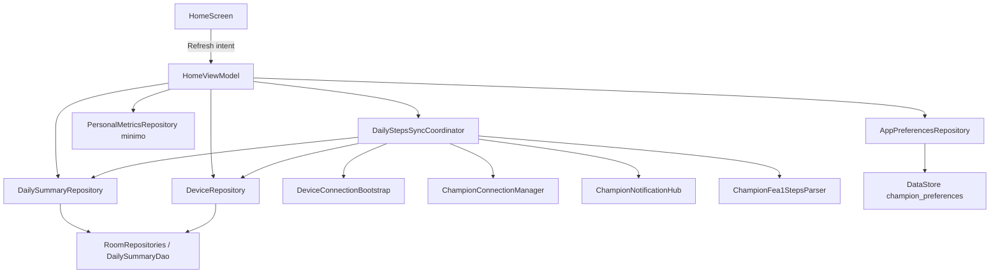
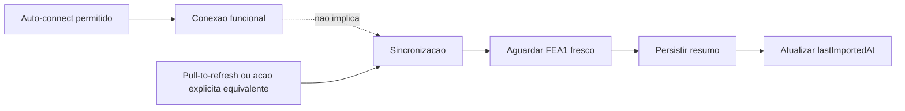
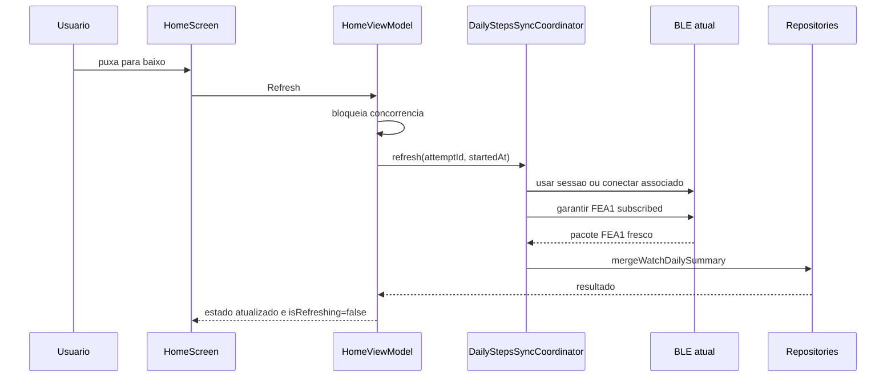
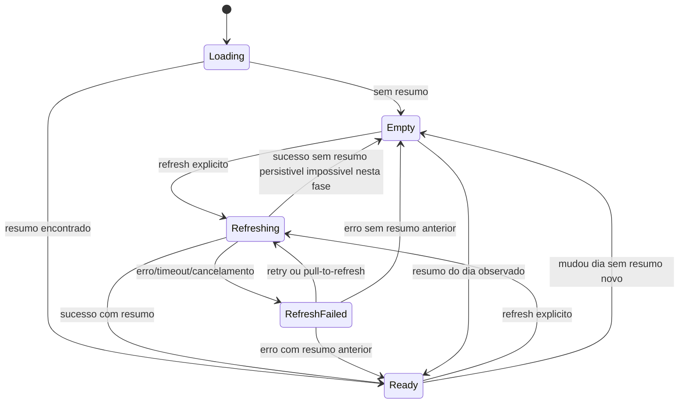
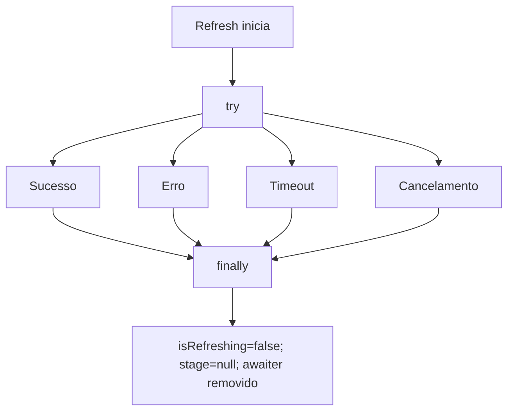
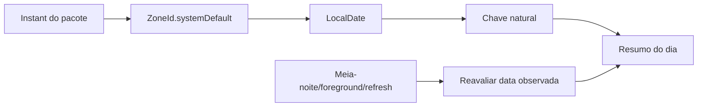
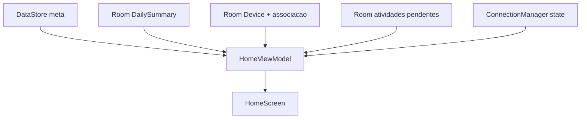

# Spec 007 — Home, passos e resumo diário

## Contexto

A Fase 07 cria a primeira experiência diária útil do Champion Companion. As fases anteriores entregaram app Android nativo, design system, Room/DataStore, domínio, núcleo BLE, PoC física com A1/FEA1/D0/F002, gerenciamento do Champion C001, associação persistente, conexão manual, auto-conexão controlada, disconnect, retry e diagnóstico seguro.

A Home atual ainda mostra `Painel em preparação` e só usa o `DeviceManagementViewModel` para exibir estado simples do relógio. Ainda não há `HomeViewModel`, resumo diário observado do banco, sync manual de passos, meta diária, distância, calorias ou atualização de `DeviceImportMetadata.lastImportedAt` por import real.

Documentos autoritativos:

- `AGENTS.md`
- `docs/specs/_inputs/phase-07-daily-summary-home-direction.md`
- ADRs vigentes em `docs/decisions/`
- `docs/roadmap/champion-companion-roadmap.md`
- `docs/specs/006-device-management.md`
- `docs/tasks/006-device-management/006-00-overview.md`
- tasks concluídas de `docs/tasks/006-device-management/`
- `docs/specs/005-native-ble-poc.md`
- `docs/tasks/005-native-ble-poc/005-00-overview.md`
- `docs/specs/004-native-ble-core.md`
- `docs/tasks/004-native-ble-core/004-00-overview.md`
- `docs/specs/003-domain-and-persistence-foundation.md`
- `docs/tasks/003-domain-and-persistence-foundation/003-00-overview.md`
- `docs/protocol/`
- `docs/baseline/current-baseline.md`

## Estado Real Após Fase 06

- `HomeScreen.kt` mostra cabeçalho, status do relógio, atalho de perfil e placeholder.
- `HomeFeatureContract.kt` agora define `HomeUiState`, `HomeIntent`, `HomeRefreshState`, `HomeRefreshStage` e erro seguro da Home, mas ainda sem `HomeViewModel` ou UI funcional.
- `DeviceManagementViewModel` controla associação, scan, conexão, retry, disconnect, forget e auto-connect controlado.
- `DeviceConnectionBootstrap` conecta dispositivo associado, faz fallback por scan curto direcionado e executa A1.
- `ChampionConnectionManager` mantém uma sessão ativa, configura subscriptions default e expõe `currentSession()`.
- `ChampionNotificationHub` multiplexa notifications e fecha collectors no disconnect.
- `DevicePocFea1Steps` parseia pacote FEA1 técnico, ainda restrito à feature de device.
- `DailySummaryRepository.save()` faz upsert simples e pode substituir valor maior por menor.
- `DailySummaryDao` possui consulta por chave natural e `observeBetween`.
- `DeviceRepository` não possui operação explícita para atualizar `DeviceImportMetadata` após import.
- `RepositoryContracts.kt` já reserva contratos-alvo para `DailyStepsSyncCoordinator`, `PersonalMetricsRepository`, `mergeWatchDailySummary(...)` e `updateImportMetadata(...)`, ainda sem implementação.
- `AppPreferencesStore` implementa `AppPreferencesRepository`, mas `AppPreferences` ainda não possui meta diária de passos e Hilt ainda não expõe binding explícito do contrato.
- `UserProfileDao` e `WeightMeasurementEntity` existem, mas não há contrato de repository para consulta mínima de dados pessoais.
- `ChampionConnectionManager.currentSession()` já permite reuso de sessão e `ChampionNotificationHub` já suporta subscriptions temporárias, porém `DeviceConnectionBootstrap` ainda não reutiliza sessão ativa por conta própria.
- Room está em versão 2 por associação de dispositivo. Schema atual já tem `daily_summaries` e campos de metadados de importação em `devices`.

## Objetivo

Permitir que usuário visualize passos do dia, meta, progresso, distância/calorias estimadas quando calculáveis, origem, última atualização e estado do relógio, e atualize os dados por pull-to-refresh. A operação deve conectar de forma controlada quando necessário, aguardar FEA1 fresco, consolidar resumo diário local e persistir sem Health Connect.

Fluxo-alvo:

```text
Pull-to-refresh
    ↓
Conexão controlada, quando necessária
    ↓
FEA1 fresco
    ↓
Consolidação do resumo diário
    ↓
Persistência local
    ↓
Home funcional
```

## Requisitos Funcionais

1. Substituir placeholder da Home por conteúdo diário funcional.
2. Mostrar data atual ou data observada.
3. Mostrar estado do relógio sem usar última conexão como última sincronização.
4. Usar pull-to-refresh como ação principal de sincronização.
5. Não mostrar botão permanente `Sincronizar agora` no estado normal.
6. Permitir gesto mesmo em estado vazio.
7. Oferecer alternativa acessível ao gesto.
8. Mostrar indicador do gesto.
9. Mostrar barra linear indeterminada abaixo do cabeçalho durante toda operação.
10. Mostrar texto opcional da etapa atual.
11. Manter dados anteriores visíveis durante refresh.
12. Bloquear refresh concorrente abaixo do Composable.
13. Conectar ao dispositivo associado quando necessário e permitido.
14. Não iniciar sync por auto-connect isolado.
15. Não salvar FEA1 espontâneo fora de tentativa explícita.
16. Aguardar pacote FEA1 fresco da sessão atual.
17. Promover parser FEA1 para componente único reutilizável.
18. Tratar FEA1 como acumulado, não delta.
19. Consolidar resumo diário por chave natural.
20. Persistir leitura maior, igual ou menor com regra de máximo.
21. Atualizar `DeviceImportMetadata.lastImportedAt` só após pacote válido e persistência concluída.
22. Calcular distância e calorias somente com dados suficientes.
23. Persistir estimativas como `null` quando faltarem dados pessoais.
24. Adicionar meta diária padrão de 8000 passos em preferências.
25. Mostrar atividades pendentes já persistidas quando houver consulta disponível.
26. Tratar sem dispositivo, desconectado, permissão ausente, Bluetooth desligado, erro, timeout e cancelamento.
27. Não implementar D1, D3, D4, BPM produtivo ou Health Connect.

## Requisitos Não Funcionais

- Telas não acessam `BluetoothGatt`, DAOs, Room, DataStore ou fila GATT diretamente.
- UI renderiza estado e emite intents.
- `HomeViewModel` é autoridade da operação e do estado de refresh.
- Regras de merge ficam em repository/persistência, não no ViewModel.
- Logs não incluem payload, bytes, hex, MAC, passos exatos, calorias, distância, peso, altura, dados pessoais ou stack trace para UI.
- Nenhum backup, manifesto ou regra XML muda nesta fase.
- Sem BLE permanente, foreground service, WorkManager ou background sync.
- Testes novos devem ser pequenos e acoplados às tasks que protegem regra crítica.

## Limites

Incluído:

- Home funcional para resumo diário local.
- Pull-to-refresh manual.
- Sync manual FEA1 para passos do dia.
- Parser FEA1 único.
- Coordinator de sync diário.
- Merge atômico.
- Meta padrão.
- Estimativas quando dados suficientes existirem.
- Smoke test manual no Galaxy S22 com Champion C001.

Fora do escopo:

- Sync automático ao abrir Home/app.
- Collector permanente salvando pacotes.
- Health Connect.
- D1, D3, D4.
- BPM produtivo.
- Último treino produtivo.
- Perfil completo, edição completa de meta ou passada.
- Serviço em background.
- Suporte a outro relógio.
- Campanha ampla de testes.

## Arquitetura



Regras arquiteturais:

- `HomeScreen` não cria infra BLE.
- `HomeScreen` não mantém estado paralelo de refresh.
- `HomeViewModel` combina resumo, preferências, dispositivo, conexão e operação ativa.
- `DailyStepsSyncCoordinator` não depende de Compose.
- `DeviceConnectionBootstrap` continua caminho de conexão funcional com A1.
- `ChampionConnectionManager.currentSession()` pode reaproveitar sessão saudável.
- Parser FEA1 fica único e PoC passa a reutilizá-lo.

## Relação Entre Conexão E Sincronização



Auto-connect permitido pela ADR-007 não autoriza persistência automática de FEA1. O app pode estar conectado, mas só pull-to-refresh ou retry explícito em erro inicia espera por pacote, consolidação, persistência e atualização de `lastImportedAt`.

## Pull-to-Refresh

Fluxo:



O gesto é ação explícita. Retry em erro e ação acessível devem chamar o mesmo intent e pipeline.

## Conteúdo Rolável

Home deve usar conteúdo rolável em todos os estados: vazio, pronto, refreshing, erro, sem dispositivo, sem permissão e Bluetooth desligado. O estado vazio deve mostrar `Puxe para baixo para sincronizar`. Pouco conteúdo não pode impedir o gesto.

## Barra Linear Indeterminada

A barra fica abaixo do cabeçalho enquanto `isRefreshing=true`. Ela é indeterminada porque a operação inclui conexão, handshake, espera por FEA1 e persistência sem progresso total confiável. Não exibir porcentagem fictícia.

## Feedback Da Etapa Atual

Etapas sugeridas:

- `Preparing`: `Preparando sincronização...`
- `Connecting`: `Conectando ao relógio...`
- `WaitingForSteps`: `Aguardando dados do relógio...`
- `Persisting`: `Atualizando resumo...`

Strings são apenas UI; regras de negócio dependem do enum.

## State Machine Da Home



Estado pode ser data class composta, mas não deve permitir combinações contraditórias.

## Estado De Refresh

Estado equivalente obrigatório:

```text
isRefreshing
refreshStage
refreshError
lastSuccessfulRefreshAt
```

`isRefreshing` deriva da operação ativa. UI não mantém booleano capaz de divergir.

## Fluxo De Sincronização

1. Ignorar se refresh já estiver ativo.
2. Resolver data atual com `Instant + ZoneId -> LocalDate`.
3. Verificar dispositivo associado.
4. Verificar permissões e Bluetooth.
5. Usar sessão atual se funcional e mesma associação.
6. Conectar com `DeviceConnectionBootstrap` quando necessário.
7. Garantir handshake A1 ou estado assumido válido da fase anterior.
8. Garantir FEA1 subscribed.
9. Registrar `refreshAttemptId`, `sessionId` e `startedAt`.
10. Aguardar FEA1 fresco no canal correto.
11. Parsear com parser único.
12. Calcular data local pelo instante do pacote e zone atual.
13. Calcular estimativas quando possível.
14. Consolidar via repository atômico.
15. Atualizar metadados de importação no mesmo caminho de sucesso.
16. Encerrar `isRefreshing` em `finally`.

## Promoção Do Parser FEA1

`DevicePocFea1Steps` deve ser promovido para parser reutilizável, por exemplo `ChampionFea1StepsParser`. Regras preservadas:

- payload com exatamente 4 bytes;
- byte 0 igual a `0x01`;
- passos como 24-bit little-endian;
- erro tipado para payload inválido;
- cópia defensiva;
- nenhum segundo parser independente.

## Pacote Fresco E Identidade Da Tentativa

Contrato da tentativa:

```text
sessionId
refreshAttemptId
startedAt
```

Pacote elegível:

```text
packet.sessionId == activeSessionId
packet.observedAt >= refreshStartedAt
refreshAttemptId ainda ativo
packet.channel == FEA1_NOTIFY
parser retornou valor valido
```

Pacotes antigos, pacote de sessão encerrada, pacote anterior ao gesto, pacote de tentativa anterior e valor cacheado global não concluem refresh.

## Timeout, Retry E Cancelamento

- Espera FEA1 possui timeout explícito e centralizado.
- Timeout inicial deve considerar evidência física da Fase 05 e ser fácil de ajustar.
- Uma tentativa por gesto.
- Sem retry automático infinito.
- Sem loop de reconexão.
- Retry é manual e usa mesmo pipeline do gesto.
- Cancelamento remove awaiters/collectors temporários, não persiste valor incompleto e não atualiza `lastImportedAt`.

## Concorrência

Somente um refresh ativo:

- novo gesto é ignorado;
- novo awaiter FEA1 não é criado;
- nova conexão não inicia;
- timeout não reinicia;
- merge concorrente não executa;
- operação atual permanece.

Bloqueio deve existir no `HomeViewModel` ou coordinator. Repository ainda precisa transação/merge atômico para proteger race externa.

## Cleanup



Barra encerra em sucesso, erro, timeout, disconnect, payload inválido, falha de persistência, cancelamento, permissão ausente e Bluetooth desligado.

## Semântica Acumulada Dos Passos

FEA1 é total acumulado do relógio. Não somar leituras.

```text
4000 depois 4150 => 4150
4000 + 4150 => proibido
```

## Chave Natural Do Resumo

Usar:

```text
deviceId
origin = WATCH_DAILY_SUMMARY
localDate
```

`deviceId` é obrigatório para `WATCH_DAILY_SUMMARY`. Data vem do `Instant` de recepção do pacote no timezone atual do sistema.

## Consolidação Atômica

Operação planejada:

```text
mergeWatchDailySummary(deviceId, localDate, incomingSteps, collectedAt, updatedAt, estimates, parserVersion)
```

```mermaid
flowchart TD
    A[Entrada FEA1 valida] --> B[Transacao Room]
    B --> C{Resumo existe?}
    C -- nao --> D[Criar resumo]
    C -- sim --> E[nextSteps = max(existingSteps, incomingSteps)]
    E --> F[Atualizar resumo]
    D --> G[Atualizar DeviceImportMetadata]
    F --> G
    G --> H[Commit]
```

Para mesma chave natural:

```text
nextSteps = max(existingSteps, incomingSteps)
```

## Leituras Maior, Igual E Inferior

- Leitura maior: atualiza passos e estimativas.
- Leitura igual: sucesso, mantém passos, atualiza import metadata, não duplica.
- Leitura inferior: sucesso de comunicação, não reduz, não soma, pode atualizar import metadata após persistência bem-sucedida.

## Proteção Contra Redução

Não reutilizar cegamente `save()` atual para sync do relógio, porque upsert simples pode sobrescrever maior por menor. Merge precisa ser transacional e independente da UI.

## Mudança De Dia E Timezone



Home reavalia data ao chegar meia-noite, retornar ao foreground, iniciar novo refresh e detectar mudança de data relevante. Não criar serviço em background. Mudança de timezone afeta novas leituras; históricos não são migrados nesta fase.

## Timestamps

- `collectedAt`: instante do pacote FEA1 válido.
- `updatedAt`: instante da persistência/merge.
- `DeviceImportMetadata.lastImportedAt`: última sync manual válida concluída.
- `lastSuccessfulConnectionAt`: última conexão funcional.

Home nunca usa última conexão como última sincronização.

## Origem

Internamente usar `DataOrigin.WATCH_DAILY_SUMMARY`. UI mostra origem amigável como `Champion C001` ou `Relógio`, não enum interno.

## Distância Estimada

Prioridade:

1. passada manual válida, quando existir em fase futura;
2. passada estimada por altura, se contrato mínimo permitir;
3. indisponível.

Formula:

```text
distanceMeters = steps * strideLengthMeters
```

Sem altura/passada: persistir `null` e mostrar indisponível.

## Calorias Estimadas

Formula:

```text
distanceKm = distanceMeters / 1000
estimatedCalories = weightKg * distanceKm * 0.55
```

Peso, passada e distância devem ser positivos. Sem dados: `null`, não zero.

## Dados Pessoais Opcionais

Fase 07 cria somente consulta mínima para altura/peso/passada quando existirem. Não antecipar formulário, histórico completo, edição de meta, recálculo histórico ou Fase 16.

## Meta Padrão E Progresso

Adicionar `dailyStepsGoal` em `AppPreferences`, padrão `8000`, valor positivo e compatível com preferências existentes.

Progresso:

```text
progress = steps / dailyStepsGoal
```

Visual pode saturar em `1f`; texto pode mostrar acima da meta.

## Home

Fontes de dados:



Home mostra:

- data;
- estado do relógio;
- pull-to-refresh;
- barra indeterminada durante refresh;
- passos;
- meta;
- progresso;
- distância estimada ou indisponível;
- calorias estimadas ou indisponíveis;
- origem;
- última atualização;
- loading não bloqueante;
- erro seguro;
- retry em erro;
- instrução no vazio;
- atividades pendentes já persistidas quando aplicável.

Métricas futuras indisponíveis, como último BPM e último treino, ficam ausentes ou neutras.

## Estados Vazios E Erros

- Sem resumo: mostrar zero visual ou ausência clara, instrução de pull-to-refresh e não usar valor inventado.
- Sem dispositivo associado: mostrar resumo salvo se existir, orientar abrir Dispositivo, não iniciar scan direto.
- Desconectado: pull-to-refresh pode conectar controladamente.
- Permissão ausente: encerrar refresh, explicar, permitir concessão por ação do usuário.
- Bluetooth desligado: encerrar refresh, orientar ação do sistema, preservar dados.
- Erro: manter resumo anterior, esconder barra, mostrar erro seguro e retry secundário.

## Loading

Loading da Home não é tela cheia durante refresh. Dados anteriores seguem visíveis e navegação segue disponível.

## Persistência

Preferir não alterar schema Room. O schema atual suporta resumo diário, estimativas, origem, timestamps, deviceId e metadados de importação. Meta diária pertence a DataStore.

## Health Connect

Fluxo desta fase:

```text
FEA1 -> Room -> Home
```

Não criar escrita, fila ou sync Health Connect.

## Privacidade E Logging

Logs permitidos somente com metadados seguros: início/fim, duração, etapa, contagem de pacotes, válido/inválido, leitura maior/igual/menor, categoria de erro. Proibido: payload, bytes, hex, MAC, identificador persistente cru, passos exatos, peso, altura, calorias, distância e dados pessoais.

## Acessibilidade

- Barra não é única indicação.
- Anunciar estados como `Sincronizando dados do relógio`, `Dados atualizados`, `Não foi possível atualizar os dados`.
- Instrução de pull-to-refresh tem alternativa acessível.
- Retry em erro é ação explícita acessível.
- Estados não dependem só de cor.

## Validação Manual

Gate obrigatório:

```bash
./gradlew assembleDebug
./gradlew assembleRelease
./gradlew installDebug
```

Comandos informativos:

```bash
./gradlew lint
./gradlew testDebugUnitTest
```

Smoke test no Galaxy S22 com Champion C001:

1. abrir a Home;
2. confirmar ausência de botão permanente de sincronização;
3. confirmar conteúdo rolável;
4. confirmar instrução de pull-to-refresh;
5. puxar para baixo;
6. confirmar indicador do gesto;
7. confirmar barra indeterminada;
8. confirmar dados anteriores ainda visíveis;
9. conectar quando necessário;
10. receber FEA1;
11. confirmar passos;
12. confirmar origem;
13. confirmar última atualização;
14. repetir com total maior;
15. confirmar substituição;
16. repetir com total igual;
17. confirmar ausência de soma;
18. reproduzir total menor;
19. confirmar ausência de redução;
20. tentar iniciar dois refreshes;
21. confirmar uma única operação;
22. fechar e reabrir o app;
23. confirmar persistência;
24. sincronizar com dispositivo desconectado;
25. validar conexão controlada;
26. desligar Bluetooth;
27. executar refresh;
28. confirmar erro seguro;
29. confirmar barra encerrada;
30. ligar Bluetooth;
31. tentar novamente;
32. negar permissão quando possível;
33. confirmar navegação preservada;
34. validar mudança de dia;
35. confirmar ausência de Health Connect.

## Testes Reduzidos

Testes pequenos recomendados junto das tasks:

- parser FEA1 promovido;
- pacote anterior ao refresh não aceito;
- pacote de sessão errada não aceito;
- leitura menor não reduz;
- leitura maior substitui;
- acumulado não soma;
- nova data cria resumo novo;
- refresh concorrente ignorado;
- progresso da meta;
- estimativa válida;
- estimativa indisponível sem perfil;
- codec de preferências mantém default.

## Dívida Técnica

- Testes Compose amplos ficam para Fase 21.
- Harness BLE determinístico amplo fica para Fase 21.
- Testes de timezone exaustivos ficam para Fase 21.
- Edição completa de meta, perfil e passada fica para Fase 16.
- Health Connect fica para Fase 12.
- Histórico/calendário completo fica para Fase 15.
- Background BLE fica para Fase 14.

## Critérios De Aceite

- Home exibe passos do dia.
- Meta padrão de 8000 existe.
- Progresso da meta existe.
- Pull-to-refresh é ação principal.
- Não existe botão permanente de sync no estado normal.
- Conteúdo permanece visível durante sync.
- Barra linear indeterminada fica visível durante refresh.
- Barra encerra em todos os caminhos.
- Refresh concorrente não cria segunda operação.
- Retry usa mesmo pipeline.
- Auto-connect isolado não persiste FEA1.
- Somente pacote fresco conclui refresh.
- Parser FEA1 é único.
- FEA1 é acumulado.
- Leituras não são somadas.
- Leitura menor não reduz.
- Leitura igual é sucesso.
- Merge é atômico.
- Mudança de dia cria resumo independente.
- Origem e última atualização aparecem.
- `DeviceImportMetadata.lastImportedAt` atualiza após import válido.
- Distância/calorias aparecem quando calculáveis.
- Valores ausentes não são inventados.
- Erros permitem retry e não bloqueiam navegação.
- Não há Health Connect, D1, D3 ou D4.
- `assembleDebug`, `assembleRelease`, `installDebug` executados e registrados.
- Smoke manual físico executado e registrado.

## Fora Do Escopo

- Sync automático ao abrir.
- Persistência de pacote espontâneo.
- D1, D3, D4.
- Health Connect.
- BPM produtivo.
- Último treino produtivo.
- Serviço em background.
- Foreground service.
- WorkManager.
- Perfil completo.
- Edição de meta.
- Histórico mensal.
- Campanha ampla de testes.

## Definition Of Done

Fase 07 conclui quando Home funcional sincroniza passos do Champion C001 por pull-to-refresh, aceita somente FEA1 fresco da tentativa atual, consolida acumulado sem redução, persiste resumo local e metadados de importação, mantém dados visíveis durante refresh, preserva limites de privacidade/arquitetura, compila debug/release, instala no Galaxy S22 e passa smoke manual físico.

## Matriz De Rastreabilidade

| Requisito | Tasks |
| --- | --- |
| Auditoria e estado herdado | `007-01` |
| Contratos, state machine e refresh state | `007-02` |
| Auto-connect permitido diferente de sync | `007-02`, `007-03`, `007-08` |
| Parser FEA1 único e pacote fresco | `007-03`, `007-08` |
| Sync coordinator e timeout | `007-03`, `007-08` |
| Merge atômico, max e lastImportedAt | `007-04`, `007-08` |
| Meta, progresso e estimativas | `007-05`, `007-06`, `007-07` |
| HomeViewModel como autoridade | `007-06`, `007-08` |
| Pull-to-refresh UI e indicadores | `007-07` |
| Concorrência, retry e day rollover | `007-08` |
| Gate reduzido e smoke físico | `007-09` |
| Fechamento, baseline e dívida | `007-10` |
