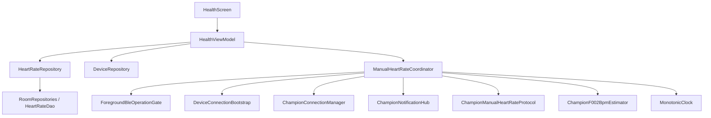
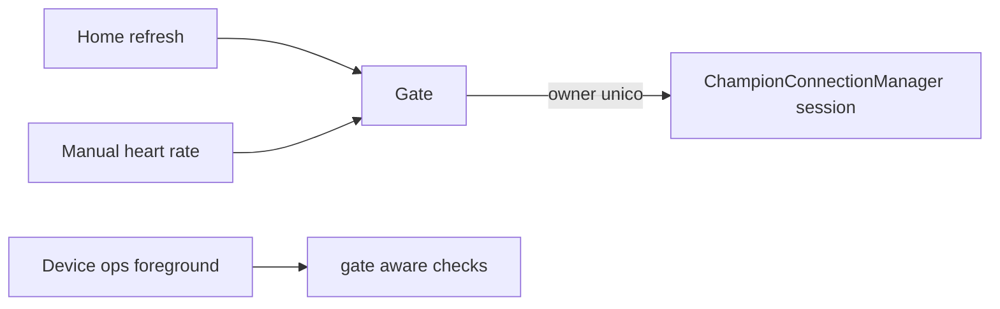
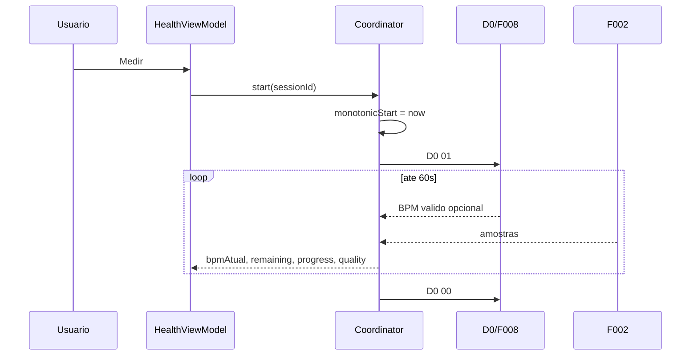
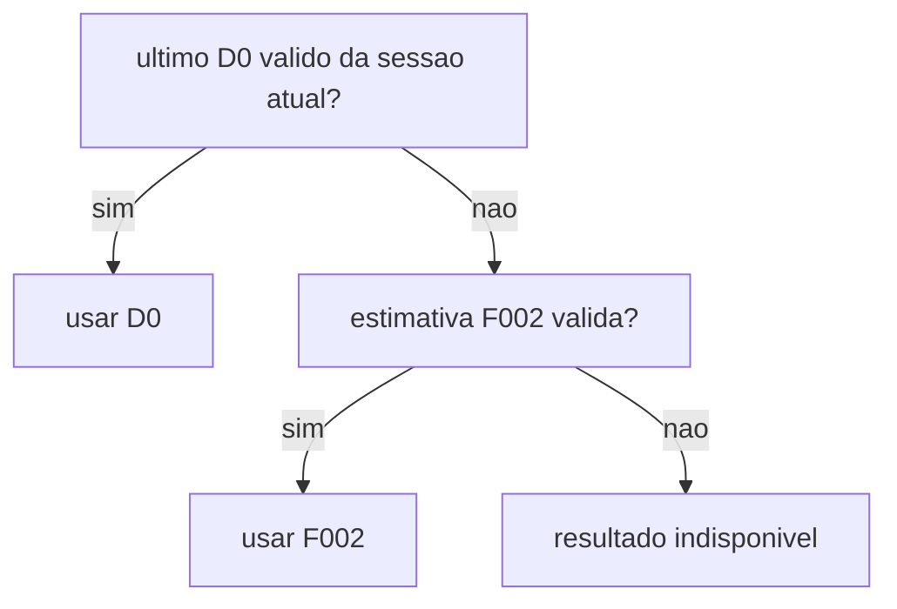
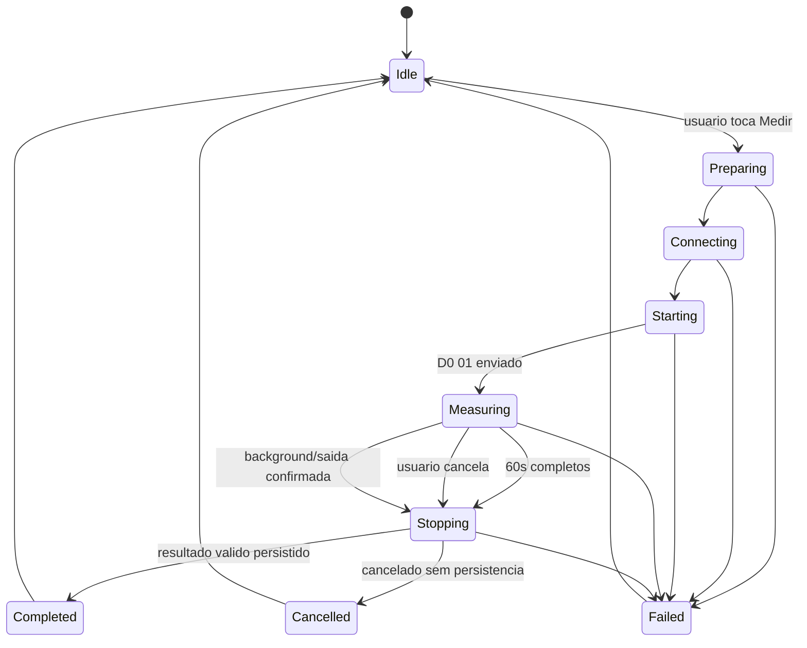
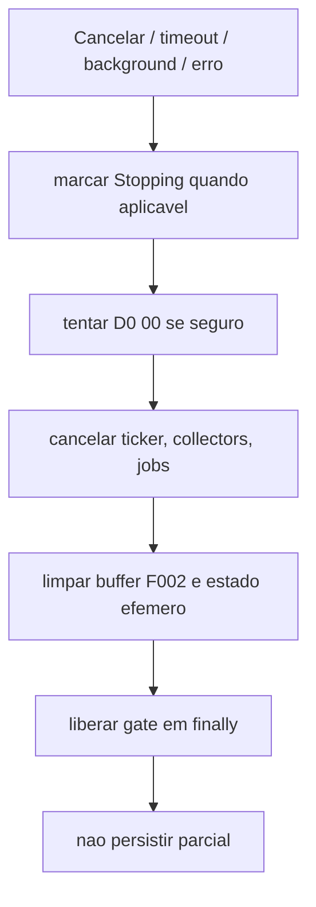
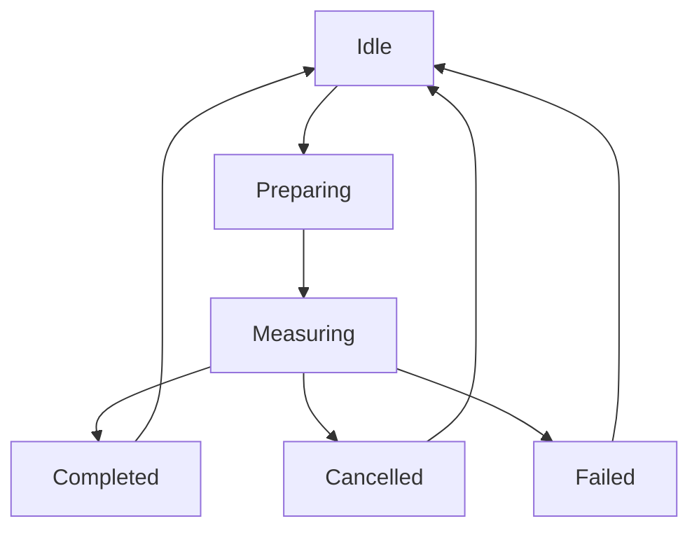
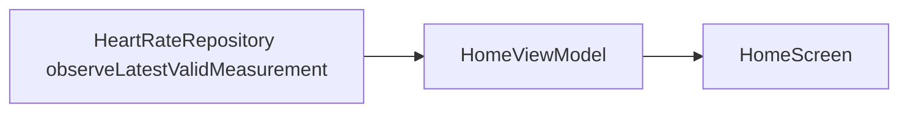

# Spec 008 - Frequencia cardiaca manual

## Contexto

A Fase 08 transforma fluxo tecnico D0/F002 validado na Fase 05 em funcionalidade de produto na tela Saude. As fases anteriores ja entregaram app Android nativo, design system, Room/DataStore, dominio de frequencia cardiaca, persistencia local, nucleo BLE nativo, fila GATT serial, conexao controlada com Champion C001, handshake A1, gerenciamento do dispositivo e Home funcional com resumo diario local.

Documentos autoritativos:

- `AGENTS.md`
- `docs/specs/_inputs/phase-08-manual-heart-rate-direction.md`
- ADRs vigentes em `docs/decisions/`
- `docs/roadmap/champion-companion-roadmap.md`
- `docs/baseline/current-baseline.md`
- `docs/specs/007-daily-summary-home.md`
- `docs/tasks/007-daily-summary-home/007-00-overview.md`
- todas as tasks concluidas da Fase 07
- `docs/specs/006-device-management.md`
- `docs/tasks/006-device-management/006-00-overview.md`
- `docs/specs/005-native-ble-poc.md`
- `docs/tasks/005-native-ble-poc/005-00-overview.md`
- `docs/specs/004-native-ble-core.md`
- `docs/specs/003-domain-and-persistence-foundation.md`
- `docs/protocol/ble-transport.md`
- `docs/protocol/handshake-a1.md`
- `docs/protocol/ble-command-mapping.md`
- `docs/protocol/heart-rate-d0-f002.md`
- `docs/protocol/history-d1.md`

## Estado Real Apos Fase 07

- `feature/health/HealthScreen.kt` ainda mostra placeholder `Saude` e `HealthFeatureContract.kt` expone apenas `data object HealthUiState`.
- `feature/home/HomeViewModel` e `HomeScreen` agora entregam resumo diario local por pull-to-refresh, mas ainda nao observam BPM persistido.
- `DeviceConnectionBootstrap` conecta dispositivo associado e executa handshake A1, aceitando resultado confirmado ou assumido.
- `ChampionConnectionManager` continua owner da unica sessao BLE ativa do app. `connect()` faz cleanup da sessao atual antes de abrir outra.
- `ChampionNotificationHub` ja garante subscription fisica unica por characteristic e multiplica collectors logicos.
- `DevicePocCoordinator` ja implementa state machine tecnica debug com D0/F002, guards por `activeSessionId` e `activeHeartRateSessionId`, e cleanup de jobs/buffer.
- `DevicePocHeartRateSession` ja cria `D0 01`, `D0 00`, parseia D0 e parseia F002 little-endian com buffer limitado.
- `DevicePocF002BpmEstimator` ja calcula estimativa F002, qualidade e selecao final `D0_CURRENT -> F002_ESTIMATE -> UNAVAILABLE`.
- `ChampionDailyStepsSyncCoordinator` ja tenta reusar `currentSession()` compativel antes de reconectar, mas esse reuso ainda nao constitui gate global de ownership foreground.
- `core/model/HeartRateAndSync.kt` ja possui `HeartRateSource.MANUAL_MEASUREMENT`, `HeartRateSource.MEASUREMENT_STREAM` e `HeartRateDeduplicationKey.MeasurementSession`.
- `HeartRateRepository` ainda so expone `import()` e `findPendingSync()`. Nao ha API para persistir medicao manual final nem para observar ultima medicao ou recentes.
- `ChampionDatabase` v2 e `heart_rate_measurements` ja contem `source`, `bpm`, `measuredAtEpochMillis`, `deviceId`, `parserVersion` e `deduplicationKey` unico. Auditoria atual nao mostrou necessidade de migration para Fase 08.
- `DeviceConnectionBootstrap` ainda nao reutiliza sessao ativa por conta propria; fluxos de produto que quiserem reuso precisam decidir isso antes de chamar bootstrap ou evolui-lo de forma compartilhada.

## Objetivo

Permitir ao usuario:

- iniciar medicao manual somente por acao explicita;
- conectar ao relogio quando necessario;
- acompanhar BPM durante 60 segundos;
- acompanhar tempo restante e progresso determinado;
- cancelar com cleanup correto;
- concluir automaticamente ao fim do periodo;
- receber resultado final valido;
- persistir localmente somente resultado final valido;
- ver ultima medicao e lista simples de medicoes manuais recentes na Saude;
- ver ultimo BPM persistido na Home.

Fluxo alvo:

```text
Acao explicita
    -> conexao controlada
    -> D0/F002
    -> medicao de 60 segundos
    -> resultado final
    -> persistencia local
    -> Saude e Home
```

## Requisitos Funcionais

1. Medicao manual inicia somente por toque explicito do usuario.
2. Abrir app, abrir Saude, conectar, concluir auto-connect, receber D0/F002 ou voltar ao foreground nunca inicia medicao.
3. Fluxo deve reutilizar sessao ativa compativel ou conectar de forma controlada ao dispositivo associado.
4. Handshake deve existir antes do start da medicao.
5. `F002_NOTIFY` deve estar subscribed antes de `D0 01`.
6. `D0 01` e `D0 00` devem passar pela fila GATT.
7. Produto mede por 60 segundos.
8. BPM ao vivo prioriza ultimo D0 valido da sessao atual.
9. Na ausencia de D0 valido, UI pode mostrar estimativa F002 confiavel com indicador discreto de estimado.
10. Antes do primeiro valor valido, UI mostra estado aguardando leitura.
11. Resultado final segue politica `ultimo D0 valido da sessao -> fallback F002 valido -> indisponivel`.
12. Somente `Completed` com resultado final valido persiste medicao.
13. Persistencia da Fase 08 salva um unico registro final por sessao manual.
14. Sessao cancelada, falha, timeout sem valor ou callback tardio nao persistem.
15. Registro persistido usa `HeartRateSource.MANUAL_MEASUREMENT` e `HeartRateDeduplicationKey.MeasurementSession(sessionId)`.
16. Home observa consulta generica de ultimo BPM valido persistido.
17. Saude observa ultima medicao valida e lista simples de recentes manuais.
18. Somente uma medicao manual pode existir por vez.
19. Medicao manual nao pode concorrer com refresh diario de passos nem com outras operacoes foreground BLE.
20. Background durante medicao cancela fluxo, tenta stop quando seguro e nao persiste parcial.

## Requisitos Nao Funcionais

- `HealthScreen` nao acessa BLE, Room, DAO, DataStore nem `BluetoothGatt`.
- `HealthViewModel` e owner do fluxo de produto.
- Coordinator manual nao depende de Compose.
- Protocolo promovido e estimador promovido nao ficam duplicados entre PoC e produto.
- Logs permanecem sanitizados, sem payload, bytes, hex, MAC, BPM exato, F002 bruto ou identificadores persistentes.
- Fase 08 nao cria sync Health Connect nem `HealthSyncOperation` para medicao manual.
- Sem foreground service, background BLE permanente ou auto medicao.
- Testes novos devem ser pequenos e acoplados a regras criticas.

## Limites

Incluido:

- fluxo manual de frequencia cardiaca na Saude;
- promocao de D0/F002 da PoC para componentes reutilizaveis;
- coordinator de medicao manual;
- gate compartilhado de operacao BLE foreground;
- persistencia do resultado final;
- ultima medicao na Saude;
- recentes manuais simples;
- ultimo BPM persistido na Home;
- validacao fisica reduzida.

Fora do escopo:

- D1 automatico ou manual;
- historico automatico de BPM;
- persistencia de stream D0;
- persistencia de sinal F002;
- persistencia de progresso, qualidade detalhada, parcial ou sessao cancelada;
- Health Connect;
- graficos, medias diarias, filtros periodicos, calendario de BPM;
- BPM durante exercicio;
- foreground service;
- suporte a outro relogio.

## Arquitetura



Regras arquiteturais:

- `HealthScreen` renderiza estado e envia intents.
- `HealthViewModel` controla fluxo de produto e persistencia.
- `ManualHeartRateCoordinator` controla medicao efemera.
- componentes promovidos ficam separados de UI e reutilizaveis pela PoC.
- Home apenas observa resultado persistido.

## Promocao Da PoC

Componentes tecnicos existentes na PoC devem ser promovidos para implementacoes unicas reutilizaveis:

- builder `D0 01`;
- builder `D0 00`;
- parser D0;
- parser F002;
- buffer limitado F002;
- estimador F002;
- classificacao de qualidade;
- selecao final do BPM.

PoC debug continua no projeto, mas passa a reutilizar componentes promovidos. Nao manter componente tecnico duplicado para produto e PoC.

## Ownership Da Operacao BLE



`ChampionConnectionManager` ja detem unica sessao BLE ativa. Fase 08 adiciona gate de produto acima dele para impedir que `MANUAL_HEART_RATE` e `DAILY_STEPS_REFRESH` controlem mesma sessao ao mesmo tempo.

Auditoria de `008-01` confirmou risco real por implementacao atual:

- `ChampionConnectionManager.connect()` chama `disconnect(CLEANUP)` antes de abrir nova sessao;
- `ChampionDailyStepsSyncCoordinator` so usa `currentSession()` como cheque de reuso, sem ownership atomico;
- `DeviceManagementViewModel` ainda pode disparar auto-connect controlado do associado ao entrar na tela.

Portanto gate foreground compartilhado nao e opcional de UX; e requisito tecnico para evitar teardown cruzado de sessao BLE entre Home, Dispositivo e medicao manual.

## Conexao E Handshake

1. Validar dispositivo associado.
2. Validar permissoes e Bluetooth.
3. Tentar reusar `ChampionConnectionManager.currentSession()` quando `transportKey` coincide com associado.
4. Se necessario, usar `DeviceConnectionBootstrap.connectAssociatedDevice()`.
5. Garantir `TransportReady`.
6. Garantir handshake valido.
7. Garantir `F002_NOTIFY` subscribed.
8. So entao iniciar medicao.

Nao:

- conectar outro Champion automaticamente;
- abrir scan amplo automatico;
- iniciar medicao so porque sessao BLE ficou pronta.

## Gate Compartilhado

Estado compartilhado minimo planejado:

- `NONE`
- `DAILY_STEPS_REFRESH`
- `MANUAL_HEART_RATE`

Regras:

- aquisicao atomica;
- um owner por vez;
- conflito retorna erro seguro explicito;
- liberacao em `finally`;
- cancelamento e erro liberam owner;
- callback tardio nunca readquire gate.

Contrato minimo definido em `008-02`:

- `ForegroundBleOperationOwner` com `DAILY_STEPS_REFRESH` e `MANUAL_HEART_RATE`;
- `ForegroundBleOperationRequest` com owner, `operationId` e `requestedAt`;
- `ForegroundBleOperationAcquireResult.Acquired` ou `.Rejected(activeOperation)`;
- `ForegroundBleOperationPermit` para ownership liberado explicitamente em `finally`.

Se implementacao introduzir contrato duradouro nao coberto por ADR, criar ADR na task responsavel.

## Contrato D0

### D0 start

```text
D0 01
```

Regras:

- canal `F008_WRITE`;
- `WITH_RESPONSE`;
- sem retry automatico cego;
- somente apos handshake;
- somente apos `F002_NOTIFY` subscribed;
- limpar estado efemero anterior antes do start;
- registrar inicio monotonic e inicio civil.

### D0 stop

```text
D0 00
```

Tentar stop em:

- conclusao normal;
- cancelamento;
- timeout;
- erro recuperavel;
- saida controlada da tela;
- app indo para background;
- disconnect solicitado.

Stop deve ser tentado antes de disconnect quando transporte ainda existir. Falha no stop nao pode impedir cleanup nem deixar sessao ativa.

## Subscription F002

F002 deve estar subscribed antes do start.

Regras:

- usar `ChampionNotificationHub`;
- uma subscription fisica;
- collector logico exclusivo da medicao;
- validar `bleSessionId` e `manualMeasurementSessionId` antes de aceitar evento;
- ausencia de F002 impede inicio da medicao de produto na Fase 08.

## Parser D0

Aceitar somente pacotes:

- `F008_NOTIFY`;
- `commandCode == 0xD0`;
- observados depois do inicio da sessao atual;
- pertencentes a sessao BLE atual;
- com BPM dentro de `35..220` para fluxo manual.

Cada D0 valido pode atualizar UI ao vivo. Nao persistir individualmente.

## Parser F002

```text
sample = lowByte | highByte << 8
```

Regras:

- little-endian por pares;
- ignorar byte final impar;
- copiar bytes defensivamente;
- usar somente amostras positivas no estimador;
- nao logar nem persistir amostras.

## Buffer

- somente em memoria;
- limitado explicitamente;
- reiniciado por nova sessao;
- descartado em stop, cancelamento, falha, timeout ou disconnect.

## Estimador

Estimador promovido preserva heuristica validada na Fase 05:

- minimo 250 amostras positivas;
- `sampleRate = positiveSamples / durationSeconds`;
- descarte inicial de `min(25% das amostras, 6s)`;
- baseline por media movel;
- suavizacao do sinal;
- threshold `mean + std * 0.35`;
- distancia minima entre picos `sampleRate * 0.4`;
- intervalos validos `0.4..1.6s`;
- minimo 3 intervalos validos;
- BPM `round(60 / mediana(intervalos))`;
- rejeitar BPM fora de `35..220`.

## Qualidade

Qualidade permanece efemera nesta fase:

- `Boa`
- `Regular`
- `Baixa`

UI pode orientar usuario sem expor metrica tecnica do sinal. Qualidade baixa nao invalida automaticamente resultado se D0 valido existir.

## Duracao

Duracao do produto:

```text
60 segundos
```

Fonte de tempo:

- relogio monotonic para `elapsed`, `remaining`, `progress` e fim automatico;
- `Instant` para `measuredAt`, exibicao e persistencia.

Contrato minimo definido em `008-02`:

- `MonotonicClock.now(): MonotonicTimestamp`;
- `MonotonicClock.elapsedSince(startedAt)`;
- helpers puros `remainingSince(...)` e `progressSince(...)`.

Nao calcular duracao apenas com `Instant.now()`.

## Relogio Monotonico, Progresso E BPM Ao Vivo



Progresso:

```text
progress = elapsed / targetDuration
```

Regras:

- clamp 0..1;
- tempo restante derivado do monotonic;
- sem depender de ticks exatos de 1 segundo;
- nao persistir progresso.

Politica do valor exibido durante sessao:

1. ultimo D0 valido da sessao;
2. fallback F002 confiavel;
3. aguardar leitura quando nenhum valido;
4. indicador discreto quando valor for estimado.

## Politica Do Resultado Final



Politica inicial preservada:

1. ultimo D0 valido da sessao atual;
2. fallback F002 valido;
3. senao indisponivel.

Proibido:

- D0 de sessao anterior;
- D0 recebido antes do start;
- ultimo valor global;
- media inventada;
- estimativa invalida;
- BPM fora do intervalo.

## Auditoria Da Regra De Media

Auditoria no MotionLog atual mostrou que medicao manual da tela Saude nao usa media nova para fechar resultado. Evidencia:

- `motionlog-app/src/app/(tabs)/health/index.tsx` usa `finalBpm = d0Bpm ?? estimatedBpm ?? null`;
- `motionlog-app/src/lib/ble/champion-heart-session.ts` calcula apenas estimativa F002 da sessao.

Media aparece em outros fluxos, como exercicios e historico, mas nao no fluxo manual de 60 segundos. Portanto Fase 08 deve preservar politica da Fase 05 e nao introduzir media sem nova evidencia fisica ou funcional.

## Session ID, Callback Tardio E Concorrencia

Identidades obrigatorias:

- `manualMeasurementSessionId`
- `bleSessionId`
- `sessionStartedAt`

Callbacks tardios nao podem:

- atualizar nova sessao;
- concluir sessao encerrada;
- persistir resultado;
- alterar BPM atual;
- readquirir gate.

Cada evento aceito deve validar IDs e tempo de inicio.

## State Machine



Estados minimos:

- `Idle`
- `Preparing`
- `Connecting`
- `Starting`
- `Measuring`
- `Stopping`
- `Completed`
- `Cancelled`
- `Failed`

## Cancelamento, Timeout E Cleanup



Cleanup independe do resultado do stop.

## Persistencia


Persistir somente resultado final valido.

Campos planejados:

- `source = MANUAL_MEASUREMENT`
- `bpm = resultado final`
- `measuredAt = timestamp do D0 escolhido ou fim/calculo final da sessao no fallback F002`
- `validity = VALID`
- `deviceId = dispositivo associado`
- `importedAt = null`
- `parserVersion = versao do pipeline promovido`
- `appWorkoutSessionId = null`
- `workoutActivityId = null`
- `deduplicationKey = MeasurementSession(sessionId)`

## Deduplicacao

- uma sessao manual gera no maximo um registro persistido;
- retry de persistencia da mesma sessao nao duplica;
- nova medicao gera novo `sessionId`;
- cancelamento nao persiste;
- falha sem resultado nao persiste;
- callback tardio nao cria registro.

## Repository

`HeartRateRepository` deve evoluir para suportar intencao equivalente a:

- `saveManualMeasurement(...)`
- `observeLatestValidMeasurement()`
- `observeRecentManualMeasurements(limit)`

Contrato minimo reservado em `008-02` usa `SaveManualHeartRateMeasurementInput` com `measurementId`, `sessionId`, `deviceId`, `bpm`, `measuredAt` e `parserVersion`.

Regras:

- feature nao acessa DAO;
- persistencia idempotente por `sessionId`;
- consultas ordenadas por `measuredAt` desc;
- ultima medicao valida generica inclui todas fontes validas futuras;
- lista simples da Saude pode filtrar `MANUAL_MEASUREMENT`.

## DAO E Queries

Queries planejadas sem mudar schema:

- ultima medicao valida generica: `validity = VALID` e `measuredAtEpochMillis not null` ordenado desc;
- recentes manuais: `source = MANUAL_MEASUREMENT` e `validity = VALID` limitados;
- dedup por `findByDeduplicationKey` continua sustentando idempotencia.

## Room

Schema atual aparenta atender Fase 08. Preferir nao alterar `ChampionDatabase.version` nem criar migration. So adicionar queries, metodos DAO, mapeadores e repository, salvo evidencia funcional inevitavel.

## Lifecycle E Background

- `HealthViewModel` e owner do fluxo.
- Recomposition nao duplica medicao.
- Tela deve manter display acordado durante medicao.
- Ao pressionar voltar ou trocar de topo durante medicao, UI pede confirmacao de cancelamento.
- Ao ir para background, medicao cancela, tenta stop quando seguro e nao persiste parcial.
- Morte do processo restaura app em `Idle` com historico persistido apenas.

## Tela Saude



### Idle

- ultima medicao;
- horario;
- botao `Medir frequencia cardiaca`;
- medicoes recentes;
- estado sem dados;
- orientacao quando nao houver dispositivo.

### Measuring

- BPM grande;
- estado aguardando leitura quando aplicavel;
- tempo restante;
- progresso determinado;
- qualidade ou orientacao discreta;
- botao `Cancelar`;
- estado da conexao de forma discreta.

### Completed

- BPM final;
- horario;
- confirmacao de salvamento;
- `Concluir`;
- `Medir novamente`.

### Failed

- erro seguro;
- retry;
- historico preservado;
- acesso para `Dispositivo` quando aplicavel.

## Home



Home deve mostrar ultimo BPM persistido e horario. Home nao inicia BLE, nao mede, nao usa estado tecnico da PoC e nao bloqueia resumo diario quando nao houver medicao.

## Historico Simples

Saude pode mostrar lista simples de recentes manuais, por exemplo:

```text
Hoje, 10:42 - 78 BPM
Ontem, 18:17 - 82 BPM
```

Sem grafico, sem agregacao diaria, semanal ou mensal nesta fase.

## Erros Seguros

Categorias minimas:

- sem dispositivo associado;
- permissao ausente;
- Bluetooth desligado;
- dispositivo nao encontrado;
- conexao falhou;
- handshake falhou;
- F002 ausente;
- start D0 falhou;
- disconnect inesperado;
- nenhum BPM valido;
- stop D0 falhou;
- persistencia falhou;
- medicao ja em andamento;
- outra operacao BLE em andamento;
- cancelamento.

## Acessibilidade

- anunciar `Medicao iniciada`, `Frequencia cardiaca detectada`, `Medicao concluida`, `Medicao cancelada`, `Nao foi possivel concluir a medicao`;
- BPM nao depende so de tamanho ou cor;
- progresso deve ter descricao de tempo restante;
- area de toque adequada para cancelar.

## Privacidade E Logging

Permitido no debug:

- inicio/fim;
- duracao;
- transicoes;
- contagem de pacotes D0/F002;
- disponibilidade de resultado;
- categoria da fonte final;
- qualidade categorica;
- categoria de erro.

Proibido:

- BPM exato em logs;
- amostras F002;
- payload;
- bytes;
- hex;
- MAC;
- identificador persistente;
- dado pessoal.

## Validacao Manual

Gate obrigatorio:

```bash
./gradlew assembleDebug
./gradlew assembleRelease
./gradlew installDebug
```

Comandos informativos:

```bash
./gradlew lint
./gradlew testDebugUnitTest
```

Smoke fisico no Galaxy S22 com Champion C001:

1. abrir Saude;
2. iniciar medicao;
3. conectar quando necessario;
4. observar BPM;
5. observar progresso;
6. concluir 60 segundos;
7. salvar resultado;
8. reabrir app;
9. observar ultima medicao;
10. observar ultimo BPM na Home;
11. fazer nova medicao;
12. cancelar;
13. confirmar ausencia de persistencia;
14. tentar duas medicoes;
15. validar bloqueio;
16. concorrer com refresh de passos;
17. validar gate;
18. desconectar durante medicao;
19. validar cleanup;
20. enviar app para background;
21. validar cancelamento;
22. desligar Bluetooth;
23. validar erro e retry;
24. confirmar ausencia de Health Connect;
25. confirmar ausencia de BPM e F002 no Logcat.

## Testes Reduzidos

Testes pequenos recomendados junto das tasks:

- `D0 01`;
- `D0 00`;
- D0 ignora pacote antigo;
- D0 ignora valor invalido;
- F002 little-endian;
- byte impar;
- buffer limitado;
- selecao final D0;
- fallback F002;
- resultado indisponivel;
- cancelamento nao persiste;
- sessao concluida persiste uma vez;
- callback tardio ignorado;
- gate impede simultaneidade;
- repository deduplica por `sessionId`;
- ultima medicao considera somente registro valido.

## Divida Tecnica

- D1 e historico automatico ficam para Fase 09;
- Health Connect fica para Fase 12;
- foreground service fica para Fase 14;
- graficos e agregacoes ficam para Fase 09/15;
- testes Compose amplos ficam para Fase 21;
- se surgir evidencia nova sobre media real do fluxo manual, revisar protocolo e spec em fase futura.

## Criterios De Aceite

- Saude deixa de ser placeholder;
- medicao inicia somente por acao explicita;
- conexao controlada funciona;
- `F002_NOTIFY` subscribed antes de `D0 01`;
- D0 start/stop passam pela fila GATT;
- BPM ao vivo aparece;
- progresso de 60 segundos aparece;
- uma medicao por vez;
- gate impede concorrencia com refresh diario;
- cancelamento envia stop quando possivel e nao persiste;
- conclusao envia stop quando possivel;
- cleanup ocorre independentemente do stop;
- resultado final usa apenas sessao atual;
- resultado final usa D0 ou fallback F002;
- ausencia de resultado nao cria medicao;
- somente resultado final e persistido;
- stream D0 e sinal F002 nao persistem;
- deduplicacao por sessao funciona;
- ultima medicao aparece na Saude;
- ultimo BPM aparece na Home;
- sem Health Connect;
- sem D1;
- debug e release compilam;
- fluxo critico validado fisicamente.

## Fora Do Escopo

- D1 e importacao de historico;
- Health Connect;
- foreground service;
- medicao automatica;
- persistencia de stream ou sinal;
- historico rico;
- BPM durante exercicio;
- suporte a outros relogios;
- campanha ampla de testes.

## Definition Of Done

Fase 08 conclui quando a tela Saude executa medicao manual de 60 segundos somente por acao explicita, reutiliza componentes promovidos da PoC, controla ownership BLE foreground sem concorrencia com refresh diario, persiste um unico resultado final valido localmente, exibe ultima medicao na Saude e ultimo BPM na Home, preserva limites de privacidade, compila debug/release, instala no Galaxy S22 e passa smoke manual fisico com Champion C001.

## Matriz De Rastreabilidade

| Requisito | Tasks |
| --- | --- |
| Auditoria estado real e regra da media | `008-01` |
| Contratos, state machine, gate, erros | `008-02` |
| Promocao PoC D0/F002/estimador | `008-03` |
| Coordinator manual, handshake, timeout, cleanup | `008-04` |
| Persistencia, deduplicacao, DAO, queries | `008-05` |
| ViewModel owner e lifecycle de produto | `008-06` |
| UI da Saude e acessibilidade | `008-07` |
| Home, lifecycle final, confirmacao de saida, screen awake | `008-08` |
| Gate reduzido e smoke fisico | `008-09` |
| Fechamento, baseline e divida | `008-10` |
