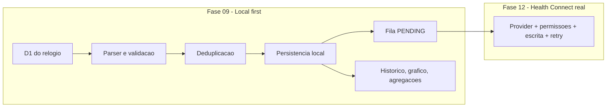
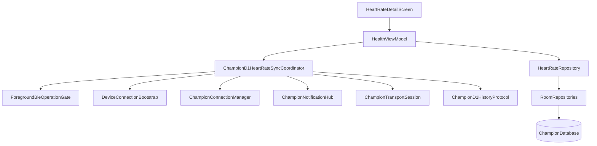
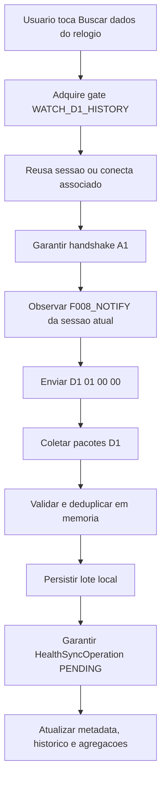
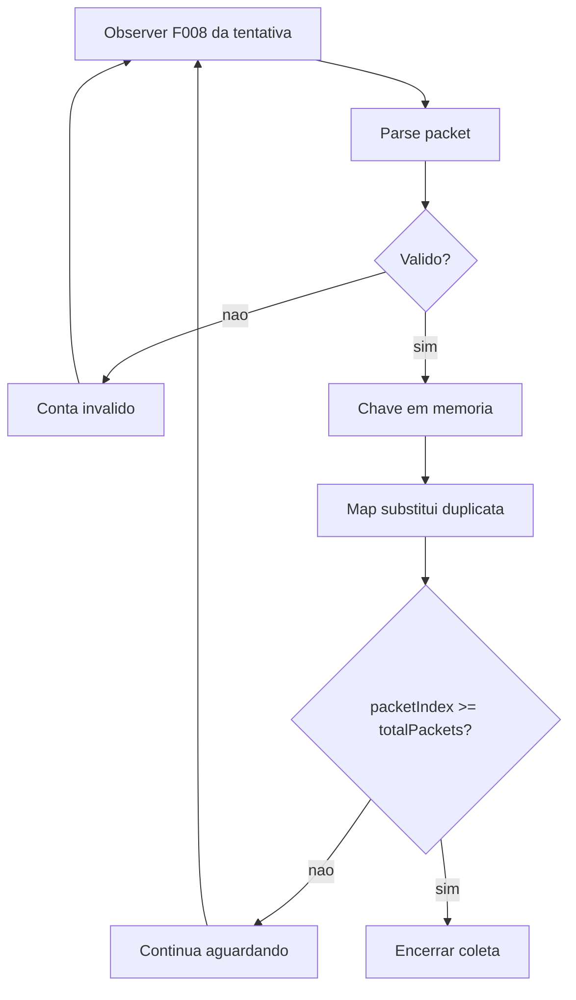
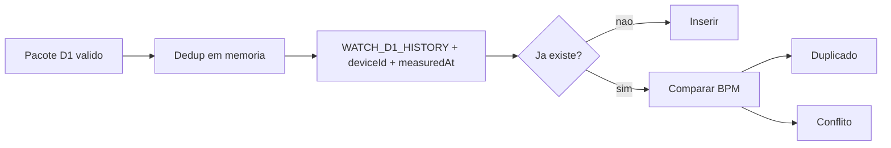
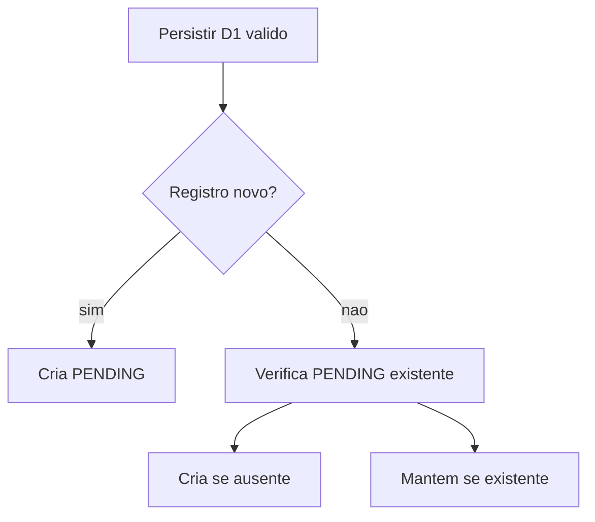
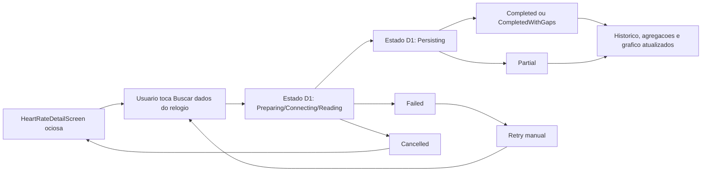
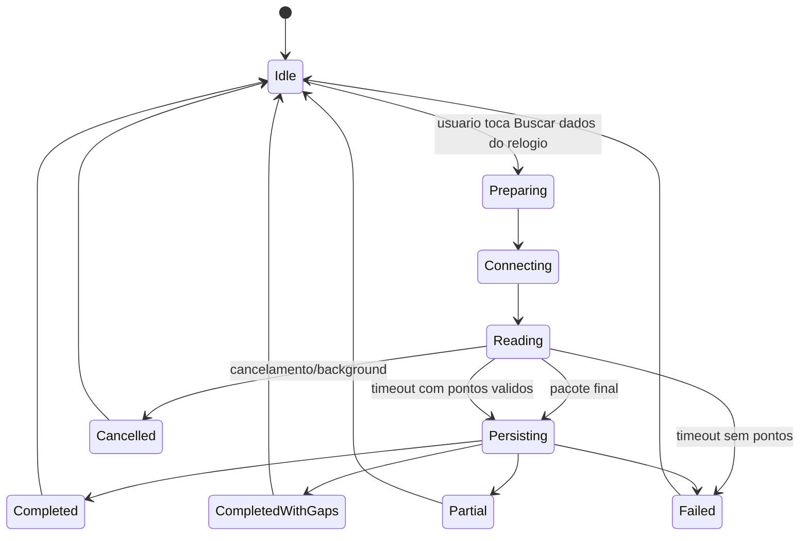

# Spec 009 - Historico D1 de frequencia cardiaca do relogio

## Status

Planejada em 2026-07-23. Fronteira local-first formalizada em `009-02`.

## Contexto

A Fase 09 transforma historico automatico D1 do Champion C001 em funcionalidade local utilizavel na tela especifica de frequencia cardiaca.

Fases anteriores ja entregaram:

- BLE nativo reutilizavel com fila GATT serial;
- conexao controlada e handshake A1;
- dispositivo associado persistido;
- gate foreground compartilhado entre refresh diario e medicao manual;
- medicao manual D0/F002 funcional;
- persistencia do resultado manual final;
- Home com ultimo BPM persistido;
- Saude como hub de metricas;
- tela especifica de frequencia cardiaca como owner visual da medicao manual;
- shells para grafico e historico aguardando Fase 09.

Roadmap atual ainda coloca escrita real no Health Connect dentro da Fase 09. Este documento corrige essa dependencia: Fase 09 e local-first; Fase 12 e owner da integracao real com provider.

## Documentos Autoritativos

- `AGENTS.md`
- `docs/specs/_inputs/phase-09-watch-heart-rate-history-direction.md`
- ADRs vigentes em `docs/decisions/`
- `docs/decisions/adr-009-health-metrics-hub-navigation.md`
- `docs/specs/008-manual-heart-rate.md`
- `docs/tasks/008-manual-heart-rate/008-00-overview.md`
- todas as tasks concluidas da Fase 08
- specs e overviews das Fases 03 a 07
- `docs/protocol/history-d1.md`
- `docs/protocol/ble-command-mapping.md`
- `docs/protocol/champion-c001.md`
- `docs/protocol/ble-transport.md`
- `docs/protocol/handshake-a1.md`
- `docs/baseline/current-baseline.md`
- `docs/baseline/health-connect-mapping.md`
- `docs/baseline/feature-parity-checklist.md`
- `docs/baseline/gaps-and-open-questions.md`

## Estado Real Apos Fase 08

- `feature/health/HealthScreen.kt` e hub de metricas persistidas e nao inicia BLE ao abrir.
- `feature/health/HealthMetricDetailScreens.kt` concentra `HeartRateDetailScreen`, onde medicao manual ja e funcional, grafico ainda e placeholder e historico atual mostra apenas recentes manuais.
- `feature/health/HealthViewModel.kt` observa `observeLatestValidMeasurement()` para ultimo BPM geral, mas `observeRecentManualMeasurements(...)` ainda limita historico da tela a `MANUAL_MEASUREMENT`.
- `feature/health/HealthFeatureContract.kt` modela apenas state machine da medicao manual. Nao ha estado independente para D1, periodo, agregacoes, grafico ou ultima importacao.
- `feature/health/HealthMetricDetailScreens.kt` ainda nao expone CTA funcional de D1: `Buscar dados do relogio` aparece apenas como copy futura no card `Ações futuras`.
- `core/model/HeartRateAndSync.kt` ja contem `HeartRateSource.WATCH_D1_HISTORY`, `D1RecordKey` e `HeartRateDeduplicationKey.D1History`.
- `core/database/ChampionDatabase.kt` v2 ja possui `heart_rate_measurements` com `deduplicationKey` unico e `health_sync_operations` com unicidade por `(aggregateId, recordType)`.
- `core/database/ChampionDaos.kt` ja possui `findValidPendingForSync()` para D1 e `observeLatestValidMeasurement()`, mas nao possui query por periodo nem historico consolidado manual + D1.
- `data/RoomRepositories.kt` ja cria `HealthSyncOperationEntity(state = "PENDING")` para D1 elegivel novo, mas nao repara operacao ausente quando registro D1 ja existe.
- `data/RoomRepositories.kt` ainda usa `import(measurements)` generico, sem resultado tipado de lote, sem contagens de inseridos/duplicados/conflitos e sem metadata D1 dedicada.
- `feature/home/HomeViewModel.kt` e `feature/home/HomeScreen.kt` usam `Device.importMetadata.lastImportedAt` como ultima sincronizacao do resumo diario; esse metadado nao pode virar ultima importacao D1.
- `core/navigation/ChampionNavigation.kt` e `HeartRateDetailScreen` hoje protegem saida e background apenas para medicao manual.
- `core/bluetooth/ChampionConnectionManager.kt`, `ChampionTransportSession.kt`, `ChampionNotificationHub.kt`, `ChampionPacketRouter.kt` e `feature/device/DeviceConnectionBootstrap.kt` ja oferecem sessao reutilizavel, subscriptions por canal e handshake A1 reutilizavel, mas auditoria nao encontrou parser D1, collector multipart nem coordinator D1 de produto.
- `core/model/RepositoryContracts.kt` e `InMemoryForegroundBleOperationGate.kt` ainda expõem somente `DAILY_STEPS_REFRESH` e `MANUAL_HEART_RATE`; `WATCH_D1_HISTORY` ainda precisa ser adicionado.

Atualizacao de `009-03`:

- `feature/health/HealthFeatureContract.kt` passou a expor `d1ImportState`, `selectedHistoryPeriod`, `history` e `latestD1ImportMetadata` sem acoplar importacao D1 a state machine da medicao manual.
- `core/model/RepositoryContracts.kt` agora reserva `importD1Measurements(...)`, `observeHistory(...)` e `observeD1ImportMetadata(...)`, alem de owner `WATCH_D1_HISTORY` no gate.
- `core/model/HeartRateAndSync.kt` agora concentra modelos duradouros de periodo, historico, agregacoes, serie do grafico, progresso D1, resultado tipado, metadata e contagens de persistencia D1.

Atualizacao de `009-04`:

- `core/bluetooth/ChampionD1HistoryProtocol.kt` agora concentra `D1ImportContext`, `D1Packet`, `MultipartCollector` e `D1CollectionOutcome`.
- comando foreground D1 foi fixado em `ChampionD1HistoryProtocol.createHistoryCommand()` com payload exato `D1 01 00 00`.
- timeout dedicado `ChampionBleTimeouts.d1History` foi reservado em 15 segundos para collector e coordinator reutilizarem sem duplicar constante.

Atualizacao de `009-05`:

- `ChampionDatabase.kt` evoluiu para `version = 3` com `AutoMigration(from = 2, to = 3)` e nova tabela `device_import_metadata`.
- `RoomRepositories.importD1Measurements(...)` agora executa lote idempotente com `insertedCount`, `duplicateCount`, `conflictCount`, `pendingCreatedCount` e `pendingExistingCount`.
- metadata D1 agora fica dedicada por `deviceId + importType`, sem reutilizar `DeviceImportMetadata.lastImportedAt`.

Atualizacao de `009-06`:

- `HeartRateDao.observeValidHistoryBetween(...)` agora consulta historico local valido por janela e fontes consolidadas.
- `RoomRepositories.observeHistory(...)` agora resolve janelas locais para `TODAY`, `LAST_7_DAYS` e `LAST_30_DAYS`, calcula agregacoes em memoria e monta `HeartRateChartSeries` sem dados sinteticos.
- `TODAY` usa pontos reais intraday; `LAST_7_DAYS` e `LAST_30_DAYS` usam buckets diarios com media, minimo, maximo e contagem por dia.

Atualizacao de `009-07`:

- `feature/health/D1HeartRateSyncCoordinator.kt` agora define contrato dedicado para tentativa D1 foreground.
- `feature/health/ChampionD1HeartRateSyncCoordinator.kt` agora orquestra gate `WATCH_D1_HISTORY`, reuso de sessao, handshake A1, observer `F008_NOTIFY`, envio D1, timeout e persistencia D1 tipada.
- mensagens de bloqueio em Home e Dispositivo agora distinguem refresh diario, medicao manual e importacao D1.

Atualizacao de `009-08`:

- `HealthIntent` agora expone `StartD1Import`, `CancelD1Import`, `RetryD1Import`, `DismissD1Import`, `ConfirmExitD1Import` e `SelectHistoryPeriod(...)` sem acoplar D1 ao fluxo manual legado.
- `HealthViewModel` agora observa `observeHistory(HeartRateHistoryQuery(...))`, `observeD1ImportMetadata(...)` e `D1HeartRateSyncCoordinator.state`, mantendo `surfaceState` e `d1ImportState` independentes.
- `ChampionNavigation` agora bloqueia troca de aba e back da tela `HealthHeartRate` quando medicao manual ou importacao D1 estiverem ativas, com confirmacao contextual.

Atualizacao de `009-09`:

- `HeartRateDetailScreen` agora compoe `HeartRateOverviewCard`, `HeartRateHistoryChartSection`, `HeartRateHistoryChart` e `HeartRateHistoryList` para fechar superficie D1 sem biblioteca externa de grafico.
- primeiro card agora mostra ultimo BPM, origem amigavel, acoes `Medir frequencia cardiaca` + `Buscar dados do relogio`, progresso/estado D1 e metadata da ultima importacao.
- grafico usa `Canvas` local com alternativa textual por ponto e historico consolidado agrupado por dia, cobrindo `Hoje`, `7 dias` e `30 dias`.

## Objetivo

Permitir ao usuario:

- tocar em `Buscar dados do relogio` na tela especifica de frequencia cardiaca;
- consultar D1 somente por acao explicita;
- importar historico automatico do dia atual do relogio;
- acompanhar progresso, cancelar e repetir;
- preservar pontos validos em timeout parcial;
- repetir sem duplicar registros;
- visualizar historico consolidado de `MANUAL_MEASUREMENT` e `WATCH_D1_HISTORY`;
- alternar entre `Hoje`, `7 dias` e `30 dias` consultando apenas banco local;
- visualizar `quantidade`, `media`, `minimo` e `maximo`;
- visualizar grafico funcional com alternativa textual e lista acessivel;
- visualizar ultima importacao D1;
- deixar registros D1 validos prontos para sincronizacao futura na Fase 12.

## Requisitos Funcionais

1. D1 inicia somente por toque explicito em `Buscar dados do relogio` dentro de `HeartRateDetailScreen`.
2. Abrir app, abrir Saude, abrir Frequencia cardiaca, conectar relogio, concluir auto-connect ou voltar ao foreground nunca inicia D1.
3. Comando D1 deve passar pela fila GATT existente.
4. Fluxo deve reutilizar sessao BLE compativel ou conectar de forma controlada ao dispositivo associado.
5. Handshake A1 deve existir antes do envio D1.
6. Leitura D1 deve observar apenas `F008_NOTIFY` da sessao atual.
7. Parser D1 deve aceitar apenas campos confirmados.
8. Bytes desconhecidos nao recebem semantica inventada.
9. Timestamp deve usar `baseLocalDate + hora + minuto + ZoneId -> Instant` com data-base e timezone congelados no inicio da tentativa.
10. Collector multipart deve aceitar pacotes fora de ordem e concluir quando `totalPackets > 0` e `packetIndex >= totalPackets`.
11. Timeout com pontos validos deve persistir pontos e retornar resultado parcial.
12. Timeout sem pontos validos deve falhar sem persistencia.
13. Duplicatas de pacote e reimportacao do mesmo timestamp nao podem criar novos registros D1.
14. Persistencia deve ser idempotente e retornar contagens explicitas.
15. Toda medicao D1 elegivel deve garantir `HealthSyncOperation.PENDING` unica.
16. Periodos `Hoje`, `7 dias` e `30 dias` devem consultar somente banco local.
17. Agregacoes devem usar somente medicoes validas.
18. Grafico de `Hoje` deve usar pontos reais por horario; `7 dias` e `30 dias` devem usar agregacao diaria.
19. Home deve continuar observando ultimo BPM persistido sem iniciar BLE.
20. Mudanca de periodo nao pode iniciar BLE.

## Requisitos Nao Funcionais

- Compose nao acessa BLE, DAO, Room, DataStore nem `BluetoothGatt`.
- `HealthViewModel` continua owner do fluxo de produto da tela.
- Parser D1 nao acessa Room.
- Coordinator D1 nao depende de Compose.
- Repository nao acessa Bluetooth.
- Logs continuam sanitizados, sem payload, bytes, hex, MAC, BPM individual, timestamps individuais ou identificadores persistentes.
- Nenhuma permissao Health Connect pode ser solicitada nesta fase.
- Nenhuma operacao vai para `SYNCING` ou `SYNCED` nesta fase.
- Testes novos devem ser pequenos e acoplados a regras criticas.

## Fronteira Health Connect

ADR-010 formaliza esta fronteira como decisao arquitetural vigente da fase.

Fase 09 e responsavel por:

- importar D1;
- persistir registros validos;
- deduplicar;
- criar ou garantir `HealthSyncOperation.PENDING`;
- fornecer historico, grafico e agregacoes;
- registrar ultima importacao D1;
- deixar dados prontos para a Fase 12.

Fase 09 nao e responsavel por:

- `HealthConnectClient`;
- disponibilidade do provider;
- permissao do Health Connect;
- escrita, update ou delete no provider;
- lotes reais;
- retry do provider;
- marcar registros como `SYNCED`.

Fase 12 e responsavel por:

- processar backlog D1 `PENDING` criado localmente;
- mapear para records reais do provider;
- executar escrita idempotente;
- manter falhas parciais pendentes ou failed sem desfazer dado local.



## Arquitetura



Regras arquiteturais:

- tela raiz `HealthScreen` nao inicia D1;
- `HeartRateDetailScreen` e owner visual da acao `Buscar dados do relogio`;
- `HealthViewModel` orquestra estados de UI e persistencia;
- coordinator D1 controla BLE, parser, collector e timeout;
- repository controla persistencia, deduplicacao persistente, operacoes `PENDING`, consultas e agregacoes;
- Hilt continua fornecendo dependencias.

## Acao Explicita

`Buscar dados do relogio` fica no primeiro card da tela especifica de frequencia cardiaca, ao lado de `Medir frequencia cardiaca`.

Nao planejar D1 automatico ao:

- abrir app;
- abrir Saude;
- abrir Frequencia cardiaca;
- conectar o relogio;
- concluir auto-connect;
- voltar ao foreground.

## Fluxo D1



## Comando D1

```text
write: D1 01 00 00
channel: F008_WRITE
notifications: F008_NOTIFY
timeout: 15 segundos
retry automatico interno: nenhum
```

Auditoria `009-01` confirmou que esse ainda e unico comando D1 documentado e implementado na baseline de referencia. Nao ha evidencia atual de variante por data, faixa, 7 dias ou 30 dias.

## Canais

- escrita em `F008_WRITE` com `WITH_RESPONSE`;
- notificacoes em `F008_NOTIFY`;
- nenhum listener global permanente;
- observer da tentativa precisa ser removido no fim, no cancelamento e no timeout.

## Parser

Planejar componente unico equivalente a `ChampionD1HistoryProtocol`.

Separacao obrigatoria:

```text
bytes -> D1Packet
D1Packet + D1ImportContext -> HeartRateMeasurement
```

## Offsets

| Offset | Campo | Regra |
| --- | --- | --- |
| `0` | codigo D1 | deve ser `0xD1` |
| `1-2` | `packetIndex` | `uint16` little-endian |
| `3-4` | `totalPackets` | `uint16` little-endian |
| `5` | hora | `0..23` |
| `14` | BPM | `30..220` |
| `19` | minuto | `0..59` |

## Bytes Desconhecidos

Offsets `6-13` e `15-18` permanecem sem semantica confirmada.

Auditoria `009-01` nao encontrou no codigo atual do app nem nos documentos obrigatorios evidencia suficiente para promover esses offsets a ano, mes, dia, segundos, timezone, checksum ou controle adicional.

Nao:

- interpretar data;
- interpretar timezone;
- interpretar checksum;
- interpretar segundos;
- persistir bytes desconhecidos;
- logar payload ou hexadecimal.

## Tentativa De Importacao

Cada tentativa D1 possui contexto congelado:

- `importAttemptId`;
- `bleSessionId`;
- `deviceId`;
- `startedAt`;
- `baseLocalDate`;
- `zoneId`;
- `parserVersion`.

## Identificacao De Sessao

Pacote pertence a tentativa somente quando:

- vem de `F008_NOTIFY`;
- vem da sessao BLE atual;
- possui codigo `D1`;
- foi observado depois do inicio da tentativa;
- tentativa ainda esta ativa.

Callbacks tardios de sessao anterior devem ser ignorados.

## Timestamp

Resolver timestamp de cada ponto por:

```text
baseLocalDate + hour + minute + ZoneId -> Instant
```

## Timezone

- usar `ZoneId` congelado no inicio da tentativa;
- nao usar timezone vindo do payload;
- nao trocar timezone no meio da coleta.

## Data-base

- usar `baseLocalDate` local congelada no inicio;
- nao inventar ano, mes ou dia do payload;
- se consulta atravessar meia-noite, manter data-base congelada e registrar limitacao.

## Validacao

Ponto D1 e valido quando:

- pacote tem `size >= 20`;
- byte `0 == 0xD1`;
- hora `0..23`;
- minuto `0..59`;
- BPM `30..220`;
- timestamp pode ser resolvido;
- device esta identificado;
- parser version existe.

Pacote invalido:

- nao e persistido;
- nao encerra coleta inteira;
- incrementa contadores sanitizados;
- nao vaza payload ou BPM no log.

## Collector Multipart

Collector da tentativa deve:

- aceitar pacotes fora de ordem;
- deduplicar em memoria;
- ordenar antes da persistencia;
- concluir por pacote final ou timeout;
- preservar pontos validos em timeout parcial;
- remover observer ao concluir;
- ignorar callbacks antigos.



## Pacotes Fora De Ordem

Pacotes fora de ordem sao aceitos. Ordenacao final da saida deve usar:

1. `measuredAt`;
2. `packetIndex` como desempate.

## Duplicatas

Duplicata em memoria usa chave de coleta:

```text
packetIndex + totalPackets + resolvedMeasuredAt
```

Ultimo pacote equivalente substitui anterior apenas dentro da tentativa.

## Lacunas

- lacunas nao impedem conclusao quando pacote final chega;
- lacunas precisam aparecer no resultado tipado e nos metadados da tentativa;
- lacunas nunca geram amostras sinteticas.

## Criterio De Conclusao

Conclusao confirmada:

```text
totalPackets > 0
e
packetIndex >= totalPackets
```

Nao exigir contiguidade total de indices.

## Timeout

Politica inicial:

```text
15 segundos
```

Sem retry automatico interno.

## Resultado Parcial

Resultado tipado definitivo:

- `Completed`
- `CompletedWithGaps`
- `Partial`
- `Failed`
- `Cancelled`

Contratos formalizados em `009-03`:

- `D1HeartRateImportResult.Completed`
- `D1HeartRateImportResult.CompletedWithGaps`
- `D1HeartRateImportResult.Partial`
- `D1HeartRateImportResult.Failed`
- `D1HeartRateImportResult.Cancelled`

Regras:

- timeout + pontos validos = `Partial`;
- timeout + zero pontos = `Failed`;
- pacote final + lacunas = `CompletedWithGaps`;
- pacote final + sem lacunas = `Completed`.

Visual:

- `Completed`: sucesso normal;
- `CompletedWithGaps`: sucesso com aviso;
- `Partial`: aviso de resultado parcial preservado;
- `Failed`: erro seguro com retry manual;
- `Cancelled`: estado neutro sem persistencia nova.

## Cancelamento

Ao cancelar:

- remover observer;
- cancelar timeout;
- impedir persistencia futura da tentativa;
- liberar gate;
- manter dados ja persistidos de tentativas anteriores;
- voltar a estado estavel.

## Retry

Retry abre nova tentativa D1.

Nao:

- reaproveitar listener antigo;
- reaproveitar `importAttemptId`;
- reaproveitar timeout;
- apagar dados anteriores;
- duplicar medicoes;
- tocar em Health Connect.

## Deduplicacao Em Memoria

Collector usa mapa da tentativa para impedir duplicatas de pacote e manter progresso coerente.

## Deduplicacao Persistente

Identidade persistente planejada:

```text
source = WATCH_D1_HISTORY
deviceId
measuredAt
```

`D1RecordKey` pode continuar ajudando rastreabilidade e consistencia do `deduplicationKey`, mas nao cria segundo registro para mesmo timestamp.



## Conflitos

Quando mesma chave persistente chegar com BPM divergente, politica planejada e:

- preservar registro persistido primeiro;
- nao sobrescrever silenciosamente;
- nao criar segundo registro;
- retornar conflito explicito nas contagens da persistencia;
- garantir operacao `PENDING` unica para esse registro.

## Persistencia Por Lote

Persistencia D1 deve ser atomica por tentativa validada, dentro de uma unica `withWriteTransaction`.

Contrato planejado equivalente a:

```text
importD1Measurements(batch) -> {
  insertedCount,
  duplicateCount,
  conflictCount,
  pendingCreatedCount,
  pendingExistingCount
}
```

Contrato reservado em `009-03`:

- `SaveD1HeartRateMeasurementsInput`
- `D1HeartRateImportPersistenceResult`

UI nao infere contagens comparando listas.

## Operacoes Pendentes

Para cada D1 valido elegivel:

- criar `HealthSyncOperation.PENDING` se ausente;
- manter unica operacao se ja existir;
- reparar ausencia de operacao em registro D1 ja persistido quando detectado;
- nao marcar `SYNCING`;
- nao marcar `SYNCED`;
- nao acessar provider;
- nao solicitar permissao.



## Metadados Da Consulta

Nao reutilizar `DeviceImportMetadata.lastImportedAt` como se fosse exclusivo de D1.

Auditoria `009-01` confirmou risco concreto desse reuso: `HomeViewModel.kt`, `HomeScreen.kt`, `DeviceManagementViewModel.kt` e `DeviceScreen.kt` continuam expondo esse campo como metadado generico de importacao/sincronizacao do dispositivo.

Solucao planejada:

- nova tabela Room generica por `deviceId + importType`;
- `importType` inicial `WATCH_D1_HISTORY`;
- campos: `lastAttemptAt`, `lastSuccessAt`, `lastResult`, `parserVersion`, `insertedCount`, `duplicateCount`, `conflictCount`, `invalidCount`, `missingIndexCount`, `timedOut`, `updatedAt`.

Impacto planejado:

- migration Room `v2 -> v3`;
- schema exportado novo;
- modelo extensivel para D3/D4 no futuro;
- ADR-010 ja registra que `DeviceImportMetadata.lastImportedAt` nao pode ser reaproveitado como metadata D1 exclusiva; detalhamento do modelo definitivo segue para `009-03` e `009-05`.

## Consultas Por Periodo

Periodos planejados:

- `Hoje`;
- `7 dias`;
- `30 dias`.

Contrato reservado em `009-03`:

- `HeartRateHistoryPeriod.TODAY`
- `HeartRateHistoryPeriod.LAST_7_DAYS`
- `HeartRateHistoryPeriod.LAST_30_DAYS`
- `HeartRateHistoryQuery`
- `HeartRateHistorySnapshot`

Interpretacao:

- `Hoje`: inicio e fim do dia local atual;
- `7 dias`: hoje + seis dias anteriores;
- `30 dias`: hoje + vinte e nove dias anteriores.

Consulta usa `ZoneId` atual da interface para calcular limites e consulta apenas banco local.

## Agregacoes

Para periodo selecionado, calcular em memoria ou query derivada:

- `quantidade`;
- `media`;
- `minimo`;
- `maximo`.

Contrato reservado em `009-03`: `HeartRateHistoryAggregates`.

Somente medicoes validas. Nada persistido.

## Serie Do Grafico

- `Hoje`: pontos reais por horario.
- `7 dias` e `30 dias`: buckets diarios com media principal; minimo e maximo quando simples.
- sem biblioteca nova de grafico por padrao; preferir Compose Canvas ou componente local pequeno.

Contrato reservado em `009-03`:

- `HeartRateChartPoint`
- `HeartRateChartSeries`
- `HeartRateChartResolution`

## Historico

Historico local consolidado deve usar apenas:

- `MANUAL_MEASUREMENT`;
- `WATCH_D1_HISTORY`.

Nao incluir automaticamente BPM de treino nesta fase.

## Origem

Rotulos amigaveis planejados:

- `Medicao manual`;
- `Champion C001`.

Nao exibir enums internos na UI.

## Primeiro Card

Primeiro card da tela de frequencia cardiaca deve conter:

- ultimo BPM valido;
- horario;
- origem;
- `Medir frequencia cardiaca`;
- `Buscar dados do relogio`;
- progresso D1;
- ultima importacao D1.

## Fluxo UI



## Progresso

- antes do primeiro pacote valido: indeterminado;
- depois de conhecer `totalPackets`: razao entre maior `packetIndex` valido observado e `totalPackets`;
- limitar exibicao a `0..1`;
- nao mostrar porcentagem quando `totalPackets == 0`.

## State Machine

Importacao D1 deve ter state machine propria, independente da medicao manual:

- `Idle`
- `Preparing`
- `Connecting`
- `Reading`
- `Persisting`
- `Completed`
- `CompletedWithGaps`
- `Partial`
- `Failed`
- `Cancelled`

Contrato reservado em `009-03`:

- `D1HeartRateImportSurfaceState`
- `D1HeartRateImportSessionState`
- `HealthD1ImportError`
- `HealthD1ImportErrorCategory`



## Gate BLE

Adicionar owner:

```text
WATCH_D1_HISTORY
```

Conflitos obrigatorios:

- `DAILY_STEPS_REFRESH`
- `MANUAL_HEART_RATE`
- `WATCH_D1_HISTORY`

Regras:

- aquisicao atomica;
- liberacao em `finally`;
- cancelamento libera;
- timeout libera;
- falha de persistencia libera;
- callback tardio nao readquire.

## Conexao

Ao iniciar D1:

1. validar dispositivo associado;
2. validar pre-requisitos BLE;
3. tentar reusar sessao ativa compativel;
4. conectar de forma controlada quando necessario;
5. garantir `TransportReady`;
6. garantir handshake A1;
7. observar `F008_NOTIFY`;
8. enviar D1;
9. coletar;
10. persistir.

## Handshake

- usar `DeviceConnectionBootstrap.executeHandshake(...)`;
- aceitar `HANDSHAKE_CONFIRMED` ou `HANDSHAKE_ASSUMED` conforme contrato atual do app;
- nao criar novo protocolo A1 paralelo para Fase 09.

## Lifecycle

- background cancela D1;
- sair da tela enquanto D1 estiver ativo exige confirmacao explicita;
- morte do processo nao restaura importacao ativa;
- `HealthViewModel` volta para estado ocioso e preserva apenas dados ja persistidos.

## Erros

Cobrir erros seguros:

- sem dispositivo associado;
- permissao BLE ausente;
- Bluetooth desligado;
- dispositivo nao encontrado;
- conexao falhou;
- handshake falhou;
- `F008_NOTIFY` indisponivel;
- envio D1 falhou;
- timeout vazio;
- timeout parcial;
- pacote invalido;
- nenhum registro valido;
- persistencia falhou;
- operacao BLE concorrente;
- disconnect inesperado;
- cancelamento;
- erro interno.

## Acessibilidade

Anunciar estados equivalentes a:

- `Buscando dados do relogio`;
- `Dados do relogio importados`;
- `Importacao parcial concluida`;
- `Nao foi possivel buscar os dados`;
- `Importacao cancelada`.

Grafico nao pode ser unica representacao. Lista textual e resumo de agregacoes sao obrigatorios.

## Privacidade

- registros permanecem locais na Fase 09;
- nenhum envio para servidor;
- nenhum acesso a provider Health Connect;
- nenhum backup ou regra de transferencia deve ser alterado.

## Logging

Permitido no debug:

- tentativa iniciada e encerrada;
- duracao;
- quantidade de pacotes;
- quantidade valida, invalida, inserida, duplicada e conflituosa;
- lacunas e timeout;
- categoria de erro.

Proibido:

- BPM individual;
- horario individual de medicao;
- payload;
- bytes;
- hexadecimal;
- MAC;
- `deviceId` persistente;
- stack trace destinado a UI.

## Validacao Fisica

Smoke fisico planejado no Galaxy S22 com Champion C001:

1. abrir frequencia cardiaca;
2. confirmar ausencia de sync automatico;
3. tocar `Buscar dados do relogio`;
4. observar progresso;
5. concluir;
6. confirmar historico;
7. repetir;
8. confirmar deduplicacao;
9. alternar periodos;
10. validar agregacoes;
11. validar grafico;
12. cancelar;
13. validar cleanup;
14. concorrer com medicao manual;
15. concorrer com refresh de passos;
16. desligar Bluetooth;
17. retry;
18. background;
19. validar operacao pendente;
20. confirmar ausencia de Health Connect.

## Estrategia Reduzida De Testes

Testes pequenos recomendados junto das tasks:

- builder `D1 01 00 00`;
- pacote menor que 20 bytes;
- comando incorreto;
- little-endian de indices;
- hora invalida;
- minuto invalido;
- BPM 30 e 220;
- BPM fora da faixa;
- resolucao de timestamp;
- timezone;
- deduplicacao em memoria;
- pacote fora de ordem;
- conclusao;
- timeout parcial;
- timeout vazio;
- persistencia idempotente;
- operacao pendente criada uma vez;
- reparo de operacao pendente ausente;
- callback tardio ignorado;
- gate impede concorrencia;
- agregacoes;
- limites `Hoje`, `7 dias` e `30 dias`.

## Divida Tecnica

- escrita real no Health Connect fica para Fase 12;
- scheduler/reenvio fica para Fase 12 ou 14;
- foreground service para importacoes longas fica para Fase 14;
- historico combinado com BPM de treinos exige decisao futura;
- fixtures fisicas adicionais de D1 ficam para evolucao posterior;
- bytes D1 desconhecidos seguem em aberto.

## Criterios De Aceite

- D1 inicia somente por acao explicita na tela especifica de frequencia cardiaca;
- comando `D1 01 00 00` passa pela fila GATT;
- parser valida somente campos confirmados;
- bytes desconhecidos seguem sem semantica inventada;
- timestamps usam data-base e timezone congelados;
- pacotes fora de ordem sao aceitos;
- timeout parcial preserva pontos validos;
- timeout vazio falha sem persistencia;
- callbacks tardios sao ignorados;
- gate impede concorrencia;
- registros D1 validos sao persistidos sem duplicar;
- operacoes `PENDING` sao criadas ou reparadas idempotentemente;
- nenhuma escrita no Health Connect ocorre;
- historico consolidado manual + D1 funciona;
- periodos `Hoje`, `7 dias` e `30 dias` funcionam sobre banco local;
- agregacoes funcionam;
- grafico funcional existe com alternativa textual;
- ultima importacao D1 fica disponivel;
- Home continua usando ultimo BPM persistido sem iniciar BLE;
- `assembleDebug`, `assembleRelease` e `installDebug` passam;
- smoke fisico e registrado.

## Fora Do Escopo

- `HealthConnectClient`;
- permissao Health Connect;
- escrita, update, delete ou lotes reais no provider;
- marcar registros como `SYNCED`;
- D1 automatico;
- D3 ou D4;
- treinos;
- reimplementacao da medicao manual D0/F002;
- persistencia de payload BLE bruto;
- interpretacao de bytes D1 desconhecidos;
- foreground service;
- WorkManager;
- historico de BPM de treinos.

## Definition Of Done

Fase 09 fecha quando:

- task documental inicial corrigir fronteira com Health Connect em ADR e roadmap;
- ADR-010 e roadmap refletirem Fase 09 local-first e Fase 12 como owner do provider real;
- `Buscar dados do relogio` estiver funcional na tela de frequencia cardiaca;
- importacao D1 for local-first;
- persistencia, deduplicacao e fila `PENDING` forem idempotentes;
- historico, agregacoes e grafico funcionarem apenas sobre banco local;
- nenhuma permissao ou escrita Health Connect ocorrer;
- gate minimo e smoke fisico forem registrados;
- baseline, checklist e divida estiverem alinhados.

## Matriz De Rastreabilidade

| Requisito | Tasks |
| --- | --- |
| Auditoria protocolo D1, lacunas e fronteira Health Connect | `009-01`, `009-02` |
| ADR local-first, roadmap e alinhamento Fase 09/Fase 12 | `009-02` |
| Contratos, metadata, state machine e estados independentes | `009-03` |
| Comando, parser, offsets, timestamp, multipart e timeout | `009-04` |
| Persistencia, deduplicacao, conflitos, fila `PENDING`, migration e metadata Room | `009-05` |
| Consultas por periodo, agregacoes e serie do grafico | `009-06` |
| Coordinator D1, gate, conexao, handshake, cancelamento e retry | `009-07` |
| Integracao de ViewModel, periodo, progresso, ultima importacao e lifecycle | `009-08` |
| UI final do primeiro card, historico consolidado, grafico e acessibilidade | `009-09` |
| Build gate, smoke fisico e atualizacao do protocolo D1 | `009-10` |
| Fechamento, baseline, checklist e divida | `009-11` |
