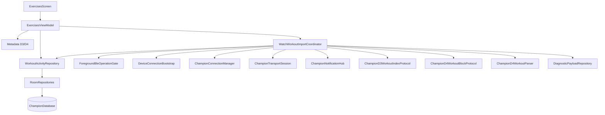
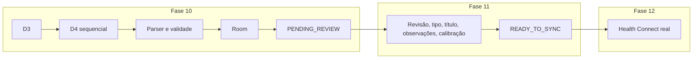
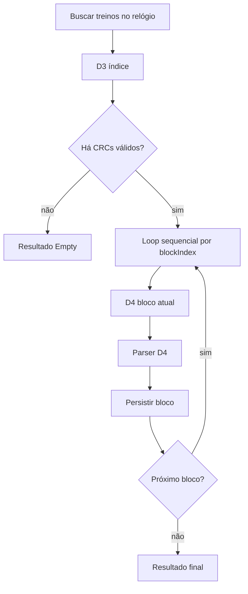
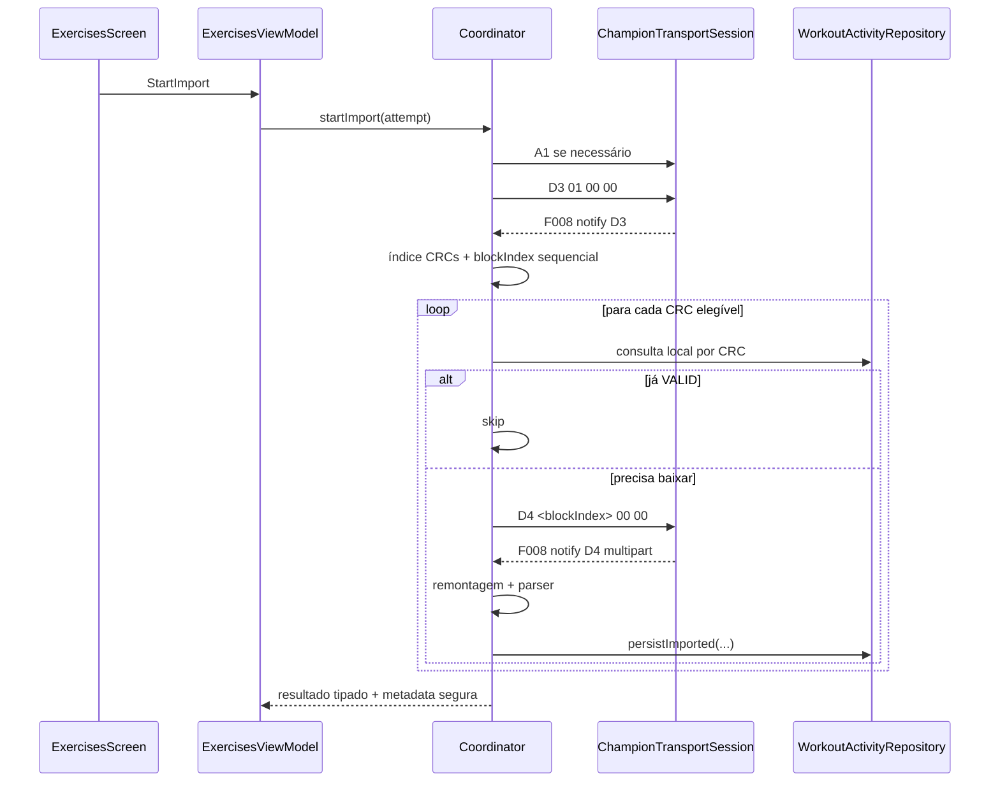
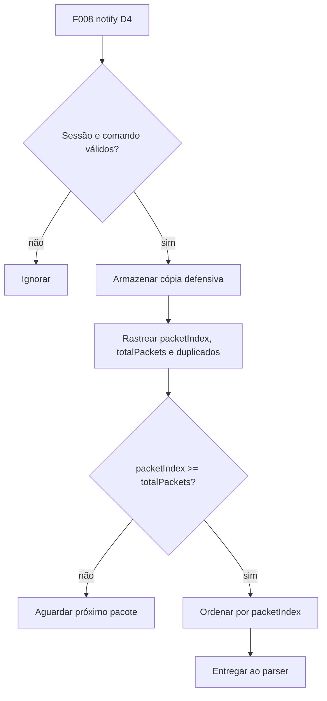
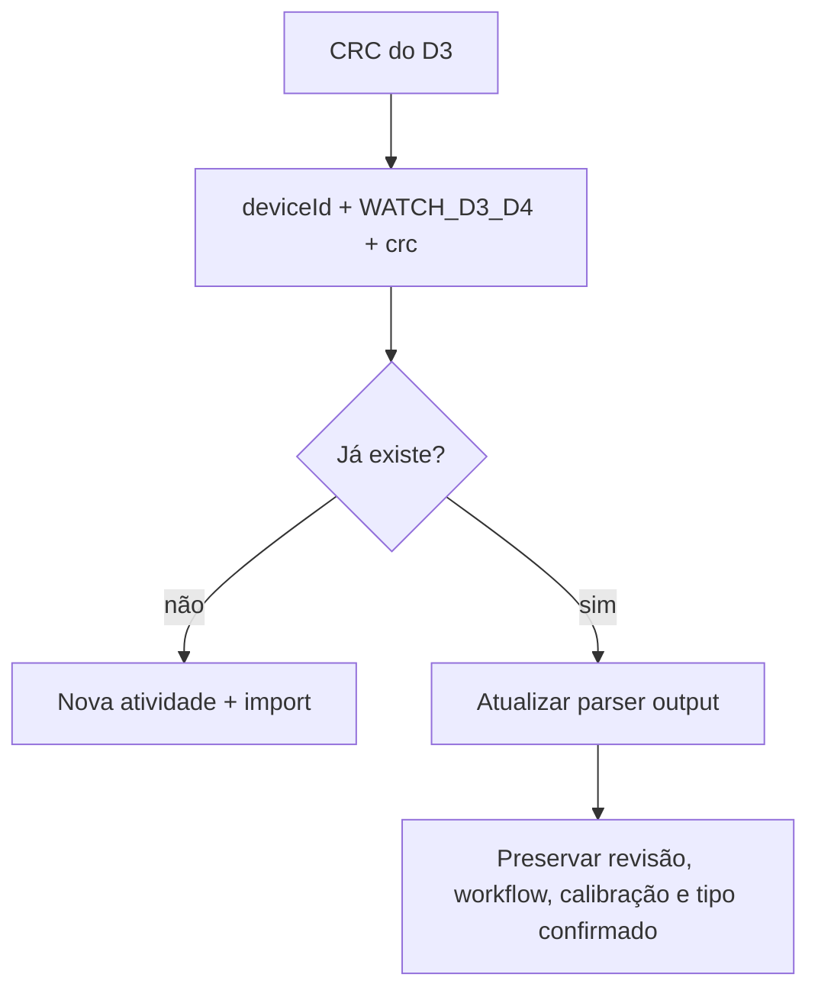
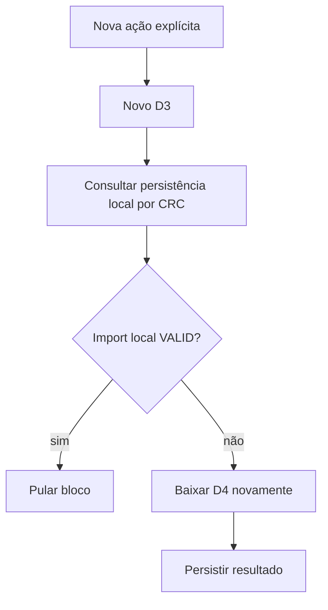
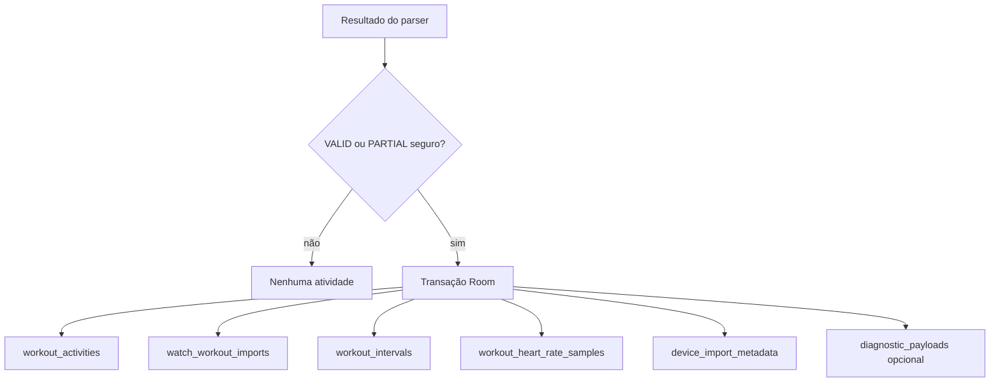
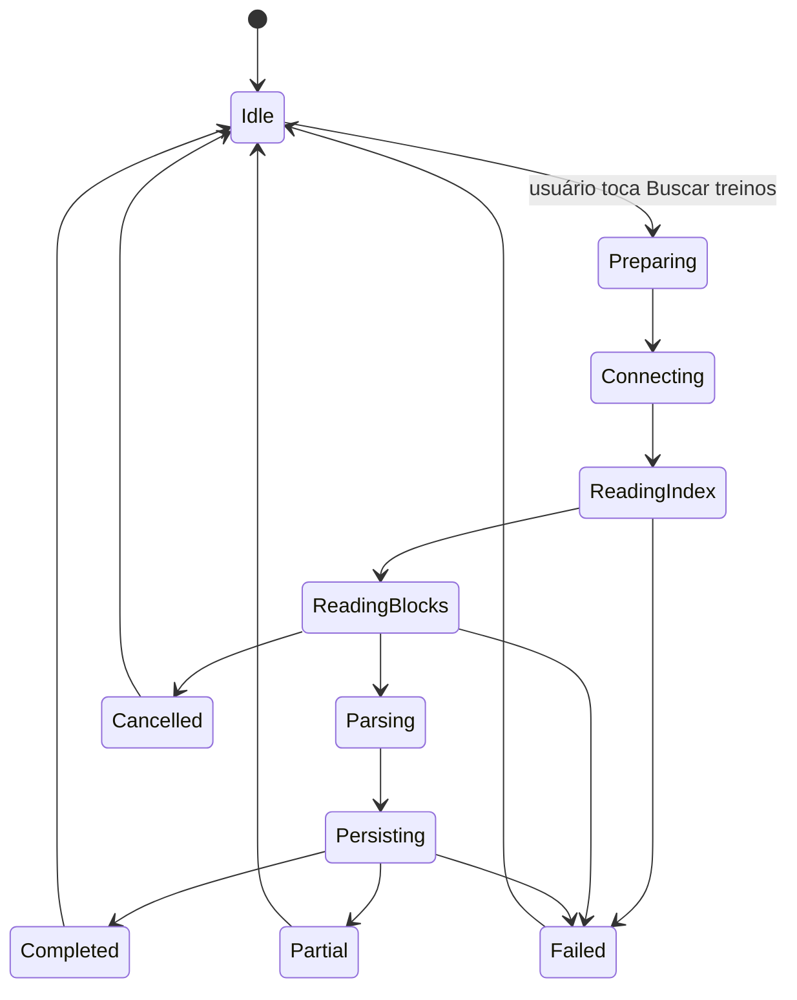

# Spec 010 - Importação de treinos D3/D4 do relógio

## Status

Planejada em 2026-07-23.

## Contexto

A Fase 10 transforma D3/D4 do Champion C001 em fluxo de produto para importar treinos gravados no relógio e persisti-los localmente como atividades pendentes de revisão.

Documentos autoritativos:

- `AGENTS.md`
- `docs/specs/_inputs/phase-10-watch-workouts-d3-d4-direction.md`
- ADRs vigentes em `docs/decisions/`
- `docs/decisions/adr-010-d1-local-first-and-health-connect-phase-boundary.md`
- `docs/specs/009-watch-heart-rate-history-d1.md`
- `docs/tasks/009-watch-heart-rate-history-d1/009-00-overview.md`
- todas as tasks concluídas da Fase 09
- specs e overviews das Fases 03 a 08
- `docs/protocol/workouts-d3-d4.md`
- `docs/protocol/ble-command-mapping.md`
- `docs/protocol/ble-transport.md`
- `docs/protocol/champion-c001.md`
- `docs/protocol/handshake-a1.md`
- `docs/protocol/history-d1.md`
- `docs/protocol/diagnostics-d8-a8.md`
- `docs/baseline/current-baseline.md`
- `docs/baseline/database-reference.md`
- `docs/baseline/feature-parity-checklist.md`
- `docs/baseline/gaps-and-open-questions.md`

## Estado real após Fase 09

- `feature/exercises/ExercisesScreen.kt` ainda é placeholder.
- `feature/exercises/ExercisesFeatureContract.kt` ainda expõe apenas `data object ExercisesUiState`.
- `core/model/WatchWorkoutActivity.kt` já contém `WorkoutActivity`, `WatchWorkoutImport`, `WatchWorkoutParserInput`, `WorkoutInterval` e `WorkoutHeartRateSample`.
- `WorkoutActivity.createFromImport(...)` já cria atividade `PENDING_REVIEW` com origem `WATCH_D3_D4`.
- `WorkoutActivity.confirmReview(...)` já bloqueia avanço quando `parserValidity != VALID`, o que favorece a fronteira obrigatória desta fase.
- `core/model/DiagnosticPayload.kt` já possui `DiagnosticCaptureFlow.WATCH_WORKOUT`, `DiagnosticDerivedOutputType.WATCH_WORKOUT_IMPORT` e retenção de 14 dias / 10 MiB.
- `ChampionDatabase.kt` já possui tabelas `workout_activities`, `watch_workout_imports`, `workout_intervals`, `workout_heart_rate_samples`, `diagnostic_payloads`, `diagnostic_derived_outputs` e `device_import_metadata`.
- `RoomRepositories.persistImported(...)` já faz deduplicação por `(deviceId, origin, crc)`, reimportação com preservação de revisão/calibração e substituição transacional de intervalos e amostras.
- `WorkoutActivityDao.observePendingReview()` já observa atividades pendentes, mas `ExercisesScreen` ainda não consome essa fonte.
- `ForegroundBleOperationGate` ainda conhece só `DAILY_STEPS_REFRESH`, `MANUAL_HEART_RATE` e `WATCH_D1_HISTORY`.
- `ChampionConnectionManager`, `ChampionTransportSession`, `ChampionNotificationHub`, `ChampionPacketRouter` e `DeviceConnectionBootstrap` já oferecem reuso de sessão, subscriptions lógicas, handshake A1 e cleanup reutilizáveis.
- `DeviceManagementViewModel.kt`, `HomeViewModel.kt` e `ChampionNavigation.kt` ainda não conhecem `WATCH_WORKOUT_IMPORT`.
- `device_import_metadata` já é genérica por `deviceId + importType`, mas o código atual só expõe caminho D1.

Atualização de `010-02`:

- `core/model/WatchWorkoutImportSync.kt` agora concentra contratos duradouros de tentativa, progresso, resultado tipado, metadata, erro seguro e política explícita de persistência `VALID/PARTIAL/INVALID`.
- `feature/exercises/ExercisesFeatureContract.kt` agora expõe `ExercisesUiState`, `ExercisesIntent`, `WatchWorkoutImportSurfaceState` e `WatchWorkoutImportSessionState`, mantendo estado de importação separado da futura UI final.
- `RepositoryContracts.kt` agora reserva owner `WATCH_WORKOUT_IMPORT` no gate foreground, além de observação e atualização dedicadas para metadata `WATCH_WORKOUT_D3_D4`.
- `DiagnosticPayload.kt` agora formaliza política de captura diagnóstica privada para treinos: release captura `PARTIAL`, `INVALID` e erro técnico; debug pode capturar bloco `VALID` apenas sob pedido explícito local.

Atualização de `010-03` e `010-04`:

- `ChampionBleTimeouts.kt` agora reserva `d3WorkoutIndex = 10 segundos` e `d4WorkoutBlock = 15 segundos`.
- `ChampionD3WorkoutIndexProtocol.kt` agora implementa builder `D3 01 00 00`, parser little-endian, detecção de header multipart plausível, deduplicação de CRC repetido e timeout parcial com CRCs preservados.
- `ChampionD4WorkoutBlockProtocol.kt` agora implementa builder `D4 <blockIndex> 00 00`, parser de header little-endian, collector por bloco com ordenação, duplicados, índices ausentes e remontagem pronta para o parser D4.

## Achados auditados em `010-01`

- `AGENTS.md` estava apontando para `docs/core/current-project-baseline.md`, mas a baseline factual vigente está em `docs/baseline/current-baseline.md`.
- MotionLog lê CRCs D3 em pares `u16` little-endian a partir do offset `3`, com `availableCount = floor((bytes.length - 3) / 2)`.
- O mesmo baseline MotionLog considera header D3 multipart plausível lendo `packetIndex = u16 LE bytes[1..2]` e `totalPackets = u16 LE bytes[3..4]`; portanto `bytes[3..4]` acumulam dupla função factual: header plausível e primeiro par candidato de CRC.
- MotionLog não deduplica CRC repetido durante coleta D3 nem antes do loop D4; `shouldSkipWorkoutBlock(...)` só pula bloco já persistido no banco, não duplicata ainda não salva da mesma consulta D3.
- MotionLog aceita D4 fora de ordem, preserva duplicatas de `packetIndex`, ordena por `packetIndex` antes do parser e marca `partial` quando quantidade de índices distintos diverge de `totalPackets` ou quando `minuteIndex` repete.
- `minuteIndex` no baseline MotionLog é `packetIndex - 4`.
- `sampledAt` no baseline MotionLog é `startedAt + minuteIndex * 60_000`; primeiro bucket usa `minuteIndex = 0`.
- Cada pacote D4 `4+` representa bucket de um minuto; baseline MotionLog não encurta bucket final para casar com sobra de duração.
- `recordCount` divergente não sintetiza amostras nem buckets; baseline MotionLog marca `partial` quando o restante mínimo segue válido.
- App nativo já possui domínio, Room e reimportação para D3/D4: `WorkoutActivity`, `WatchWorkoutImport`, `WorkoutInterval`, `WorkoutHeartRateSample`, tabelas dedicadas e `persistImported(...)` transacional.
- Reimportação atual no app nativo deduplica por chave natural `(deviceId, origin, crc)`, preserva identidade da atividade e mantém `confirmedType`, `workflowState`, `reviewedAt`, `calibrationId` e métricas calibradas como dados autoritativos.
- O schema Room atual impõe unicidade de intervalos por `(activityId, intervalIndex)` e de amostras BPM por `(activityId, sampledAtEpochMillis)`, então a deduplicação derivada de BPM já acontece por timestamp, não por `minuteIndex` explícito.

## Objetivo

Permitir que o usuário:

- toque explicitamente em `Buscar treinos no relógio` na tela Exercícios;
- acompanhe leitura do índice D3;
- acompanhe downloads D4 sequenciais;
- cancele uma tentativa em andamento;
- preserve blocos já concluídos antes de falha ou cancelamento;
- repita a tentativa sem duplicar treinos;
- retome por CRC, pulando blocos já `VALID`;
- importe treino curto e treino longo ou multipart;
- persista atividade `VALID` ou `PARTIAL` segura;
- visualize lista simples e somente leitura de atividades pendentes;
- mantenha toda atividade fora do Health Connect até revisão futura.

## Requisitos funcionais

1. D3 e D4 iniciam somente por ação explícita na tela Exercícios.
2. Abrir app, abrir Exercícios, conectar relógio, concluir auto-connect, voltar ao foreground ou observar pendência nunca inicia importação.
3. O fluxo usa handshake A1 antes de D3 e D4.
4. D3 envia `D3 01 00 00` em `F008_WRITE` e recebe `F008_NOTIFY`.
5. D4 envia `D4 <blockIndex> 00 00` em `F008_WRITE` e recebe `F008_NOTIFY`.
6. `blockIndex` de D4 é sequencial, derivado do D3, e nunca usa CRC como índice.
7. D3 aceita little-endian, ignora CRC zero, preserva ordem, atribui índice sequencial e deduplica CRC repetido.
8. D3 suporta resposta única sem header plausível e multipart apenas quando o header for plausível.
9. D3 com timeout e CRCs já coletados continua para D4 e marca tentativa potencialmente parcial.
10. D3 vazio conclui com resultado `Empty`, sem criar atividade.
11. D4 executa um bloco por vez, sem concorrência entre blocos.
12. D4 aceita pacotes fora de ordem, rastreia duplicados, calcula ausentes e conclui quando `totalPackets > 0 && packetIndex >= totalPackets`.
13. Pacotes D4 obrigatórios são `1`, `2` e `3`.
14. Ausência ou falha estrutural de pacote obrigatório não cria atividade.
15. Parser preserva layout preferido e fallback legado já documentados, sem heurística nova sem evidência.
16. `minuteIndex` continua `packetIndex - 4`.
17. Timestamp de amostra de BPM usa `startedAt + minuteIndex * 60 segundos`.
18. Cada pacote `4+` representa bucket de um minuto; o bucket final não é encurtado artificialmente para ajustar duração residual.
19. Duração da atividade prefere `endedAt - startedAt`; fallback usa duração do pacote 3 quando necessário.
20. Se duração total não fecha em minutos exatos, a duração da atividade é preservada e os buckets permanecem em minutos inteiros; a divergência é diagnóstica.
21. `recordCount` divergente não sintetiza amostras; gera `PARTIAL` quando o restante mínimo for seguro.
22. Passos, distância e calorias totais preservam os totais do pacote 2; soma dos intervalos é apenas diagnóstico.
23. Calorias usam `caloriesRaw / 1000` com uma casa decimal.
24. BPM válido é `30..220`; `0`, `255` e faixas inválidas são ignorados.
25. `VALID`, `PARTIAL` e `INVALID` precisam ser definidos explicitamente.
26. Atividade `PARTIAL` só persiste quando pacotes `1`, `2` e `3` forem seguros e não exigir invenção de valores.
27. Atividade `INVALID` não é criada.
28. Chave natural de deduplicação permanece `deviceId + origin = WATCH_D3_D4 + crc`.
29. Reimportação preserva tipo confirmado, workflow, revisão e calibração já existentes.
30. Retomada usa nova ação explícita, novo D3 e consulta local por CRC para pular `VALID` e repetir ausente/parcial/falho.
31. Persistência é transacional e por bloco, para preservar progresso parcial real.
32. Payload diagnóstico bruto permanece privado, local e temporário.
33. Metadata genérica de importação usa `importType = WATCH_WORKOUT_D3_D4`.
34. Resultado tipado da tentativa usa `Completed`, `Partial`, `Empty`, `Cancelled` e `Failed`.
35. Tela Exercícios mostra última importação, progresso, cancelamento, retry, resultado e lista simples read-only de pendências.

## Requisitos não funcionais

- Compose não acessa BLE, Room, DAOs, DataStore nem bytes D3/D4.
- `ExercisesViewModel` é owner do fluxo de produto, não do transporte BLE.
- Parser não acessa Room.
- Repository não acessa BLE.
- Coordinator não depende de Compose.
- Todos os writes passam pela fila GATT existente.
- Logs continuam sanitizados, sem payload, bytes, hex, CRC, BPM, passos, distância, calorias, MAC ou identificador persistente.
- Nenhuma operação de Health Connect é criada nesta fase.
- Nenhuma mudança de backup, manifesto, Gradle, Compose root, Kotlin de outras fases ou roadmap é exigida para o planejamento.
- Testes novos devem ser pequenos e acompanhar regras críticas, sem task exclusiva de testes.

## Limites

### Incluído

- auditoria MotionLog e código atual;
- correção futura do caminho de baseline em `AGENTS.md` pela task `010-01`;
- contratos de importação e metadata D3/D4;
- owner `WATCH_WORKOUT_IMPORT` no gate foreground;
- comando D3;
- parser D3;
- collector D3;
- índice de CRCs;
- comando D4;
- collector D4;
- remontagem;
- parser D4;
- timestamps;
- duração;
- intervalos;
- passos;
- distância total e por intervalo;
- calorias totais e por intervalo;
- BPM por intervalo e agregados;
- sugestão de tipo;
- validade `VALID/PARTIAL/INVALID`;
- persistência local;
- deduplicação;
- reimportação;
- retomada por CRC;
- payload diagnóstico privado;
- retenção;
- metadata da importação;
- ViewModel e UI de Exercícios;
- cancelamento, retry, lifecycle e erros seguros;
- validação física inicial e Gate B.

### Fora do escopo

- revisão de atividade;
- confirmação ou edição de tipo;
- título;
- observações;
- calibração;
- edição de distância;
- descarte definitivo pela UI;
- `READY_TO_SYNC`, `SYNCING`, `SYNCED`;
- Health Connect;
- `HealthSyncOperation` para atividades;
- importação automática;
- background BLE;
- foreground service;
- WorkManager;
- D8;
- A8;
- GPS, rota, coordenadas, mapa, GPX, TCX, FIT;
- suporte a outros relógios.

## Arquitetura



Regras arquiteturais:

- `ExercisesScreen` só renderiza estado e envia intents.
- `ExercisesViewModel` observa pendências e metadata, mas não inicia BLE em `Load`.
- `WatchWorkoutImportCoordinator` controla tentativa D3/D4, timeout, cancelamento, conexão, handshake e persistência por bloco.
- `ChampionD3WorkoutIndexProtocol`, `ChampionD4WorkoutBlockProtocol` e `ChampionD4WorkoutParser` ficam desacoplados da UI.
- `WorkoutActivityRepository` continua fonte de verdade da persistência de atividades, importações, intervalos e amostras.

## Fronteira entre Fases 10, 11 e 12



## Ação explícita

A tela Exercícios deve oferecer ação textual equivalente a `Buscar treinos no relógio`.

Não planejar importação em:

- abertura do app;
- abertura da tela;
- conexão manual;
- auto-connect concluído;
- retorno ao foreground;
- observação de pendências persistidas.

## Gate BLE

Owner obrigatório:

```text
WATCH_WORKOUT_IMPORT
```

O gate arbitra:

```text
DAILY_STEPS_REFRESH
MANUAL_HEART_RATE
WATCH_D1_HISTORY
WATCH_WORKOUT_IMPORT
```

Regras:

- aquisição atômica;
- um owner por vez;
- erro seguro quando outro owner estiver ativo;
- liberação em `finally`;
- timeout libera;
- cancelamento libera;
- falha de persistência libera;
- callback tardio nunca readquire gate;
- `DeviceManagementViewModel`, `HomeViewModel`, fluxos de Saúde e Exercícios precisam conhecer o novo owner.

## Conexão

Fluxo obrigatório:

1. validar dispositivo associado;
2. validar permissões e Bluetooth;
3. adquirir `WATCH_WORKOUT_IMPORT`;
4. tentar reusar `ChampionConnectionManager.currentSession()` quando `transportKey` coincidir;
5. conectar com `DeviceConnectionBootstrap` quando necessário;
6. garantir `TransportReady`;
7. garantir handshake A1;
8. observar `F008_NOTIFY`;
9. iniciar D3;
10. seguir para D4 sequencial.

## Handshake

- reusar `DeviceConnectionBootstrap.executeHandshake(...)`;
- aceitar `HANDSHAKE_CONFIRMED` e `HANDSHAKE_ASSUMED` conforme contrato atual do app;
- não criar protocolo A1 paralelo nesta fase;
- auto-connect não pode derrubar sessão saudável usada pela importação.

## Identidade da tentativa

Cada tentativa deve carregar:

```text
importAttemptId
bleSessionId
deviceId
startedAt
parserVersion
```

Collectors D3 e D4 aceitam pacote somente quando:

- a tentativa ainda está ativa;
- a sessão BLE coincide;
- o dispositivo coincide;
- o pacote chegou depois do início da tentativa;
- o canal é `F008_NOTIFY`;
- o comando esperado é `0xD3` ou `0xD4`.

## D3 - Comando

```text
write = D3 01 00 00
channel = F008_WRITE
notifications = F008_NOTIFY
timeout = 10 segundos
retry interno = nenhum
```

## D3 - Parser

Regras obrigatórias:

- usar little-endian;
- ignorar CRC zero;
- preservar ordem;
- atribuir `blockIndex` sequencial iniciado em zero;
- deduplicar CRC repetido de forma determinística;
- não usar CRC como `blockIndex`;
- tratar header multipart apenas quando plausível;
- aceitar resposta única sem header plausível;
- preservar fato auditado de que MotionLog hoje começa CRCs no offset `3`, mesmo quando também testa plausibilidade multipart com `bytes[3..4]`;
- tratar deduplicação intra-D3 como decisão explícita da Fase 10, porque ela não existe no baseline MotionLog auditado;
- não atribuir semântica a bytes não confirmados.

## D3 - Multipart

Header plausível:

- `totalPackets` entre `1` e `256`;
- `packetIndex` entre `1` e `totalPackets`.

Sem header plausível, a primeira notificação D3 válida encerra a coleta.

## D3 - Índice vazio

- resultado tipado `Empty`;
- sem erro técnico;
- sem criar atividade;
- sem criar payload diagnóstico artificial.

## D3 - Timeout parcial

- preserva CRCs já encontrados;
- segue para D4;
- marca tentativa como potencialmente parcial;
- registra `timedOut = true` no resultado;
- permite nova tentativa posterior.

## Fluxo D3/D4



## Sequência D3 seguida de D4



## D4 - Comando

```text
write = D4 <blockIndex> 00 00
channel = F008_WRITE
notifications = F008_NOTIFY
timeout = 15 segundos por bloco
execução = sequencial
retry interno = nenhum
```

## D4 - Execução sequencial

- um bloco por vez;
- sem D4 concorrente;
- falha de um bloco não aborta blocos seguintes quando a sessão continuar saudável;
- nova tentativa manual deve pular `VALID` e repetir parcial/ausente/falho.

## D4 - Collector

Header obrigatório:

```text
packetIndex = u16 LE bytes 1..2
totalPackets = u16 LE bytes 3..4
```

Conclusão:

```text
totalPackets > 0
e
packetIndex >= totalPackets
```

Regras:

- rejeitar pacote curto;
- copiar bytes defensivamente;
- aceitar fora de ordem;
- registrar duplicados e preservar evidência para diagnóstico, porque MotionLog não elimina `packetIndex` repetido antes do parser;
- ordenar por `packetIndex` antes do parser;
- calcular índices ausentes;
- remover observer em todos os caminhos.

## D4 - Timeout por bloco

- timeout marca bloco falho;
- timeout não rebaixa blocos já persistidos;
- timeout de bloco atual não inicia retry oculto;
- timeout com material mínimo seguro pode resultar em `PARTIAL`;
- timeout sem pacotes obrigatórios válidos resulta em `INVALID` e sem atividade.

## D4 - Pacotes fora de ordem

- collector aceita e ordena por `packetIndex`.

## D4 - Pacotes duplicados

- collector preserva ocorrência para diagnóstico;
- parser considera duplicidade relevante ao calcular `PARTIAL`.

## D4 - Índices ausentes

- índices ausentes entram em metadata segura e resultado tipado;
- índices ausentes não geram pacotes sintéticos.

## D4 - Remontagem



## D4 - Pacotes obrigatórios

```text
1
2
3
```

Ausência, corrupção ou layout não reconhecido de qualquer um deles:

- não cria `WorkoutActivity`;
- não inventa métricas;
- registra erro seguro;
- pode preservar payload diagnóstico privado.

## D4 - Layout preferido

- pacote `1`: início em offsets `7..13` e fim em `14..19`, anos `u16 LE`;
- pacote `2`: passos `u16 LE 7..8`, distância `u16 LE 11..12 * 100 cm`, calorias `u24 LE 15..17`;
- pacote `3`: `recordCount` no byte `9`, CRC `u16 LE 14..15`;
- pacote `4+`: `minuteIndex = packetIndex - 4`, BPM byte `6`, passos `u24 LE 7..9`, distância `u24 LE 10..12`, calorias `u16 LE 13..14`.

Observação auditada: no pacote `1`, segundo final não existe no layout preferido; baseline MotionLog usa `0`.

## D4 - Layout legado

- pacote `1`: fallback legado quando datas do layout preferido forem inválidas;
- pacote `2`: fallback legado quando layout preferido não for plausível;
- pacote `3`: fallback legado com duração `u32 LE 5..8`, `recordCount u16 LE 9..10`, CRC `u16 LE 11..12`.

## Parser D4

O parser deve:

- preservar campos ausentes como ausentes;
- preservar bytes desconhecidos apenas como diagnóstico privado, sem semântica derivada;
- não introduzir terceiro layout especulativo;
- manter validações já confirmadas pelo MotionLog;
- produzir saída própria para `VALID`, `PARTIAL` ou `INVALID` antes da persistência.

## Timestamp

- `startedAt` e `endedAt` vêm do pacote `1`;
- `sampledAt` de BPM usa `startedAt + minuteIndex * 60_000`;
- o primeiro minuto usa `minuteIndex = 0`;
- amostras fora da duração total não são ajustadas artificialmente; entram como diagnóstico quando houver incoerência.

## Duração

- preferir `endedAt - startedAt` quando positivo;
- usar fallback do pacote `3` quando necessário;
- quando fim não for posterior ao início, resolver `endedAt = startedAt + durationFallback`;
- atividade preserva duração reportada, mesmo quando buckets não fecharem minutos exatos.

## Intervalos

- cada pacote `4+` gera um `WorkoutInterval` com `index = minuteIndex`;
- duração de cada intervalo é `60 segundos`;
- duração do último intervalo permanece `60 segundos` como bucket de um minuto, porque a baseline MotionLog não encurta o último bucket;
- quando a duração total não fechar em minutos, a divergência permanece diagnóstica;
- `recordCount` divergente não cria buckets sintéticos; marca `PARTIAL` quando os demais mínimos forem seguros.

## Passos

- total preservado do pacote `2`;
- passos por intervalo preservados do pacote `4+`;
- soma dos intervalos é apenas diagnóstico.

## Distância

- total original preservado do pacote `2`;
- distância por intervalo preservada do pacote `4+`;
- conversão de cm para metros usa `round(raw / 100)`;
- não preencher distância calibrada, fator ou distância manual nesta fase.

## Calorias

- total e por intervalo preservam `caloriesRaw / 1000`;
- uma casa decimal;
- divergência entre soma e total é diagnóstica.

## BPM

- criar `WorkoutHeartRateSample` somente para BPM `30..220`;
- `0`, `255` e faixas inválidas são ignorados;
- samples usam origem implícita de treino importado do relógio.

## Agregados

- média, mínimo e máximo calculados apenas sobre BPM válido;
- sem BPM válido, campos permanecem ausentes.

## Sugestão de tipo

```text
steps < 1000 -> FREE_WORKOUT
steps >= 1000 -> RUNNING
```

É apenas sugestão. Confirmação fica para a Fase 11.

## Validade

```text
VALID
PARTIAL
INVALID
```

### VALID

- pacotes obrigatórios válidos;
- estrutura reconhecida;
- sem timeout comprometedor;
- índices e amostras compatíveis com o mínimo esperado.

### PARTIAL

- timeout após dados mínimos seguros;
- índices ausentes;
- pacotes duplicados relevantes;
- divergência de `recordCount`;
- divergência CRC D3 x CRC D4;
- incoerência que não exige inventar valores.

### INVALID

- pacote obrigatório ausente;
- layout não reconhecido;
- data irrecuperável;
- dados mínimos inseguros;
- impossibilidade de produzir atividade sem invenção.

## Política PARTIAL

- persistir somente quando pacotes `1`, `2` e `3` forem interpretáveis;
- `workflowState = PENDING_REVIEW`;
- `parserValidity = PARTIAL`;
- atividade permanece visível como incompleta;
- não pode avançar para sincronização;
- pode ser reimportada em tentativa futura.

## Política INVALID

- não criar atividade;
- registrar resultado seguro e, quando aplicável, payload diagnóstico privado.

## CRC divergente

- usar CRC do D3 como chave externa da tentativa e da deduplicação;
- divergência com CRC do pacote `3` produz `PARTIAL` ou `INVALID`, conforme suficiência dos mínimos;
- não criar atividade paralela usando CRC divergente.

## Deduplicação



Regras:

- mesma atividade não duplica;
- CRC repetido no mesmo D3 deve deixar de disparar download duplicado na implementação da Fase 10; auditoria `010-01` confirmou que MotionLog atual ainda não faz essa deduplicação intra-tentativa;
- reimportação substitui intervalos e amostras transacionalmente;
- workflow revisado, sincronizado ou calibrado não é rebaixado.

## Reimportação

- localizar por chave natural;
- atualizar métricas importadas, parser e diagnóstico;
- preservar identidade, revisão, tipo confirmado, calibração e workflow autoritativo.

## Retomada



Regras:

- retomada não restaura sessão GATT morta;
- sempre usa novo `importAttemptId` e novo permit do gate;
- `VALID` é pulado por padrão;
- parcial, ausente e falho são tentados de novo.

## Persistência



Preferir reutilizar schema atual.

Plano inicial:

- sem migration prevista;
- reuso de `WorkoutActivity`, `WatchWorkoutImport`, `WorkoutInterval`, `WorkoutHeartRateSample` e `device_import_metadata`;
- criação de migration só se `010-01` ou `010-02` provarem lacuna real de schema.

## Payload diagnóstico

- fluxo `WATCH_WORKOUT`;
- sem payload em logs;
- sem bytes na UI;
- sem fixture real versionada;
- release deve preferir captura bruta só para `PARTIAL`, `INVALID` ou erro técnico relevante;
- debug e validação física podem permitir captura explícita de bloco `VALID` para investigação local.

Contratos formalizados em `010-02`:

- `WatchWorkoutDiagnosticCapturePolicy`
- constante `WatchWorkoutDiagnostics`
- `derivedOutputType = WATCH_WORKOUT_IMPORT`

## Retenção

```text
14 dias
10 MiB
```

## Metadata

Tipo planejado:

```text
WATCH_WORKOUT_D3_D4
```

Persistir quando disponível:

- `lastAttemptAt`;
- `lastSuccessAt`;
- `lastResult`;
- `parserVersion`;
- `insertedCount`;
- `duplicateCount`;
- `conflictCount`, quando houver reimportação divergente;
- `invalidCount`;
- `missingIndexCount`;
- `timedOut`.

Contagens como `partialCount`, `timedOutBlockCount` e `skippedValidCount` vivem no resultado tipado da tentativa e só ganham persistência dedicada se auditoria futura provar necessidade real de schema novo.

Contratos formalizados em `010-02`:

- `WATCH_WORKOUT_D3_D4_IMPORT_TYPE`
- `WatchWorkoutImportMetadata`
- `WorkoutActivityRepository.observeWatchWorkoutImportMetadata(...)`
- `WorkoutActivityRepository.updateWatchWorkoutImportMetadata(...)`

## State machine



Contratos formalizados em `010-02`:

- `WatchWorkoutImportSurfaceState`
- `WatchWorkoutImportSessionState`
- `WatchWorkoutImportProgress`
- `WatchWorkoutImportError`
- `WatchWorkoutImportErrorCategory`

## Resultado tipado

```text
Completed
Partial
Empty
Cancelled
Failed
```

Metadados seguros planejados:

- `discoveredBlockCount`;
- `processedBlockCount`;
- `insertedCount`;
- `duplicateCount`;
- `partialCount`;
- `invalidCount`;
- `timedOutBlockCount`;
- `skippedValidCount`;
- `missingPacketCount`;
- `startedAt`;
- `finishedAt`.

Contratos formalizados em `010-02`:

- `WatchWorkoutImportSummary`
- `WatchWorkoutImportStatus`
- `WatchWorkoutImportResult.Completed`
- `WatchWorkoutImportResult.Partial`
- `WatchWorkoutImportResult.Empty`
- `WatchWorkoutImportResult.Cancelled`
- `WatchWorkoutImportResult.Failed`

## Progresso

- D3 usa progresso indeterminado;
- D4 usa `blocos processados / blocos encontrados`;
- dentro do bloco, quando `totalPackets` for válido, usa `packetIndex / totalPackets`;
- progresso informa etapa, bloco atual e pacote atual de modo amigável;
- UI nunca mostra CRC.

## ViewModel

`ExercisesViewModel` precisa manter estado separado para:

- pendências persistidas observadas do banco;
- operação de importação D3/D4;
- última metadata D3/D4;
- erro terminal seguro;
- progresso;
- resultado da última tentativa.

`Load` não inicia BLE.

## Tela Exercícios

Substituir placeholder por superfície que mostre:

- título e explicação curta;
- CTA `Buscar treinos no relógio`;
- última importação D3/D4;
- progresso e etapa atual;
- cancelamento;
- retry;
- resultado tipado;
- lista simples read-only de pendências `PENDING_REVIEW`;
- estado vazio;
- estado de erro;
- acessibilidade textual para operações e pendências.

## Lista read-only

Mostrar somente:

- data;
- duração;
- tipo sugerido;
- validade;
- status pendente.

Não implementar revisão, detalhes completos, descarte, calibração ou sincronização.

## Cancelamento

- encerra collector ativo;
- cancela timeout do bloco ou do índice;
- não inicia próximo bloco;
- libera gate;
- preserva blocos já persistidos;
- não persiste bloco incompleto sem dados mínimos.

## Retry

- abre nova tentativa;
- executa novo D3;
- usa novo `importAttemptId`;
- usa novo permit;
- não reaproveita listener;
- pula `VALID`;
- tenta parcial, ausente e falho.

## Lifecycle

- sair da tela durante importação exige confirmação explícita;
- ir para background cancela;
- morte do processo volta para `Idle`;
- dados já persistidos permanecem;
- retomada real acontece por novo D3 e consulta local por CRC.

## Erros

Categorias mínimas planejadas:

- sem dispositivo associado;
- permissões BLE ausentes;
- Bluetooth desligado;
- operação BLE concorrente;
- conexão falhou;
- handshake falhou;
- `F008_NOTIFY` indisponível;
- envio D3 falhou;
- D3 vazio;
- D3 inválido;
- timeout D3;
- envio D4 falhou;
- timeout D4;
- resposta D4 vazia;
- pacote obrigatório ausente;
- layout inválido;
- CRC divergente;
- persistência falhou;
- disconnect inesperado;
- cancelamento;
- armazenamento diagnóstico indisponível;
- erro interno.

## Acessibilidade

Anunciar estados equivalentes a:

- `Buscando treinos do relógio`;
- `Baixando treino do relógio`;
- `Treino importado`;
- `Importação parcial concluída`;
- `Nenhum treino novo encontrado`;
- `Importação cancelada`;
- `Não foi possível importar os treinos`.

O progresso não pode ser única indicação.

## Logging

Permitido apenas:

- início e fim;
- duração;
- etapa;
- quantidade de CRCs;
- blocos e pacotes;
- quantidade válida, parcial, inválida, duplicada e inserida;
- índices ausentes;
- categoria de erro.

Proibido:

- payload;
- bytes;
- hexadecimal;
- CRC;
- BPM;
- passos;
- distância;
- calorias;
- datas exatas da atividade;
- MAC;
- `deviceId` persistente;
- stack trace para UI.

## Privacidade

- não persistir latitude, longitude, rota, polyline, mapa, GPX, TCX, FIT;
- não enviar dados a servidor;
- não alterar backup;
- payload diagnóstico permanece local, privado, limitado e temporário.

## Validação física

Executar em Galaxy S22 com Champion C001:

1. abrir Exercícios;
2. confirmar ausência de importação automática;
3. tocar `Buscar treinos no relógio`;
4. observar D3;
5. observar D4 sequencial;
6. importar treino curto;
7. confirmar atividade pendente;
8. repetir importação e confirmar deduplicação;
9. cancelar durante D4;
10. tentar novamente e confirmar retomada.

## Gate B

Validar ao menos:

- treino curto;
- treino longo ou multipart;
- D3;
- D4;
- remontagem;
- persistência;
- intervalos;
- BPM;
- deduplicação;
- cancelamento;
- retomada;
- atividade pendente;
- ausência de Health Connect.

## Testes reduzidos

Testes pequenos recomendados:

- builder D3;
- CRC little-endian;
- CRC zero ignorado;
- CRC duplicado;
- D3 sem header;
- D3 multipart;
- timeout D3 parcial;
- builder D4;
- header D4 little-endian;
- pacotes fora de ordem;
- pacotes duplicados;
- índices ausentes;
- pacotes obrigatórios;
- layout preferido;
- layout legado;
- calorias por mil;
- distância raw para metros;
- BPM válido e inválido;
- agregados BPM;
- sugestão de tipo;
- parser `PARTIAL`;
- parser `INVALID`;
- deduplicação por CRC;
- reimportação preserva revisão;
- retomada pula `VALID`;
- gate impede concorrência;
- callback tardio ignorado;
- cancelamento não inicia próximo bloco.

## Dívida técnica

- revisão, confirmação e calibração ficam para Fase 11;
- Health Connect fica para Fase 12;
- foreground service para importações longas fica para Fase 14;
- confirmação de bytes desconhecidos segue pendente;
- confirmação funcional de D8 e A8 segue fora do fluxo principal;
- política definitiva de payload diagnóstico em release pode exigir ADR posterior.

## Critérios de aceite

- `ExercisesScreen` deixa de ser placeholder;
- importação começa só por ação explícita;
- owner `WATCH_WORKOUT_IMPORT` existe;
- gate impede concorrência;
- D3 produz índice de CRCs;
- D4 executa sequencialmente;
- callbacks tardios são ignorados;
- pacotes fora de ordem são remontados;
- pacotes obrigatórios são validados;
- layout preferido e legado são preservados;
- passos, distância, calorias, intervalos e BPM são interpretados conforme baseline auditada;
- agregados BPM são calculados;
- atividade `VALID` persiste;
- atividade `PARTIAL` segura persiste e permanece bloqueada para sync;
- atividade `INVALID` não é criada;
- deduplicação por dispositivo, origem e CRC funciona;
- reimportação preserva decisões do usuário;
- retomada pula blocos válidos;
- payload diagnóstico obedece retenção e privacidade;
- nenhuma operação de Health Connect é criada;
- atividade nasce `PENDING_REVIEW`;
- treino curto real é importado;
- treino longo ou multipart real é importado;
- Gate B é validado;
- `lint`, `assembleDebug`, `assembleRelease` e `installDebug` são registrados.

## Fora do escopo

- revisão;
- confirmação de tipo;
- edição de tipo;
- título;
- observações;
- calibração;
- descarte pela UI;
- `READY_TO_SYNC`, `SYNCING`, `SYNCED`;
- Health Connect.

## Definition of Done

Fase 10 conclui quando:

- `010-01` fechar auditoria, baseline factual e correção futura do caminho em `AGENTS.md`;
- D3 e D4 funcionarem por ação explícita em Exercícios;
- persistência local, deduplicação, reimportação e retomada por CRC estiverem concluídas;
- UI de Exercícios substituir placeholder por fluxo read-only de importação e pendências;
- nenhuma revisão, calibração ou Health Connect for implementado;
- Gate B físico for executado e registrado;
- spec, overview, baseline factual e protocolo D3/D4 estiverem alinhados ao estado entregue.

## Matriz de rastreabilidade

| Requisito | Tasks |
| --- | --- |
| Auditoria MotionLog, baseline factual, offsets, unidades e lacunas | `010-01` |
| Contratos, state machine, metadata, política `PARTIAL/INVALID` e diagnóstico | `010-02` |
| Comando D3, parser D3, multipart, índice vazio e timeout parcial | `010-03` |
| Comando D4, collector sequencial, duplicados, ausentes e remontagem | `010-04` |
| Parser D4, timestamps, duração, intervalos, BPM, agregados e sugestão | `010-05` |
| Persistência, deduplicação, reimportação, metadata e payload privado | `010-06` |
| Coordinator, gate, conexão, handshake, retomada por CRC e persistência por bloco | `010-07` |
| `ExercisesViewModel`, observação local, resultado, progresso e erro | `010-08` |
| UI de Exercícios, ação explícita, progresso, lista read-only e acessibilidade | `010-09` |
| Cancelamento, retry, lifecycle, navegação e mensagens seguras cross-feature | `010-10` |
| Validação física inicial D3/D4 | `010-11` |
| Correção de achados físicos e Gate B | `010-12` |
| Fechamento documental da fase | `010-13` |
