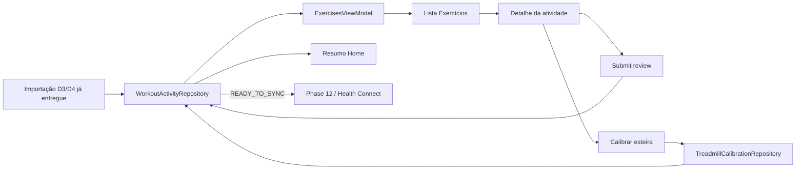
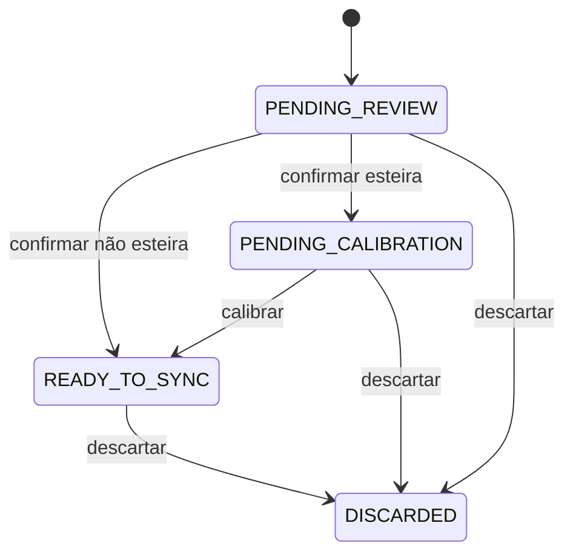
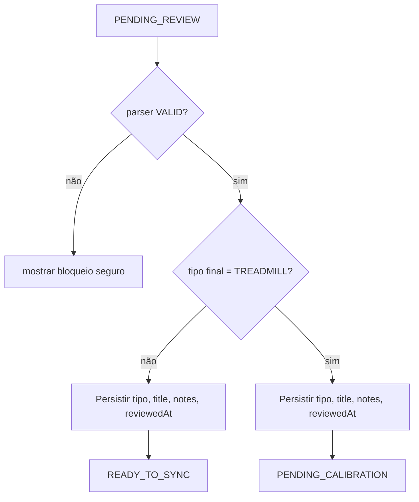
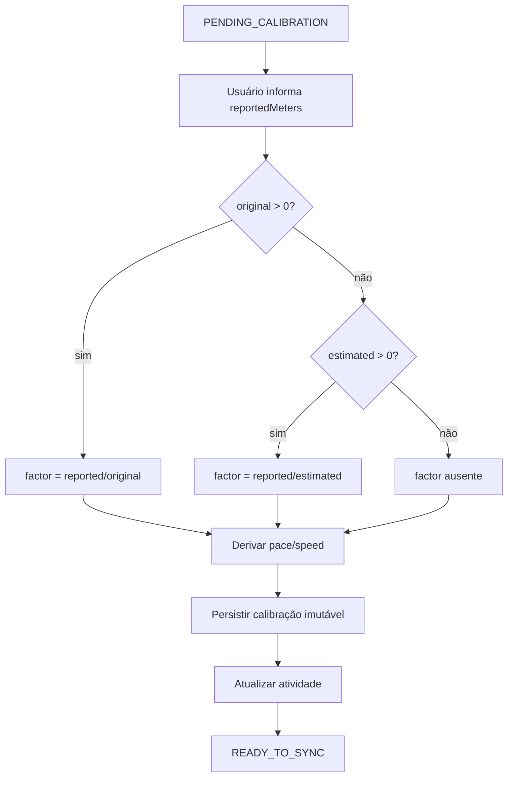
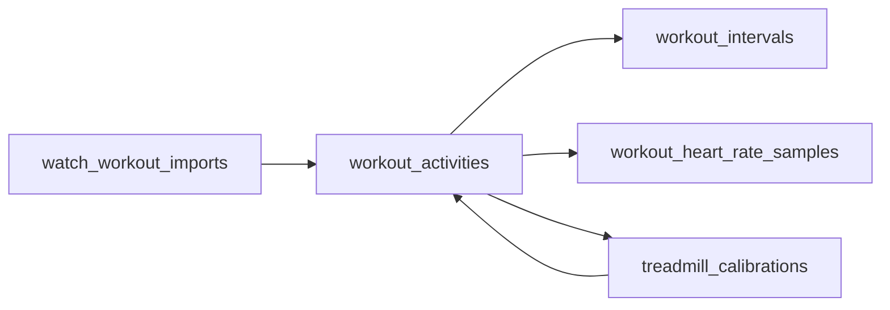
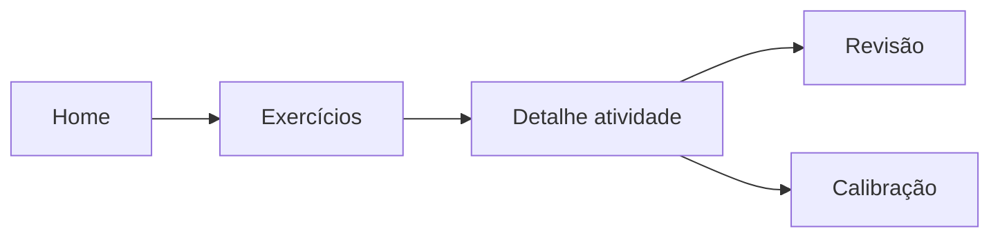
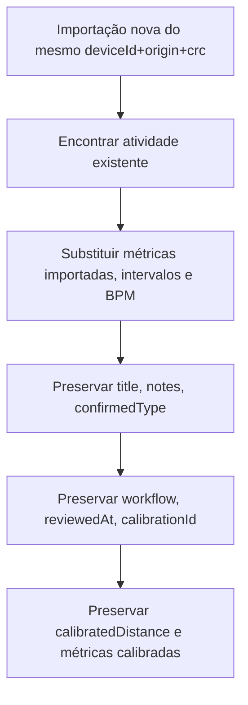

# Spec 011 - Revisão e calibração de atividades importadas

## Status

Em andamento em 2026-07-24. `011-01`, `011-02`, `011-04` e `011-05` concluídas.

Observação de execução real:

- `011-04` e `011-05` foram executadas antes de `011-03`.
- `011-03` continua pendente para formalizar contratos duradouros de revisão, calibração e estado de UI da feature, além de alinhar documentalmente o que já entrou no domínio de repositórios.

## Contexto

A Fase 10 encerrou a importação local-first de treinos D3/D4 do Champion C001 até `PENDING_REVIEW`. O app já persiste atividade importada, intervalos, amostras de BPM, sugestão de tipo, validade do parser, metadados de importação e payload diagnóstico privado. A tela Exercícios já possui CTA explícita de importação, progresso, resultado e lista simples somente leitura de pendências.

A próxima necessidade funcional é transformar essas atividades locais em atividades revisadas, calibradas quando necessário e prontas para sincronização futura, mantendo a fronteira obrigatória:

```text
PENDING_REVIEW
        ↓
Revisão
        ↓
Tipo, título e observações
        ↓
Calibração quando necessária
        ↓
READY_TO_SYNC
```

## Documentos autoritativos

- `AGENTS.md`
- `docs/specs/_inputs/phase-11-activity-review-calibration-direction.md`
- ADRs vigentes em `docs/decisions/`
- `docs/decisions/adr-010-d1-local-first-and-health-connect-phase-boundary.md`
- `docs/specs/010-watch-workouts-d3-d4.md`
- `docs/tasks/010-watch-workouts-d3-d4/010-00-overview.md`
- tasks concluídas da Fase 10
- specs e overviews das Fases 03 a 09
- `docs/protocol/workouts-d3-d4.md`
- `docs/baseline/current-baseline.md`
- `docs/baseline/database-reference.md`
- `docs/baseline/feature-parity-checklist.md`
- `docs/baseline/gaps-and-open-questions.md`

## Estado real após Fase 10

- `core/model/WatchWorkoutActivity.kt` ainda não contém `title` nem `notes`; hoje só existem `suggestedType`, `confirmedType`, `workflowState`, `reviewedAt` e `calibrationId` como decisões persistidas de revisão.
- `WorkoutActivity.confirmReview(...)` já bloqueia confirmação quando `parserValidity != VALID` e já distingue esteira de não esteira.
- `WorkoutActivityEntity` ainda não possui `title` nem `notes`; `ChampionDatabase` está na versão `3`.
- `RoomRepositories.planWatchWorkoutPersistence(...)` já preserva `confirmedType`, `workflowState`, `reviewedAt`, `calibrationId` e métricas calibradas na reimportação, mas ainda não pode preservar `title` e `notes`.
- `ExercisesViewModel.kt` ainda observa apenas `observePendingReview()` e estado de importação D3/D4.
- `ExercisesScreen.kt` ainda mostra apenas lista simples read-only e não possui filtros, detalhe, revisão, calibração nem descarte.
- `HomeViewModel.kt` e `HomeScreen.kt` ainda tratam pendências como sessões locais de `AppWorkoutSession`, não como atividades importadas de `WorkoutActivity`.
- Navegação real usa `AppDestination` e `ChampionNavigation.kt` com back stack manual; ainda não existe rota de detalhe de atividade importada.
- `TreadmillCalibration.kt` já persiste registro imutável, mas hoje exige `originalMeters > 0` para atividade importada e não cobre fallback por `estimatedMeters` ou sem fator.

Atualização de `011-01`:

- `WorkoutActivityRepository` real ainda só expõe `persistImported(...)`, `observePendingReview()`, lookup por CRC, metadata D3/D4, `review(...)` e `discard(...)`.
- `TreadmillCalibrationRepository` real ainda só expõe `register(calibration)`.
- `WorkoutActivityDao` ainda só observa `PENDING_REVIEW`; faltam lista ampla por workflow, detalhe observável por ID e resumo por workflow.
- `TreadmillCalibrationDao.findLatestForActivity(...)` já existe e favorece `observeLatestCalibration(activityId)` futuro, mas ainda não sobe ao contract público.
- `ExercisesFeatureContract.kt` ainda não separa `selectedFilter`, `workflowSummary`, `selectedActivity`, `detailState`, `reviewFormState` ou `calibrationFormState`.
- `AppDestination.kt` ainda não possui destino específico de detalhe por `activityId`.
- Baseline MotionLog confirma revisão manual e calibração de esteira antes do sync, mas também confirma diferença importante: descarte na baseline antiga é exclusão persistida, enquanto a Fase 11 do app novo adotará `DISCARDED` como descarte lógico.

Atualização de `011-04`:

- `WorkoutActivity` agora já contém `title` e `notes` como campos opcionais no domínio.
- `WorkoutActivityEntity` agora já contém `title` e `notes` como colunas opcionais.
- `ChampionDatabase` subiu para `v4` com `AutoMigration(from = 3, to = 4)`.
- `RoomRepositories.planWatchWorkoutPersistence(...)` agora preserva `title` e `notes` na reimportação, junto das demais decisões do usuário.
- `app/schemas/br.com.mwconsulting.championcompanion.core.database.ChampionDatabase/4.json` já foi exportado com as duas novas colunas nullable em `workout_activities`.

Atualização de `011-05`:

- `WorkoutActivityRepository` agora já expõe contratos observáveis equivalentes de lista por filtro, detalhe por `activityId` e resumo por workflow.
- `TreadmillCalibrationRepository` agora já expõe observação da calibração mais recente por atividade via snapshot de contrato.
- `WorkoutActivityDao` agora já possui query para lista completa, lista por workflow, detalhe observável por ID e resumo por workflow.
- `TreadmillCalibrationDao` agora já possui observação reativa da calibração mais recente por atividade.
- `DatabaseMappers.kt` agora já reconstrói `WorkoutActivity` para múltiplos workflows observáveis, sem depender apenas do caminho específico de `PENDING_REVIEW`.
- `011-03` permanece necessária para consolidar formalmente esses contratos e completar a parte ainda pendente de estado de UI e inputs equivalentes de review/calibração.

## Objetivo

Permitir que o usuário:

- visualize atividades importadas em múltiplos estados de workflow;
- filtre a lista por estado;
- abra detalhes completos por atividade;
- compare tipo sugerido e tipo confirmado;
- informe título;
- informe observações;
- confirme revisão de atividades `VALID`;
- calibre atividades confirmadas como esteira;
- visualize distância final e métricas derivadas;
- descarte logicamente atividades indesejadas ou inviáveis;
- acesse pendências pela Home;
- preserve todas as decisões após reinício e reimportação;
- finalize a fase em `READY_TO_SYNC`, sem qualquer sincronização real.

## Requisitos funcionais

1. Toda atividade importada nova continua nascendo em `PENDING_REVIEW`.
2. `title` e `notes` passam a existir no domínio e na persistência como opcionais.
3. `title` é opcional e não exige valor persistido quando o usuário preferir usar fallback visual.
4. `notes` é opcional, preserva quebras de linha e não aceita conteúdo composto apenas por espaços.
5. A tela Exercícios preserva a área de importação D3/D4 já entregue na Fase 10.
6. Abaixo da área de importação, a tela Exercícios passa a exibir resumo, filtros e lista clicável de atividades.
7. Os filtros planejados são `Todas`, `Aguardando revisão`, `Aguardando calibração`, `Prontas`, `Sincronizadas`, `Com erro` e `Descartadas`.
8. A Fase 11 só produz `PENDING_REVIEW`, `PENDING_CALIBRATION`, `READY_TO_SYNC` e `DISCARDED`.
9. `SYNCED` e `SYNC_FAILED` permanecem apenas observáveis para compatibilidade futura.
10. Cada card da lista mostra título ou fallback, data, duração, tipo sugerido ou confirmado, status, validade e distância.
11. A navegação `Exercícios -> detalhe` carrega apenas `activityId`.
12. A navegação `Home -> Exercícios` abre a lista e não pula direto para uma atividade específica.
13. `SubmitWorkoutReviewInput(activityId, confirmedType, title, notes, reviewedAt)` deve existir em contrato equivalente no domínio de repositórios.
14. Confirmar revisão de atividade não esteira faz `PENDING_REVIEW -> READY_TO_SYNC`.
15. Confirmar revisão de atividade como esteira faz `PENDING_REVIEW -> PENDING_CALIBRATION`.
16. A operação de revisão é atômica.
17. `parserValidity != VALID` bloqueia confirmação, calibração e `READY_TO_SYNC`.
18. Atividade `PARTIAL` continua visível, detalhável, descartável e reimportável.
19. O usuário não pode alterar manualmente `parserValidity`, origem, CRC, timestamps importados, métricas importadas ou diagnóstico.
20. `UNKNOWN` não pode ser tipo final confirmado.
21. `CalibrateImportedActivityInput(activityId, reportedMeters, appliedAt)` deve existir em contrato equivalente no domínio de repositórios.
22. A calibração deve carregar atividade, validar `PENDING_CALIBRATION`, obter próxima revisão, criar registro imutável, atualizar atividade e avançar para `READY_TO_SYNC` na mesma operação.
23. A primeira calibração usa `revision = 1`.
24. Quando `originalMeters > 0`, `factor = reportedMeters / originalMeters`.
25. Quando `originalMeters` não for positivo e `estimatedMeters > 0`, `factor = reportedMeters / estimatedMeters`.
26. Quando não houver distância-base positiva, o fator permanece ausente, mas a calibração continua válida.
27. Distância final usa prioridade `calibratedMeters`, depois `originalMeters`, depois `estimatedMeters`, depois indisponível.
28. O descarte é lógico, com `workflowState = DISCARDED`, sem apagar atividade, importação, intervalos, amostras, calibrações ou diagnóstico.
29. O repository deve expor, em contratos equivalentes, `observeActivities(filter)`, `observeActivity(activityId)`, `observeWorkflowSummary()`, `submitReview(input)`, `discard(activityId)`, `calibrateImportedActivity(input)` e `observeLatestCalibration(activityId)`.
30. A feature não acessa DAOs diretamente.
31. A Home deve exibir banner com `pendingReviewCount` e `pendingCalibrationCount`, priorizando calibração.
32. `READY_TO_SYNC` é estado local concluído e deve aparecer como `Pronta para sincronizar`, sem ação funcional de envio.
33. A reimportação deve preservar `title`, `notes`, `confirmedType`, `workflowState`, `reviewedAt`, `calibrationId`, `calibratedDistanceMeters`, `calibratedAveragePaceSecondsPerKilometer` e `calibratedAverageSpeedMetersPerSecond`.

## Requisitos não funcionais

- Navegação continua em `Navigation3` com back stack manual.
- Revisão e calibração funcionam offline e não dependem de BLE.
- Revisão e calibração não usam `ForegroundBleOperationGate`.
- Compose não acessa Room, DAOs, bytes D3/D4 nem `HealthConnectClient`.
- `ExercisesViewModel` permanece owner do fluxo de produto da área Exercícios.
- `HomeViewModel` observa resumo local e não depende de provider externo.
- Logs permanecem sanitizados e não registram título, observações, distância, passos, calorias, BPM, timestamps da atividade, CRC, payload nem IDs persistentes.
- Não criar novos testes automatizados, não alterar testes existentes e não considerar testes como bloqueio da fase.

## Fronteira com Fase 12

Fase 11 termina obrigatoriamente em `READY_TO_SYNC`.

Fase 12 será responsável por:

- `SYNCING`;
- `SYNCED`;
- `SYNC_FAILED`;
- `HealthConnectClient`;
- permissões do Health Connect;
- criação de records;
- envio, update, delete e retry do provider;
- backlog D1 e backlog de atividades prontas.

Atividades prontas permanecem locais até a futura ação de sincronização.

## ADR

ADR criada na fase:

- `docs/decisions/adr-011-activity-ready-to-sync-phase-boundary.md`

Ela formaliza:

- Fase 11 termina em `READY_TO_SYNC`;
- Fase 12 controla sincronização real;
- métricas importadas são imutáveis;
- calibração é camada derivada;
- descarte é lógico;
- `PARTIAL` não pode ser confirmado;
- reimportação não apaga decisões do usuário.

## Roadmap

Roadmap corrigido na fase:

- remover da Fase 11 qualquer ação funcional de sincronizar, retry do Health Connect e responsabilidade por `SYNCING`, `SYNCED` e `SYNC_FAILED`;
- reforçar que a Fase 12 consome `READY_TO_SYNC`;
- preservar tipo confirmado, título, observações e distância calibrada como entradas da Fase 12.

Atualização de `011-02`:

- Fase 11 do roadmap agora termina explicitamente em `READY_TO_SYNC` e não cita ação funcional de sync;
- Fase 12 do roadmap agora assume explicitamente consumo de backlog `READY_TO_SYNC` e estados remotos de sincronização.

## Arquitetura



## Domínio

Planejar evolução de `WorkoutActivity` para incluir:

- `title: String?`
- `notes: String?`

Regras:

- ambos opcionais;
- `title` usa normalização simples com trim externo;
- `notes` usa trim externo, preserva quebras de linha internas e vira `null` quando composta apenas por espaços;
- fallback visual de `title` não é persistido;
- fallback usa `confirmedType` quando existir, senão `suggestedType`, senão `Treino do relógio`;
- sem truncamento silencioso;
- limites, na ausência de baseline confirmada: `title` até `120` caracteres e `notes` até `2000` caracteres.

## Título

Fallbacks visuais planejados:

- `Caminhada`
- `Corrida`
- `Treino livre`
- `Esteira`
- `Treino do relógio`

## Observações

- opcionais;
- não enviadas nesta fase;
- não incluídas em logs nem em diagnóstico;
- preservadas na reimportação;
- mostradas como somente leitura após confirmação.

## Tipo sugerido e tipo confirmado

- `suggestedType` continua heurística importada;
- `confirmedType` continua decisão explícita do usuário;
- tipos finais válidos: `WALKING`, `RUNNING`, `FREE_WORKOUT`, `TREADMILL`;
- `UNKNOWN` não deve ser opção final válida.

## Validade do parser

- `VALID`: permite revisão.
- `PARTIAL`: permite visualização, descarte e reimportação; bloqueia revisão, calibração e `READY_TO_SYNC`.
- `INVALID`: não deve nascer na Fase 10; se registro legado ou inconsistente surgir, a UI mostra erro seguro e não inventa dados.

## State machine



## Confirmação da revisão



## Distância

- `originalMeters`: distância importada original;
- `estimatedMeters`: distância estimada persistida na importação;
- `calibratedMeters`: distância derivada pela calibração;
- `distanceFinal`: camada de exibição com prioridade `calibrated > original > estimated > indisponível`.

## Calibração



## Fator, ritmo e velocidade

- fator sempre derivado, nunca substitui métrica importada;
- `averageSpeed = reportedMeters / durationSeconds` quando duração positiva;
- `averagePace = durationSeconds * 1000 / reportedMeters` quando duração positiva;
- se duração zero, ritmo e velocidade ficam indisponíveis.

## Revisionamento

- calibração ativa apontada por `calibrationId` na atividade;
- registro de calibração permanece imutável;
- estrutura mantém suporte a revisões futuras, mesmo sem UI completa de recalibração nesta fase.

## Persistência

- migration v3 -> v4 para `workout_activities`;
- adicionar `title TEXT NULL` e `notes TEXT NULL`;
- nenhuma outra tabela precisa de expansão demonstrada por esta fase;
- schema exportado deve incluir `4.json`.



## Migration

- preferir `AutoMigration` se Room 3 suportar adição de colunas opcionais sem intervenção extra;
- fallback permitido: migration manual com `ALTER TABLE workout_activities ADD COLUMN title TEXT` e `ADD COLUMN notes TEXT`;
- migration não cria valores artificiais;
- migration não altera workflow, tipo, calibração ou métricas existentes.

Atualização de `011-04`:

- `AutoMigration(from = 3, to = 4)` foi suficiente para adição segura de `title` e `notes` nullable;
- nenhuma outra tabela precisou de mudança estrutural para esta task.

## Repository

Contratos equivalentes planejados:

```text
observeActivities(filter)
observeActivity(activityId)
observeWorkflowSummary()
submitReview(input)
discard(activityId)
calibrateImportedActivity(input)
observeLatestCalibration(activityId)
```

Atualização de `011-05`:

- `observeActivities(filter)`, `observeActivity(activityId)`, `observeWorkflowSummary()` e `observeLatestCalibration(activityId)` já existem na superfície de repositories.

## Queries

As queries devem permitir:

- lista por filtro;
- lista completa;
- detalhe por ID;
- atividade com intervalos;
- atividade com amostras BPM;
- calibração mais recente por atividade;
- resumo por workflow;
- ordenação por treino mais recente.

## Filtros

- `Todas`
- `Aguardando revisão`
- `Aguardando calibração`
- `Prontas`
- `Sincronizadas`
- `Com erro`
- `Descartadas`

## Lista

Cards devem mostrar:

- título ou fallback;
- data;
- duração;
- tipo sugerido ou confirmado;
- status;
- validade;
- distância.

## Detalhe



Tela de detalhe deve conter:

- cabeçalho com título, status, tipo, data, origem e validade;
- resumo com duração, distância final, distância importada, passos, calorias, ritmo, velocidade, BPM médio/mínimo/máximo;
- gráfico de BPM;
- lista de intervalos;
- formulário de revisão quando `PENDING_REVIEW` e `VALID`;
- formulário de calibração quando `PENDING_CALIBRATION`;
- estado somente leitura quando `READY_TO_SYNC` ou `DISCARDED`;
- aviso de bloqueio quando `PARTIAL`.

## Métricas, gráfico, intervalos e amostras de BPM

- usar amostras reais de `WorkoutHeartRateSample`;
- não adicionar biblioteca externa sem necessidade;
- preferir padrão visual já usado no gráfico da área Saúde;
- associação intervalo ↔ BPM só quando for segura por timestamp e janela temporal do intervalo;
- quando associação não for segura, mostrar gráfico e intervalos separadamente.

## Home e banner

- banner aparece quando existir revisão ou calibração pendente;
- prioridade visual para calibração pendente;
- `READY_TO_SYNC` pode aparecer em resumo neutro, sem sugerir envio funcional.

## ViewModel e formulários

Estado planejado para Exercícios:

- `importState`
- `selectedFilter`
- `activityList`
- `workflowSummary`
- `selectedActivity`
- `detailState`
- `reviewFormState`
- `calibrationFormState`
- `operationError`

Rascunho de formulário não persiste a cada tecla nesta fase.

## Descarte

- soft discard com confirmação explícita;
- não cria operação de Health Connect;
- mantém atividade visível no filtro `Descartadas`.

## Reimportação



## Concorrência

- impedir duplo submit de revisão, calibração e descarte;
- enquanto salva, desabilitar ação principal;
- repository valida novamente o estado atual da atividade antes de concluir a operação.

## Loading e erros

Detalhe deve representar:

- `Loading`
- `Ready`
- `NotFound`
- `Failed`

Erros seguros previstos:

- atividade não encontrada;
- estado alterado por outra operação;
- parser parcial;
- tipo inválido;
- título inválido;
- observações inválidas;
- distância inválida;
- duração incompatível;
- calibração já aplicada;
- atividade descartada;
- falha de persistência;
- erro interno.

## Acessibilidade

- estados anunciáveis para revisão pendente, calibração pendente, revisão concluída, calibração concluída, pronta para sincronizar, descartada e falha ao salvar;
- gráfico nunca será a única forma de entender BPM;
- campos com rótulos persistentes;
- erros associados aos campos corretos.

## Logging

Pode registrar apenas:

- operação iniciada;
- operação concluída;
- transição de workflow;
- categoria de tipo;
- presença ou ausência de calibração;
- categoria de erro.

## Privacidade

- manter `allowBackup=false` e regras de backup atuais;
- não persistir localização, coordenadas, rota, mapa, GPX, TCX ou FIT;
- `title` e `notes` permanecem locais até fase futura autorizada.

## Validação manual

Gate obrigatório da implementação:

```bash
./gradlew lint assembleDebug assembleRelease
./gradlew installDebug
```

Roteiro manual obrigatório no Galaxy S22 com atividades reais D3/D4:

1. abrir Home;
2. confirmar banner de pendências;
3. tocar no banner;
4. abrir Exercícios;
5. alternar filtros;
6. abrir atividade;
7. visualizar métricas;
8. visualizar gráfico;
9. visualizar intervalos;
10. revisar atividade não esteira;
11. confirmar `READY_TO_SYNC`;
12. reiniciar app e confirmar persistência;
13. revisar atividade como esteira;
14. confirmar `PENDING_CALIBRATION`;
15. calibrar;
16. confirmar métricas derivadas e `READY_TO_SYNC`;
17. reiniciar app e confirmar persistência da calibração;
18. reimportar mesmo treino;
19. confirmar preservação de decisões;
20. abrir atividade `PARTIAL` e confirmar bloqueios;
21. descartar atividade;
22. confirmar filtro `Descartadas`;
23. confirmar ausência de Health Connect funcional;
24. confirmar ausência de testes novos ou alterados.

## Dívida técnica

- Fase 12: Health Connect real e estados remotos;
- futura reabertura/edição após sincronização;
- futura recalibração com múltiplas revisões expostas na UI;
- exercícios iniciados pelo app;
- foreground service;
- calendário;
- exportação.

## Critérios de aceite

- ADR e roadmap alinhados durante a implementação;
- Home com banner de pendências;
- filtros funcionais;
- lista clicável;
- detalhe completo existente;
- revisão não esteira produz `READY_TO_SYNC`;
- revisão de esteira produz `PENDING_CALIBRATION`;
- calibração produz `READY_TO_SYNC`;
- atividade `PARTIAL` continua visível, mas bloqueada para revisão/calibração;
- descarte é lógico;
- reimportação preserva decisões;
- dados persistem após reinício;
- nenhuma operação do Health Connect é criada;
- nenhum teste é criado, alterado ou executado como parte da fase.

## Fora do escopo

- `HealthConnectClient`;
- permissões do Health Connect;
- criação de records;
- envio;
- update/delete remoto;
- retry do provider;
- sincronização automática;
- fila de atividades;
- exercícios iniciados pelo app;
- GPS, rotas e mapas;
- alteração do parser D3/D4 sem defeito comprovado;
- testes automatizados.

## Definition of Done

- spec, overview e tasks da fase alinhados;
- ADR e roadmap atualizados no trabalho de implementação correspondente;
- migration v4 documentada e implementada apenas com `title` e `notes` como expansão obrigatória;
- contratos de repository, filtros, Home, navegação, detalhe, revisão, descarte e calibração implementados sem furar fronteira da Fase 12;
- screenshots registradas para mudanças visuais;
- gate `lint assembleDebug assembleRelease` e `installDebug` concluídos;
- validação manual concluída;
- nenhum teste automatizado criado, alterado ou executado como requisito da fase.

## Matriz de rastreabilidade

| Tema | Tasks |
| --- | --- |
| Auditoria de domínio, Room, filtros, Home, navegação, MotionLog e fronteira F11/F12 | `011-01` |
| ADR da fronteira `READY_TO_SYNC` e correção do roadmap | `011-02` |
| Contratos de review/calibração, filtros, estado de UI e limites funcionais | `011-03` |
| `title`, `notes`, migration v4 e schema exportado | `011-04` |
| Queries de lista, detalhe, resumo por workflow e calibração ativa | `011-05` |
| Persistência atômica de revisão, descarte e preservação na reimportação | `011-06` |
| Workflow atômico de calibração e métricas derivadas | `011-07` |
| Evolução do `ExercisesViewModel` e estado da feature | `011-08` |
| Filtros, lista, navegação e shell de detalhe | `011-09` |
| Detalhe, gráfico, intervalos e formulários | `011-10` |
| Banner da Home, validações, confirmações e erros seguros | `011-11` |
| Gate e validação manual em dispositivo | `011-12` |
| Fechamento documental da fase | `011-13` |
