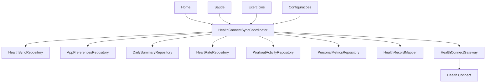
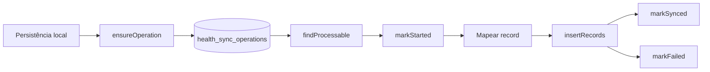
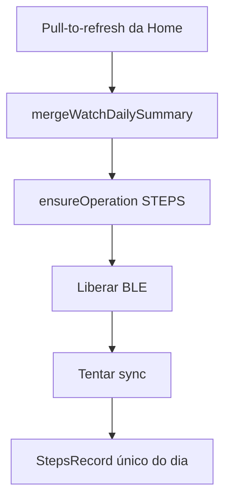
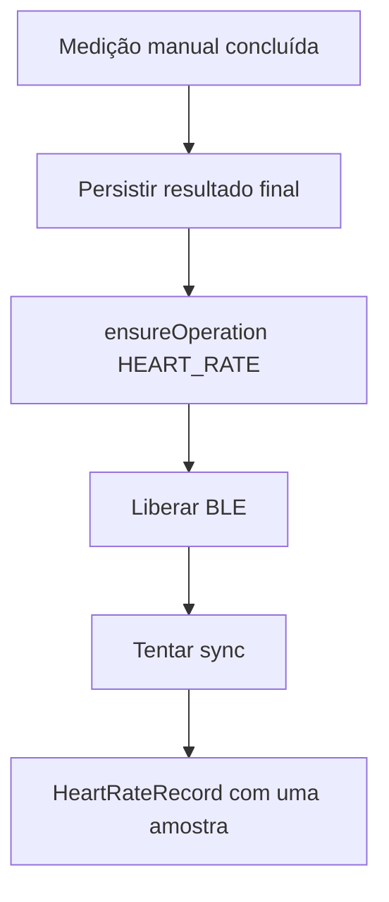
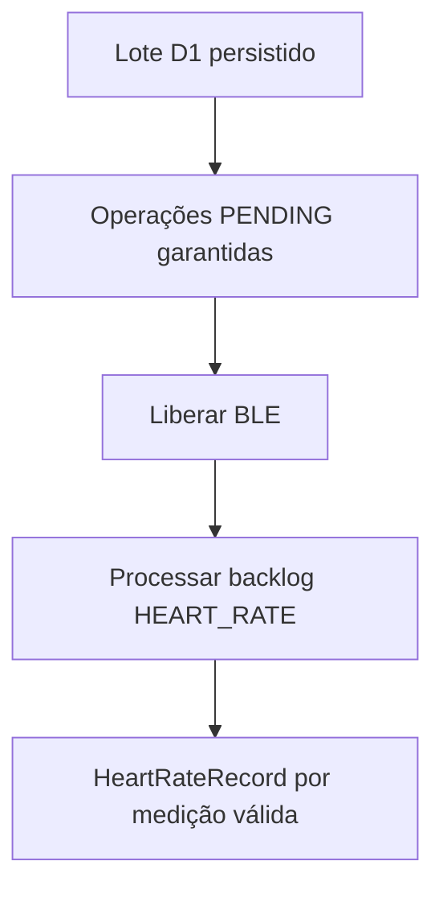
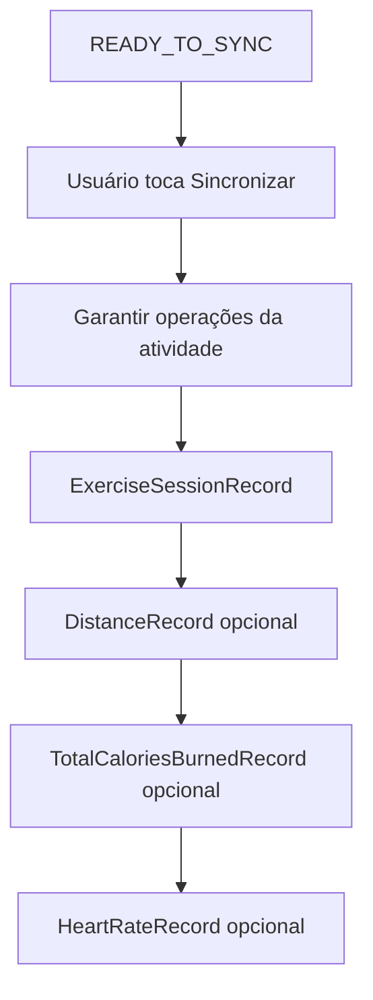
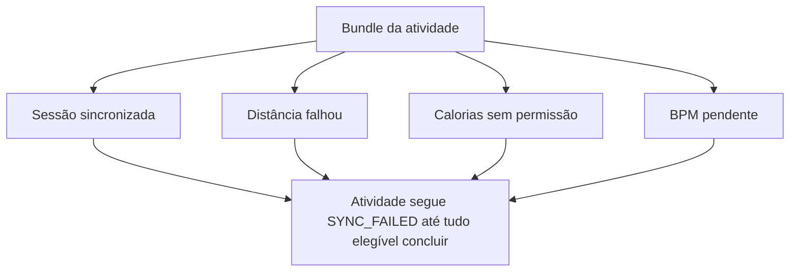
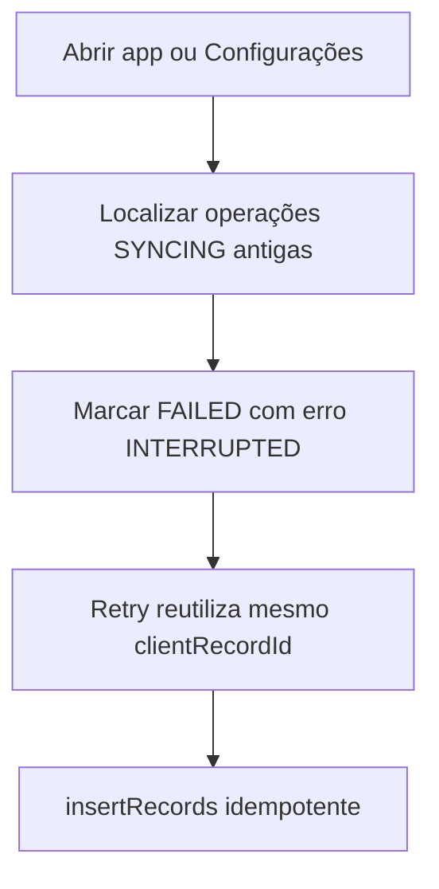

# Spec 012 - Health Connect nativo write-only com fila persistida

## Status

Concluída em 2026-07-28 após corrigir a identidade de sync por variante e repetir o Gate C afetado.

## Contexto

As Fases 07 a 11 já entregaram persistência local operacional para resumo diário, medição manual de frequência cardíaca, histórico D1, importação D3/D4, revisão de atividades, calibração de esteira, descarte lógico e atividades em `READY_TO_SYNC`.

A Fase 12 implementa a primeira integração real do Champion Companion com o Health Connect, preservando a arquitetura local-first:

```text
Dados locais
    ↓
Fila persistida
    ↓
Health Connect
    ↓
SYNCED ou FAILED
```

Room permanece fonte operacional e visual primária. O Health Connect é destino derivado de escrita.

## Documentos autoritativos

- `AGENTS.md`
- `docs/specs/_inputs/phase-12-native-health-connect-direction.md`
- `docs/roadmap/champion-companion-roadmap.md`
- `docs/baseline/current-baseline.md`
- `docs/baseline/health-connect-mapping.md`
- `docs/baseline/database-reference.md`
- `docs/baseline/feature-parity-checklist.md`
- `docs/baseline/gaps-and-open-questions.md`
- ADRs vigentes em `docs/decisions/`
- `docs/decisions/adr-010-d1-local-first-and-health-connect-phase-boundary.md`
- `docs/decisions/adr-011-activity-ready-to-sync-phase-boundary.md`
- `docs/decisions/adr-012-health-connect-write-only-and-granular-sync.md`
- `docs/specs/011-activity-review-calibration.md`
- `docs/tasks/011-activity-review-calibration/011-00-overview.md`

## Estado pós-Fase 11

- `DailySummary` já persiste passos locais por dia.
- `HeartRateMeasurement` já persiste medições manuais e D1.
- `HealthSyncOperation` já existe, mas ainda cobre apenas `HEART_RATE` e backlog D1.
- `WorkoutActivity` já possui `READY_TO_SYNC`, `SYNCING`, `SYNCED`, `SYNC_FAILED` e `DISCARDED` no domínio.
- `TreadmillCalibration` já preserva camada derivada local sem sobrescrever métricas importadas.
- `AppPreferences.healthSyncEnabled` já existe, mas ainda não participa do fluxo funcional.
- `SettingsScreen` ainda é placeholder.
- `ChampionDatabase` está em `v4`.

## Reconciliação documental herdada

A primeira task da fase deve reconciliar documentação atrasada da Fase 11 sem reabrir implementação funcional:

- overview da Fase 11;
- baseline factual;
- checklist de paridade;
- lacunas e perguntas abertas;
- task de fechamento pendente;
- visão factual de backlog local herdado.

Achados confirmados por `012-01`:

- Fase 11 foi reconciliada como concluída sem reabrir implementação funcional.
- `ChampionDatabase` segue em `v4` e ainda não possui campos de identidade estável de sync.
- `AndroidManifest.xml` ainda não possui permissões, queries ou Activity de rationale do Health Connect.
- `gradle/libs.versions.toml` e `app/build.gradle.kts` ainda não contêm `connect-client`.
- `AppPreferences.healthSyncEnabled` já existe, persiste em DataStore e ainda não participa do fluxo funcional.
- Backlog herdado real está distribuído por tipo: D1 com operação persistida, medição manual sem operação garantida, resumo diário sem operação garantida, atividades `READY_TO_SYNC` e dados locais de peso/altura elegíveis sem pipeline funcional de sync.

Achados confirmados por `012-03` e `012-04`:

- SDK `androidx.health.connect:connect-client:1.1.0` foi integrado ao catálogo e ao módulo `:app`.
- `AndroidManifest.xml` passou a declarar permissões write-only para passos, frequência cardíaca, exercício, distância, calorias totais, peso e altura.
- `AndroidManifest.xml` passou a declarar `queries` para `com.google.android.apps.healthdata`.
- rationale Activity foi adicionada com `androidx.health.ACTION_SHOW_PERMISSIONS_RATIONALE` e alias compatível com Android 14+ para `android.intent.action.VIEW_PERMISSION_USAGE` com categoria `android.intent.category.HEALTH_PERMISSIONS`.
- disponibilidade Android passou a ser modelada via `HealthConnectClient.getSdkStatus(...)`.
- `ChampionDatabase` subiu para `v5`.
- `DailySummaryEntity` ganhou `collectedZoneId` nullable para preparar congelamento futuro de timezone.
- `HealthSyncOperationEntity` ganhou metadados nullable de identidade, versão, sincronização, timezone e auditoria temporal, preservando backlog D1 existente.

Achados confirmados por `012-05`:

- `HealthSyncRepository` foi ampliado para cobrir `ensureOperation`, `findProcessable`, `observeSyncSummary`, `findOperationsForAggregate`, `markStarted`, `markSynced`, `markFailed`, `resetInterrupted` e `reconcileBacklog`.
- `RoomRepositories` passou a reconciliar backlog herdado de resumo diário, BPM manual, D1, peso e altura sem duplicar operações já persistidas.
- operações antigas sem `clientRecordId`, versão ou timestamps novos agora recebem repair idempotente antes do processamento normal da fila.
- atividades `READY_TO_SYNC` continuam excluídas da reconciliação genérica.

Achados confirmados por `012-06` e `012-07`:

- `HealthConnectGateway` foi adicionado sobre `HealthConnectClient`, cobrindo disponibilidade, permissões write-only concedidas e `insertRecords` sem leitura remota.
- `HealthRecordMapper` passou a mapear resumo diário, BPM manual, backlog D1, peso, altura e atividade para records reais do SDK, reutilizando `clientRecordId` e versão da fila persistida.
- granularidade de atividade foi estabilizada por record independente: sessão obrigatória, distância/calorias/BPM opcionais quando elegíveis, sem `StepsRecord` e sem rota.
- `ParserValidity.PARTIAL` passou a ser tratado por presença real de dados complementares, sem inventar métricas ausentes.

Achados confirmados por `012-08`:

- `HealthConnectSyncCoordinator` foi adicionado com resultados `Completed`, `CompletedWithFailures`, `NothingToSync`, `PermissionRequired`, `ProviderUnavailable`, `Disabled` e `Failed`.
- o coordinator passou a combinar reset de `SYNCING` interrompido, reconciliação de backlog, checagem de preferência, disponibilidade, permissões e processamento foreground limitado da fila.
- retry agora reutiliza `clientRecordId` da fila, processa apenas `PENDING|FAILED` e preserva records já sincronizados em cenários de falha parcial.
- workflow local de atividade passou a ser reconciliado a partir do estado real das operações granulares, permitindo que `012-09`, `012-10` e `012-11` avancem em paralelo sobre coordinator estável.

Achados confirmados por `012-09`, `012-10` e `012-11`:

- triggers automáticos pós-persistência foram conectados em Home e Saúde para passos, medição manual e backlog D1, sempre após liberação do gate BLE.
- sync explícito de atividade foi integrado no detalhe de Exercícios, com CTA dedicada, retry por atividade e preservação de falha parcial sem duplicar records já enviados.
- `Settings` deixou de ser placeholder e passou a mostrar disponibilidade, preferência, permissões por capacidade amigável, provider, fila local, `Sincronizar agora` e `Gerenciar acesso`.
- peso e altura continuam fora do pedido de permissão quando não há dado local elegível.

Achados confirmados por `012-12`:

- Home passou a mostrar Health Connect como estado secundário explícito e separado do refresh local do relógio.
- Saúde passou a expor sincronização do Health Connect como feedback subordinado ao sucesso local de medição manual, D1, passos e distância.
- Exercícios passou a resumir estados de sync do Health Connect com segurança na lista e no detalhe, incluindo falha parcial e retry seguro.
- falhas do provider não rebaixam sucesso local já persistido em nenhuma das três features.

Achado corretivo registrado antes de `012-15`:

- `RoomRepositories` usava o prefixo fixo `br.com.mwconsulting.championcompanion` na formação de todo `clientRecordId`;
- a variante debug usa `applicationId` final `br.com.mwconsulting.championcompanion.dev`, portanto a implementação diverge desta spec e da ADR-012;
- `012-15` passou a usar o `applicationId` final da variante, preservando chave natural, versão, fila, schema e comportamento release;
- validação física debug direcionada confirmou passos reconhecidos pelo provider; demais dados continuam sincronizando. A repetição integral de `012-13` permanece necessária.

## SDK

Dependência planejada:

```text
androidx.health.connect:connect-client:1.1.0
```

Regras:

- usar versão estável;
- não usar alpha sem requisito comprovado e ADR própria;
- integrar via version catalog e dependência do módulo `:app`.

## Disponibilidade

Estados mínimos planejados:

- `Available`
- `ProviderUpdateRequired`
- `Unavailable`

Comportamento:

- `Available`: permite ler permissões concedidas, abrir conexão e processar fila.
- `ProviderUpdateRequired`: mantém backlog local, informa correção e oferece abertura do destino apropriado.
- `Unavailable`: não pede permissão, não tenta escrita e preserva fila local.

Infra Android real desta fase usa `HealthConnectClient.getSdkStatus(context, providerPackageName)` para modelar esses estados.

## Provider

O app deve encapsular `HealthConnectClient` atrás de gateway Android-free. A integração é write-only nesta fase.

Package do provider integrado no manifesto e na infra Android:

```text
com.google.android.apps.healthdata
```

Não implementar:

- leitura do Health Connect;
- leitura de dados de terceiros;
- `ChangeLogs`;
- reconciliação baseada em leitura remota.

## Permissões

Solicitar apenas permissões de escrita, agrupadas por capacidade amigável:

- Passos
- Frequência cardíaca
- Exercícios
- Distância
- Calorias
- Peso
- Altura

Regras:

- não pedir leitura;
- não exigir peso e altura para passos ou BPM;
- não exigir distância e calorias para escrever sessão de exercício;
- pedir peso e altura somente quando houver dado local elegível.

## Rationale

Deve existir Activity de rationale de privacidade, explicando:

- quais tipos são enviados;
- por que são enviados;
- que Room continua sendo fonte operacional;
- que nenhuma rota é enviada;
- como pausar sincronização;
- como gerenciar permissões;
- como os dados são tratados.

Integração real desta fase também passou a declarar:

- Activity para `androidx.health.ACTION_SHOW_PERMISSIONS_RATIONALE`;
- alias para Android 14+ com `android.intent.action.VIEW_PERMISSION_USAGE` e categoria `android.intent.category.HEALTH_PERMISSIONS`.

## Política formalizada

`012-02` formaliza em ADR própria:

- write-only;
- Room como fonte operacional e visual primária;
- triggers assimétricos por tipo;
- atividade somente com ação explícita;
- IDs determinísticos por agregado e tipo;
- versões monotônicas;
- granularidade por record;
- falha parcial por complemento de atividade;
- permissões agrupadas por capacidade;
- ausência de `Steps` por atividade;
- ausência de `WorkManager` na fase.

## Preferência

Reutilizar `AppPreferences.healthSyncEnabled`.

Regras:

- desativada: persistir local, manter `PENDING` ou `FAILED`, não tentar automaticamente;
- ativada: verificar disponibilidade, pedir permissões em contexto explícito, reconciliar backlog e processar tipos autorizados;
- desativar não apaga dados locais nem records já escritos.

## Arquitetura



Fronteiras:

- Compose não acessa `HealthConnectClient`;
- ViewModel não cria records;
- mapper não acessa Room;
- gateway não interpreta regra de produto;
- repository não acessa APIs Android do Health Connect;
- coordinator controla fila, transições, retry foreground e resultado seguro.

## Fila persistida



Contratos estabilizados em `012-05`:

- `ensureOperation(...)`
- `findProcessable(...)`
- `observeSyncSummary(...)`
- `findOperationsForAggregate(...)`
- `markStarted(...)`
- `markSynced(...)`
- `markFailed(...)`
- `resetInterrupted(...)`
- `reconcileBacklog(...)`

Regras:

- chave natural por agregado e tipo de record;
- duplicata não cria nova operação;
- `SYNCED` não volta para `PENDING` sem nova versão local;
- `FAILED` é repetível;
- `SYNCING` abandonado volta a estado recuperável;
- limite inicial foreground: 100 operações por execução.

## Migration

Base atual após `012-04`: schema `v5`.

Migration `v4 -> v5` contemplou:

- expansão de `health_sync_operations` com `clientRecordId`, `clientRecordVersion`, `syncedAt`, `timeZoneId`, `createdAt` e `updatedAt` nullable;
- índices adicionais para `clientRecordId` e ordenação por estado/atualização;
- `collectedZoneId` nullable em `daily_summaries` para preparar congelamento futuro de timezone.

Regras:

- operações D1 existentes não podem ser perdidas;
- campos impossíveis de preencher em migration podem nascer nullable;
- repository deve fazer repair idempotente antes de processar operação antiga.

## Aggregates

Aggregates planejados para fila:

- `DailySummary`
- `HeartRateMeasurement`
- `WorkoutActivity`
- `WeightMeasurement`
- `UserProfileHeight`

## Record types

Tipos planejados:

- `STEPS`
- `HEART_RATE`
- `EXERCISE_SESSION`
- `DISTANCE`
- `TOTAL_CALORIES_BURNED`
- `WEIGHT`
- `HEIGHT`

## IDs estáveis

Formato determinístico planejado:

```text
<applicationId>:<aggregateType>:<aggregateId>:<recordType>
```

Regras:

- não usar valor aleatório por tentativa;
- não usar timestamp atual como ID;
- retry usa mesmo ID;
- não incluir BPM, passos, distância, peso, altura, título ou notas.

## Versões

- resumo diário: derivada de `updatedAt`;
- BPM manual e D1: estável por registro local imutável;
- atividade: derivada da revisão mais recente entre importação, revisão e calibração;
- peso: `measuredAt` ou equivalente local monotônico;
- altura: `updatedAt` do perfil.

Atualização local deve produzir versão maior que a já enviada.

## Upsert

Usar `insertRecords` com:

- `clientRecordId`
- `clientRecordVersion`

Não depender de leitura prévia remota.

Não apagar `Steps` por intervalo antes de inserir.

## Passos

Origem local: `DailySummary`.



Regras:

- um único `StepsRecord` por resumo diário;
- mesmo `clientRecordId` em todos os refreshes do mesmo dia;
- refresh repetido atualiza o mesmo record;
- não criar `StepsRecord` separado para atividade;
- para dia corrente, usar fim no instante coletado;
- para dia encerrado, usar fim no início do dia seguinte no timezone congelado.

## BPM manual

Origem local: `MANUAL_MEASUREMENT`.



Regras:

- uma operação por medição persistida;
- uma amostra por record;
- usar timestamp exato da medição;
- manter idempotência por `clientRecordId`.

## D1

Origem local: `WATCH_D1_HISTORY`.



Regras:

- enviar todos os pontos válidos persistidos;
- uma operação por medição persistida;
- sem seleção individual;
- repair idempotente para operações antigas sem identidade nova.

## Atividade

Atividade local só sincroniza por ação explícita do usuário.



### Sessão

Usar:

- início;
- fim;
- tipo confirmado;
- título;
- observações.

Exigir:

- `READY_TO_SYNC` ou `SYNC_FAILED`;
- tipo confirmado;
- duração positiva;
- sessão temporal válida.

### Tipo de exercício

Mapeamento explícito:

- `WALKING`
- `RUNNING`
- `TREADMILL`
- `FREE_WORKOUT`

Quando não houver correspondência exata, usar tipo conservador.

### Distância

Prioridade:

1. calibrada
2. original
3. estimada
4. ausente

Não criar record quando valor for ausente, não finito ou não positivo.

### Calorias

Criar somente quando valor existir, for finito, positivo e a permissão correspondente estiver concedida.

### BPM da atividade

Usar amostras reais persistidas dentro da sessão.

Quando não houver amostras:

- omitir record;
- não inventar amostra a partir de média.

### Passos da atividade

Não criar record separado. Os passos do treino continuam apenas como dado local exibido no detalhe.

### PARTIAL

`ParserValidity.PARTIAL` pode sincronizar somente dados realmente presentes.

Regras:

- não inventar métricas ausentes;
- exigir sessão temporal válida;
- falhar com erro seguro quando dados mínimos não formarem record válido.

## Granularidade e falha parcial



Regras:

- sessão sincronizada não deve ser apagada se complemento falhar;
- marcar somente operação complementar como `FAILED`;
- retry processa apenas pendentes ou falhas;
- atividade só vira `SYNCED` quando todas as operações elegíveis concluírem.

## Peso

Record planejado: `WeightRecord`.

Origem local: `weight_measurements` existentes.

Regras:

- valor positivo e finito;
- timestamp persistido;
- uma operação por medida;
- não usar `Instant.now()` como fallback silencioso.

## Altura

Record planejado: `HeightRecord`.

Origem local: altura persistida no perfil.

Regras:

- converter centímetros para metros;
- valor positivo e finito;
- usar `updatedAt`;
- não solicitar permissão quando não houver altura local.

## Gatilhos

Gatilhos exatos da fase:

```text
Passos:
persistir -> liberar BLE -> tentar sync

BPM manual:
persistir -> liberar BLE -> tentar sync

D1:
persistir lote -> liberar BLE -> processar backlog

Atividade:
READY_TO_SYNC -> ação explícita -> sync
```

Com `healthSyncEnabled` desativado:

```text
persistir -> manter PENDING -> não tentar
```

## Backlog

Reconciliação genérica em habilitar integração ou `Sincronizar agora`:

- operações D1 existentes;
- medições manuais válidas sem operação;
- resumos diários válidos sem operação;
- peso persistido elegível;
- altura persistida elegível.

Atividades `READY_TO_SYNC` não entram em reconciliação genérica. Exigem ação explícita própria.

Implementação atual de `012-05` preserva operações D1 existentes, repara metadados legados quando faltantes e deixa workflow explícito de atividade para `012-10`.

## Workflow

- `PENDING` -> `SYNCING` -> `SYNCED`
- `PENDING` -> `SYNCING` -> `FAILED`
- `FAILED` -> retry -> `SYNCING`
- atividade: `READY_TO_SYNC` ou `SYNC_FAILED` -> `SYNCING` -> `SYNCED|SYNC_FAILED`

## Coordinator

Responsabilidades planejadas de `HealthConnectSyncCoordinator`:

- reconciliar backlog;
- verificar `healthSyncEnabled`;
- verificar disponibilidade;
- verificar permissões por record;
- marcar início;
- carregar agregado;
- mapear record;
- executar upsert;
- marcar sucesso ou falha;
- atualizar workflow de atividade;
- limitar processamento;
- não executar BLE.

## Gateway

Interface planejada de `HealthConnectGateway`:

- `getAvailability()`
- `getGrantedPermissions()`
- `insert(records)`
- `openProviderUpdate()`
- `openManageAccess()`

Delete por `clientRecordId` pode existir como infraestrutura, mas não é fluxo obrigatório desta fase.

## Settings

`SettingsScreen` deve deixar de ser placeholder e exibir:

- status de disponibilidade;
- integração ativada ou pausada;
- permissões concedidas e faltantes;
- provider;
- ação `Conectar`;
- ação `Sincronizar agora`;
- ação `Gerenciar acesso`;
- pendentes;
- falhas;
- última sincronização.

## Home

- resumo local continua mensagem principal;
- Health Connect aparece como estado secundário;
- falha do provider não desfaz resumo diário;
- pull-to-refresh não deve esperar fim do processamento HC.

## Saúde

- medição manual e D1 continuam locais-first;
- Health Connect aparece como contagem secundária segura;
- falha do provider não transforma sucesso local em falha principal.

## Exercícios

- detalhe deve expor CTA explícita `Sincronizar com Health Connect` em `READY_TO_SYNC`;
- `SYNCING` mostra progresso/estado;
- `SYNCED` mostra data da sincronização;
- `SYNC_FAILED` mostra erro seguro, grupos pendentes e retry.

## Lifecycle

- sincronização foreground pode continuar enquanto ViewModel dono estiver ativo;
- não iniciar serviço;
- não iniciar `WorkManager`;
- morte de processo preserva fila;
- operações `SYNCING` abandonadas devem ser reparadas.

## Recuperação após morte de processo



Atividades em `SYNCING` sem operação ativa correspondente voltam para `SYNC_FAILED`.

## Erros seguros

Categorias mínimas planejadas:

- `PERMISSION_REQUIRED`
- `PROVIDER_UNAVAILABLE`
- `PROVIDER_UPDATE_REQUIRED`
- `INVALID_LOCAL_DATA`
- `WRITE_REJECTED`
- `RETRY_LATER`
- `INTERRUPTED`
- `INTERNAL`

Não persistir stack trace nem mensagens completas do provider.

## Logging

Pode registrar:

- disponibilidade;
- categoria da permissão;
- quantidade de operações;
- tipo de record;
- transição de estado;
- duração da execução;
- categoria do erro.

Não registrar:

- valores de saúde;
- payloads completos;
- `clientRecordId` completo;
- IDs locais completos;
- título;
- notas.

## Privacidade

- manter `allowBackup=false`;
- manter ausência de servidor;
- manter ausência de rota;
- não expor dados sensíveis em logs;
- solicitar somente tipos usados por funcionalidades visíveis.

## Gate C

Validação física obrigatória no Galaxy S22 com Health Connect real para:

- disponibilidade;
- permissões parciais;
- passos;
- update sem duplicação;
- BPM manual;
- backlog D1;
- atividade explícita;
- atividade calibrada;
- ausência de `StepsRecord` da atividade;
- ausência de rota;
- falha parcial;
- retry;
- preferência pausada;
- recuperação após processo encerrado;
- peso e altura quando elegíveis;
- privacidade.

## Fronteira com Fase 14


A Fase 12 não implementa `WorkManager`, retry em background, foreground service ou sync periódico. Essa fronteira deve permanecer explícita.

## Critérios de aceite

- SDK estável integrado;
- disponibilidade funcional;
- provider ausente ou desatualizado tratado;
- rationale existente;
- `Settings` funcional;
- preferência pausar/retomar funcional;
- permissões por capacidade;
- fila suportando tipos planejados;
- operações D1 preservadas;
- `clientRecordId` estável;
- versões monotônicas;
- passos sincronizando após refresh persistido;
- BPM manual sincronizando após persistência;
- backlog D1 processado sem seleção individual;
- atividades não sincronizando automaticamente;
- atividade `READY_TO_SYNC` sincronizada por ação explícita;
- sessão usando tipo, título e observações confirmados;
- esteira usando distância calibrada;
- distância, calorias e BPM como records granulares;
- passos de atividade não enviados separadamente;
- falha parcial retomável;
- morte de processo sem perda de fila;
- peso e altura sincronizando quando elegíveis;
- nenhuma rota enviada;
- nenhum teste automatizado criado, alterado, executado ou planejado;
- `lint`, `assembleDebug`, `assembleRelease` e `installDebug` concluídos na execução da fase;
- Gate C físico validado;
- documentação refletindo estado final.

## Registro de execução do Gate C

Execução física realizada em 2026-07-28 no Galaxy S22 `SM-S901E`, com debug `br.com.mwconsulting.championcompanion.dev` e provider real `com.google.android.apps.healthdata`.

- builds `lint`, `assembleDebug`, `assembleRelease` e `installDebug` concluídos;
- disponibilidade, origem debug, permissões parciais, BPM manual e rationale de privacidade confirmados;
- refresh de passos, fila, D1, atividades, falha parcial, retry, preferência pausada, recuperação de processo, peso/altura quando elegíveis, ausência de `StepsRecord` de atividade e ausência de rota foram informados como funcionando na validação manual adicional do usuário;
- builds e instalação debug permaneceram aprovados;
- Gate C foi concluído; `012-14` está liberada para fechamento documental.

## Fora do escopo

- leitura do Health Connect;
- importação de dados de outros apps;
- `ChangeLogs`;
- `WorkManager`;
- retry em background;
- foreground service;
- sincronização periódica;
- sincronização ao abrir app;
- rota;
- GPS;
- `ExerciseRoute`;
- backup;
- formulário completo de perfil;
- exercícios iniciados pelo app;
- testes automatizados.

## Definition of Done

- spec, overview e tasks atualizados;
- backlog herdado reconciliado documentalmente;
- ADR da fase criada;
- roadmap e baseline alinhados no fechamento da fase;
- build e instalação registrados nas tasks de implementação;
- evidências manuais e screenshots visuais registradas quando aplicáveis;
- nenhum teste automatizado criado, alterado, executado ou recomendado.

## Matriz de rastreabilidade

| Tema | Tasks principais |
| --- | --- |
| Reconciliação Fase 11 | `012-01`, `012-14` |
| Política arquitetural e ADR | `012-02` |
| SDK, manifesto, rationale, disponibilidade | `012-03` |
| Record types, IDs, versões, schema, migration | `012-04` |
| Fila persistida e backlog | `012-05` |
| Gateway e mapeadores de passos, BPM, peso e altura | `012-06` |
| Mapeadores de atividade e complementos | `012-07` |
| Coordinator, partial, retry, interrupted | `012-08` |
| Triggers pós-persistência para passos, manual e D1 | `012-09` |
| Sync explícito de atividade e workflow | `012-10` |
| Settings, permissões e manage access | `012-11` |
| Feedback secundário em Home, Saúde e Exercícios | `012-12` |
| Gate C físico | `012-13` |
| Fechamento documental da fase | `012-14` |
| Identidade de sync por variante | `012-15` |

## Adendo posterior — distância temporal em exercícios da Fase 13

A Fase 12 permanece concluída, write-only e sem rota. Seu mapeamento histórico
de atividade usava um complemento `DISTANCE` agregado. A Fase 13, por meio de
`013-14`, corrige esse comportamento para exercícios processados no novo fluxo:
cada intervalo elegível deve produzir `DistanceRecord` temporal, positivo,
ordenado e não sobreposto, com delta da mesma fonte da atividade.

Sessão phone usa a série de distância phone; watch-only usa intervalos D3/D4
quando reconstruíveis; atividade phone correlacionada não usa distância,
intervalos ou total do relógio. A correção não autoriza distribuição temporal
inventada, não apaga records de terceiros e deve impedir coexistência do
agregado legado com a série corrigida. Este adendo não reabre subtarefas da
Fase 12 nem altera sua validação histórica.
