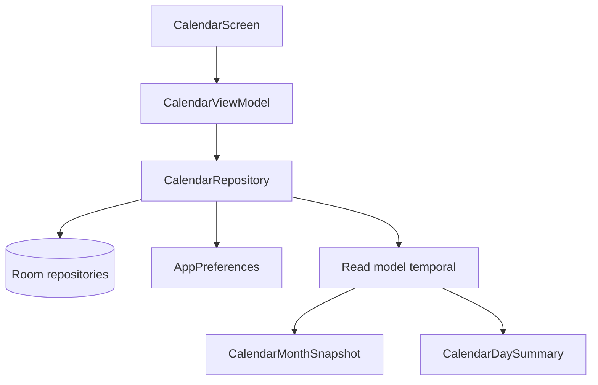
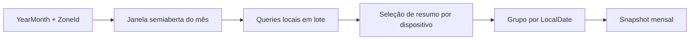
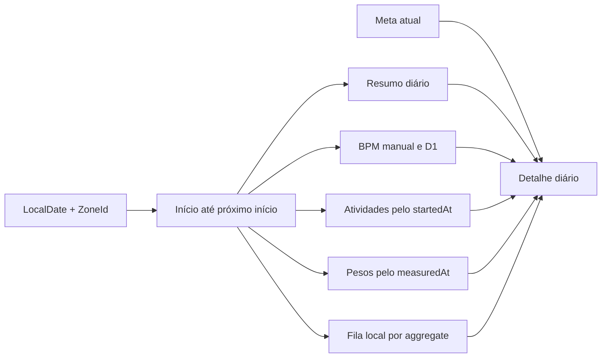
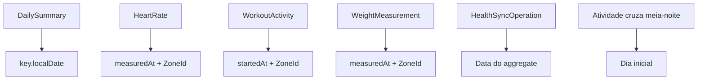
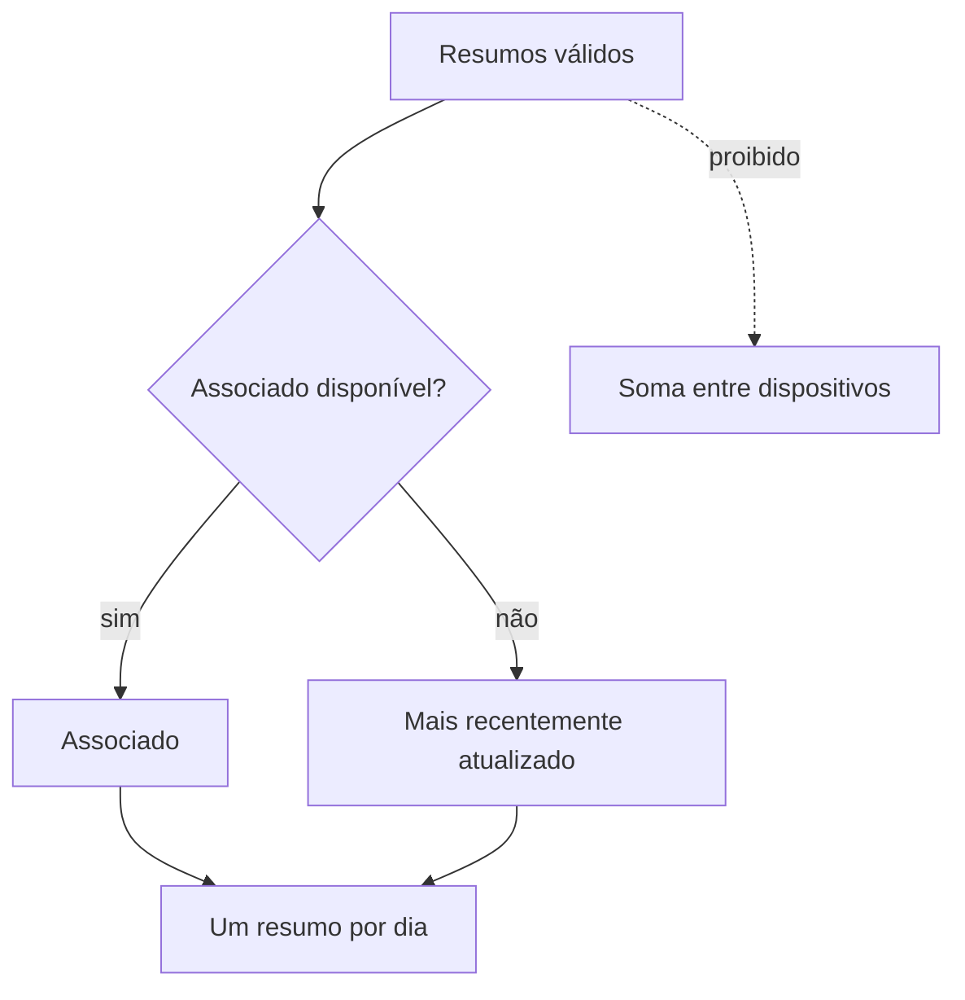
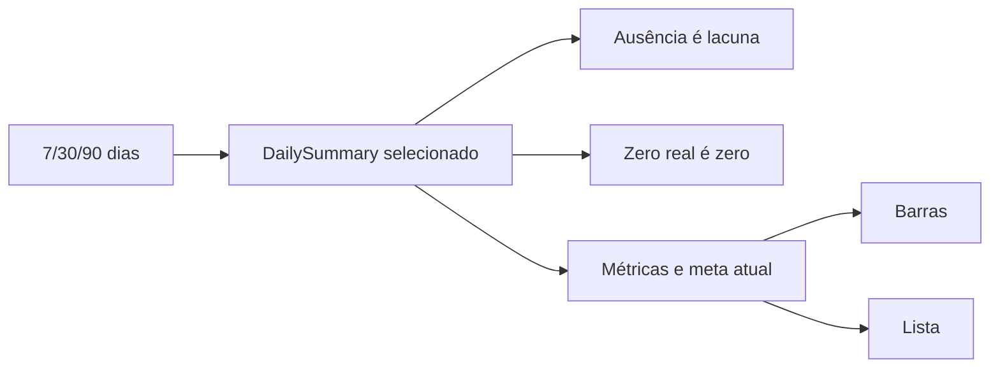
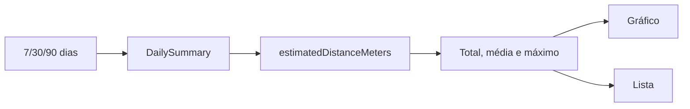
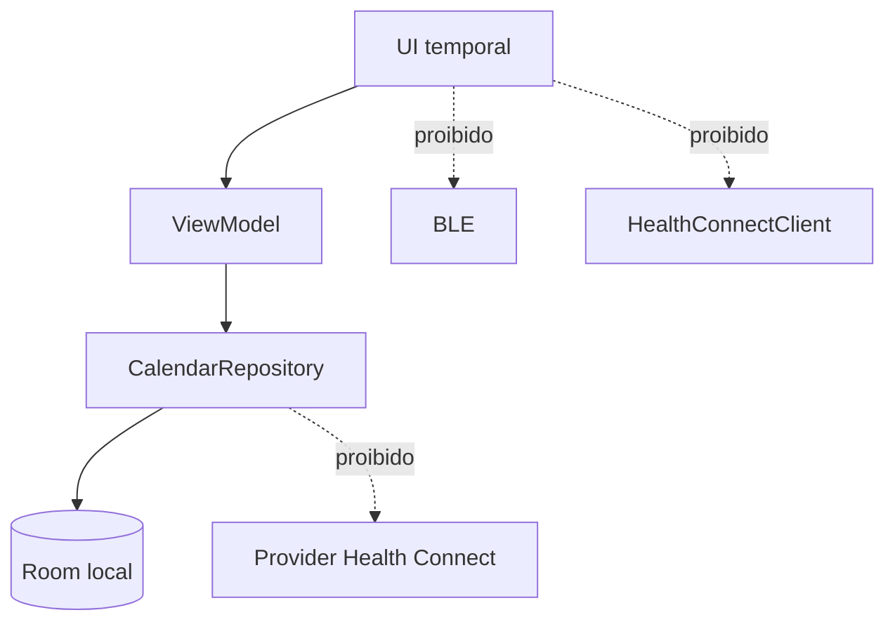

# Fase 15 — Calendário e histórico consolidado local

- **Ticker:** `015`
- **Status:** concluída em 29/07/2026.
- **Base:** pós-Fase 12, com Fases 13 e 14 adiadas
- **Fonte de direção:** [phase-15-calendar-consolidated-history-direction.md](_inputs/phase-15-calendar-consolidated-history-direction.md)

## Contexto

As Fases 07 a 12 deixaram dados locais persistidos para resumos diários, passos,
distância estimada, frequência cardíaca manual e D1, amostras de frequência
cardíaca de atividades importadas,
revisão e calibração de atividades, peso e fila local de Health Connect. Saúde
possui shells de passos e distância; Calendário ainda é placeholder.

Room continua fonte operacional e visual primária. Health Connect é destino
write-only. A Fase 15 deve transformar dados já persistidos em projeção temporal
local, sem iniciar coleta, sincronização ou escrita de dados.

## Estado pós-Fase 12

- Fase 12 está considerada concluída, com fila granular e integração foreground
  write-only do Health Connect.
- O provider não é consultado para formar telas.
- `DailySummary`, `HeartRateMeasurement`, `WorkoutActivity`,
  `WeightMeasurement` e `HealthSyncOperation` já existem no domínio/Room.
- Histórico local dedicado de BPM já suporta `MANUAL_MEASUREMENT` e
  `WATCH_D1_HISTORY` com janela semiaberta; a subtarefa 015-14 deve incluir
  também `WATCH_WORKOUT_ACTIVITY` a partir das amostras de atividades persistidas.
- `CalendarScreen` é placeholder e não há `CalendarRepository` ou
  `CalendarViewModel`.
- Passos e distância possuem apenas detalhes atuais e shells de histórico.
- Atividades possuem workflows locais e detalhe reutilizável em
  `ExercisesScreen`.
- Room está na versão 5.

## Fases adiadas e ordem autoritativa

Não renumerar fases.

- **Fase 12 — concluída.**
- **Fase 13 — adiada:** exercícios iniciados pelo aplicativo.
- **Fase 14 — adiada:** background, WorkManager e foreground service.
- **Fase 15 — concluída:** calendário e histórico consolidado local.

As tasks 015-01 e 015-02 devem planejar a atualização documental do roadmap e
de ADR. Esta execução de planejamento não altera ADR existente nem roadmap.

## Objetivo

Entregar uma experiência temporal local e read-only:

```text
Room e repositories locais
        ↓
Read model temporal
        ↓
Calendário mensal
        ↓
Detalhe diário
        ↓
Históricos de passos e distância
```

O usuário poderá navegar por mês, selecionar um dia, consultar os dados locais
consolidados e abrir detalhes relacionados sem iniciar operações externas.

## Requisitos funcionais

### Projeção e camadas

O fluxo obrigatório é:

```text
CalendarScreen
    ↓
CalendarViewModel
    ↓
CalendarRepository
    ↓
Room e AppPreferences
```

O repository retorna modelos consolidados, nunca entities. A UI não acessa DAO,
Room, BLE, `HealthConnectClient` ou DataStore diretamente.

O read model será derivado em memória sobre tabelas existentes. Não haverá tabela
materializada de calendário.

### Semântica de datas

Aplicar exatamente:

```text
DailySummary → key.localDate
HeartRate → measuredAt no ZoneId selecionado
WorkoutActivity → startedAt no ZoneId selecionado
WeightMeasurement → measuredAt no ZoneId selecionado
HealthSyncOperation → data do aggregate local
```

Atividade que cruza meia-noite pertence ao dia inicial, definido por
`startedAt`. Nunca usar `syncedAt` como data do dado.

Todas as consultas temporais novas usam:

```text
[fromInclusive, untilExclusive)
```

Não usar fim de dia artificial com milissegundos. `ZoneId` deve ser explícito no
read model e congelado durante a formação de cada consulta/snapshot.

### Múltiplos dispositivos

Para cada data:

1. selecionar resumo válido do dispositivo associado;
2. se inexistente, selecionar resumo válido mais recentemente atualizado;
3. nunca somar resumos completos de dispositivos diferentes.

Desempates devem ser determinísticos. Ausência de resumo é diferente de resumo
válido com zero passos.

### Passos e meta

Passos diários vêm exclusivamente de `DailySummary.steps`. Não somar passos de
atividades. Usar a meta vigente em `AppPreferences.dailyStepsGoal` e exibir
explicitamente o rótulo **Meta atual**. Não criar meta histórica nesta fase.

Para períodos de 7, 30 e 90 dias, mostrar:

- total;
- média por dia com registro;
- máximo;
- dias registrados;
- dias que atingiram a meta atual;
- barras;
- lista textual.

Dia ausente não vira zero. Registro real com zero permanece zero.

### Distância

Distância diária vem exclusivamente de
`DailySummary.estimatedDistanceMeters`. Não somar distância de exercícios.
Distâncias de exercícios aparecem apenas nos respectivos cards de atividade.

Para períodos de 7, 30 e 90 dias, mostrar:

- total dos dias com valor;
- média por dia com valor;
- máximo;
- dias com estimativa;
- dias sem estimativa;
- gráfico;
- lista textual.

Dia sem estimativa permanece ausente/indisponível, não zero sintético.

### BPM

No histórico dedicado de frequência cardíaca da tela Saúde, consolidar somente
fontes reais persistidas:

```text
MANUAL_MEASUREMENT
WATCH_D1_HISTORY
WATCH_WORKOUT_ACTIVITY
```

Calcular quantidade, média, mínimo, máximo e última leitura. Para
`WATCH_WORKOUT_ACTIVITY`, ler diretamente `workout_heart_rate_samples` somente
quando a atividade importada associada não estiver `DISCARDED`, usando
`sampledAt` na janela semiaberta. Não copiar, duplicar ou fingir essas amostras
como `HeartRateMeasurement`; o read model deve preservar identidade e contexto
da atividade. Reutilizar a semântica de validade e janela do histórico local já
existente para fontes manual e D1.
O resumo de BPM do detalhe diário do calendário permanece limitado às fontes
manuais e D1 previstas nesta fase; esta inclusão vale para a página dedicada de
frequência cardíaca.

### Atividades

Usar atividades não descartadas, associadas à data de `startedAt` no timezone
selecionado. Mostrar workflows atuais e os dados já persistidos. Reutilizar o
detalhe existente de `ExercisesScreen`/`ExerciseDetail`; não duplicar tela nem
alterar workflows.

### Peso

Mostrar medidas existentes que pertençam ao dia no timezone selecionado. Não
implementar edição, gerenciamento ou histórico completo de peso.

### Sincronização

Consultar somente `HealthSyncOperation` local, em lote e por aggregate. Não
consultar provider externo.

Estados apresentados:

```text
Sem operações
Pendente
Sincronizando
Sincronizado
Falha
Parcial
```

Presença de operação não prova validade do aggregate. Falha de sync não remove
nem oculta dado local válido.

### Calendário mensal

O calendário deve suportar:

- mês anterior;
- próximo mês;
- Hoje;
- localidade e nomes dos dias da semana;
- seleção de data;
- indicação de hoje;
- indicadores de presença por célula;
- legenda;
- estados vazios;
- loading e erro recuperável;
- acessibilidade para navegação, seleção e indicadores.

Não adicionar biblioteca externa de calendário sem justificativa arquitetural
separada.

### Detalhe diário

O detalhe diário consolida passos, distância, BPM, atividades, peso e status de
sincronização. Cada ausência deve ser distinguível de zero ou de falha quando a
fonte estiver indisponível.

### Navegação

Adicionar rota parametrizada:

```text
CalendarDay(localDateIso)
```

Validar com `LocalDate.parse` de forma segura. Fluxo:

```text
Calendário → Dia → Detalhes relacionados
```

Ao abrir atividade, reutilizar `ExerciseDetail`, preservar o dia e manter o
back stack manual. Voltar deve remover o destino atual, não navegar novamente
para um pai.

### Estado de `CalendarViewModel`

O estado deve ser equivalente a:

```text
selectedMonth
selectedDate
monthSnapshot
dayDetail
monthLoading
dayLoading
error
```

Intents:

```text
Load
PreviousMonth
NextMonth
GoToToday
SelectDate
OpenDate
Retry
DismissError
```

## Requisitos não funcionais

- Local-first e read-only.
- Nenhum acesso a BLE, Health Connect, permissões, conexão, refresh, D1, D3,
  D4, WorkManager ou foreground service.
- Nenhuma tabela nova, migration ou índice preventivo inicialmente.
- Consultas por intervalo semiaberto.
- Evitar N+1 em atividades e operações de sincronização.
- Preservar ausência como ausência.
- Não expor dados pessoais ou métricas em logs.
- Respeitar `allowBackup=false` e regras de backup existentes.
- Não introduzir GPS, latitude, longitude, rota, GPX ou localização.
- Manter módulo único `:app`, Hilt, Navigation 3 e back stack manual.
- Mudanças visuais exigem screenshot durante validação manual.
- Cada task é executável em sessão nova.
- Não criar, alterar ou executar testes automatizados.

## Arquitetura e read model

Modelos temporais ficam em `core/model`, sem dependência de Compose ou entities:

- `CalendarMonthQuery`;
- `CalendarMonthSnapshot`;
- `CalendarDayPresence`;
- `CalendarDaySummary`;
- resumos tipados de BPM, atividades, peso e sync;
- `CalendarHistoryQuery`;
- snapshots de passos e distância.

Recomenda-se `LocalCalendarRepository` em `data/`, composto sobre contratos
locais existentes e `AppPreferencesRepository`. Ele deve observar fontes em
lote, selecionar um resumo por data, agrupar eventos e produzir snapshots
imutáveis.

### Ausência de tabela materializada

O calendário é projeção derivada. Não persistir células, marcadores, resumos
consolidados ou status de calendário. Não criar migration. Alteração de timezone
somente reprojeta dados; não altera registros históricos.

### Queries e contratos

Planejar contratos equivalentes a:

```text
observeMonth(query)
observeDay(localDate, zoneId)
```

Ampliar, de forma aditiva, operações equivalentes a:

```text
WorkoutActivityRepository.observeActivitiesBetween(...)
PersonalMetricsRepository.observeWeightsBetween(...)
HealthSyncRepository.observeForAggregates(...)
```

Reutilizar contratos temporais de resumo diário e BPM, adaptando a query de
resumo inclusiva existente sem quebrar consumidores atuais.

Atividades devem usar projeção leve, sem carregar detalhes de intervalos e
amostras para a grade. Sync deve consultar agregados em lote, com chunking se o
limite de parâmetros SQLite exigir.

## Diagramas

### Arquitetura



### Formação do mês



### Formação do dia



### Semântica de datas



### Múltiplos dispositivos



### Navegação

```mermaid
flowchart LR
    Calendar[Calendar] --> Day[CalendarDay(localDateIso)]
    Day --> Related[Detalhes relacionados]
    Related --> Exercise[ExerciseDetail(activityId)]
    Exercise -->|pop| Day
    Day -->|pop| Calendar
```

### Histórico de passos



### Histórico de distância



### Fronteira local sem BLE/Health Connect



## Detalhamento obrigatório do read model e da UI

### Presença diária

`CalendarDayPresence` deve expor `hasSteps`, `hasHeartRate`, `workoutCount`,
`hasWeight`, `hasSyncPending` e `hasSyncFailure`. A célula não acessa entities.

### Resumo diário

`CalendarDaySummary` deve conter `localDate`, `dailySummary`, `stepsGoal`,
`heartRateSummary`, `workouts`, `weightMeasurements` e `syncSummary`.
O resumo de passos deve exibir origem e última atualização. A meta deve ser
rotulada **Meta atual**, sem afirmar que era a meta histórica daquela data.

### BPM

O resumo diário de BPM contém quantidade, média, mínimo, máximo e última
medição, apenas de registros válidos com timestamp dentro da janela, mantendo
as fontes manual e D1 previstas pelo read model do calendário. Amostras de
atividade permanecem somente no histórico dedicado da tela de frequência
cardíaca: vêm diretamente de `workout_heart_rate_samples`, permanecem
vinculadas à atividade importada não descartada e não são materializadas em
`heart_rate_measurements`.

### Atividades

Atividades não `DISCARDED` permanecem visíveis, inclusive pendentes de revisão
ou calibração. Cards mostram título ou fallback, tipo confirmado ou sugerido,
início, duração, distância final, calorias, BPM médio, workflow e status de
sync. Distância final segue precedência `calibrada → original → estimada →
indisponível`. A distância do card nunca participa dos totais diários.

### Peso

Medidas do dia são ordenadas da mais recente para a mais antiga. A mais recente
é o resumo; as demais permanecem na lista do detalhe. Não há cadastro, edição,
exclusão, meta ou gráfico completo de peso.

### Sincronização

`CalendarSyncSummary` contém `pendingCount`, `syncingCount`, `failedCount` e
`syncedCount`. Aplicar a tabela ordenada exata: sem operações produz `Sem
operações`; sucesso combinado (`syncedCount > 0`) com qualquer pendência,
sincronização ou falha produz `Parcial`; sem sucesso combinado, qualquer falha
produz `Falha`; sem falha, qualquer sincronização produz `Sincronizando`; sem
falha ou sincronização, qualquer pendência produz `Pendente`; `Sincronizado`
somente quando todas as operações estão concluídas.
Aggregate ausente, operação órfã e degradação parcial devem ser representados
com estado seguro, sem associar operação por `syncedAt`.

### Calendário e datas especiais

O título mostra mês e ano completos. O primeiro dia da semana segue a
localidade atual. Dias fora do mês podem ser ocultados ou ter contraste
reduzido, mas não podem abrir outro mês sem atualizar seleção. Datas futuras
podem ser selecionadas e mostram estado vazio, sem valores simulados. Células
priorizam erro/pendência, atividade, BPM e passos, com descrição acessível
completa.

### Histórico e unidades

Listas históricas mostram data, valor, origem, última atualização e, para
distância, indicação explícita de estimativa. Metros permanecem no domínio;
quilômetros são usados na apresentação. Dias ausentes não entram como zero.

## Arquivos, módulos e símbolos afetados

Arquivos prováveis:

- `app/src/main/java/.../feature/calendar/CalendarScreen.kt`;
- `app/src/main/java/.../feature/calendar/CalendarFeatureContract.kt`;
- futuro `feature/calendar/CalendarViewModel.kt`;
- `core/model/RepositoryContracts.kt` e novos modelos temporais;
- `core/database/ChampionDaos.kt`;
- `data/DatabaseMappers.kt`;
- `data/RoomRepositories.kt` ou novo `LocalCalendarRepository.kt`;
- `data/RepositoryModule.kt`;
- `feature/health/HealthMetricDetailScreens.kt` e estados isolados;
- `feature/health/HeartRateHistoryChart.kt`;
- `core/navigation/AppDestination.kt`;
- `core/navigation/ChampionNavigation.kt`.

Módulo permanece `:app`; `ChampionDatabase.kt` só será tocado se auditoria
demonstrar necessidade obrigatória, hipótese não prevista.

## Alternativas descartadas

- Tabela materializada de calendário: duplicaria dados e exigiria consistência.
- Composição no ViewModel: duplicaria política temporal e exporia persistência.
- `CalendarRepository` dentro de `RoomRepositories`: ampliaria monólito e
  misturaria Room com DataStore.
- Carregar atividades completas: geraria N+1 e dados desnecessários.
- Consulta de sync por aggregate individual: geraria N+1.
- Trocar silenciosamente API inclusiva de resumo: quebraria consumidores.
- Tela duplicada de atividade: divergiria do workflow existente.
- Biblioteca externa de calendário: sem justificativa inicial.

## Riscos e mitigação

- **Timezone extremo:** explicitar ZoneId e registrar deslocamento possível;
  nunca alterar persistência.
- **Muitos dispositivos:** seleção determinística e nunca soma.
- **N+1:** projeções leves e sync em lote.
- **Dados inválidos:** filtros de validade e estado de degradação explícito.
- **Back stack compartilhado:** pop contextual e preservação de CalendarDay.
- **Histórico grande:** monitorar performance; não adicionar índice preventivo.
- **Estado parcial de Flow:** snapshot tipado distingue vazio de falha.
- **Logs sensíveis:** revisar Logcat sem métricas, IDs ou payloads.

## Premissas

- Fase 12 permanece concluída para fins de planejamento.
- Fases 13 e 14 permanecem adiadas.
- Dados locais existentes são a única fonte visual.
- `dailyStepsGoal` é a única meta disponível e é atual.
- Não haverá edição ou coleta dentro do calendário.
- Room v5 é suficiente para a primeira implementação.
- Validação é manual, offline e acompanhada de build/install.

## Ordem das subtarefas

```text
015-01 → 015-02 → 015-03 → 015-04 → 015-05 → 015-06
                                                    ├→ 015-07 → 015-08 ─┐
                                                    │         └→ 015-14 ┤
                                                    ├→ 015-09 ──────────┼→ 015-11 → 015-12 → 015-13
                                                    └→ 015-10 ──────────┘
```

## Privacidade e logging

Não registrar BPM, passos, distância, peso, títulos, IDs de atividade,
identificadores de dispositivo, argumentos de rota ou timestamps individuais.
Erros devem usar categorias seguras já existentes. Preservar guards de
localização/rotas e regras de backup.

## Validação offline

A validação manual futura ocorrerá no Galaxy S22 com:

- Bluetooth desligado;
- relógio desconectado;
- Health Connect indisponível ou sem permissão, quando reproduzível;
- dados locais reais já persistidos.

Confirmar que calendário abre, mês navega, detalhe abre, históricos funcionam,
nenhuma permissão aparece, nenhuma operação BLE começa e nenhuma operação
Health Connect começa.

Comandos de build e instalação:

```bash
./gradlew lint assembleDebug assembleRelease
./gradlew installDebug
```

Não criar, alterar ou executar testes automatizados.

## Critérios de aceite

1. Calendário mensal abre sem conexão, provider ou permissão.
2. Navegação mensal, Hoje, seleção e indicadores funcionam com dados locais.
3. Detalhe diário usa exatamente as semânticas de data definidas.
4. Intervalos temporais usam início inclusivo e fim exclusivo.
5. Múltiplos dispositivos nunca são somados.
6. Passos e distância usam somente `DailySummary`.
7. Ausência, zero e erro permanecem estados distintos.
8. O resumo diário de BPM contém somente manual e D1; o histórico dedicado de
   frequência cardíaca também inclui amostras reais de atividades importadas
   não descartadas, vinculadas à atividade e fora de `heart_rate_measurements`.
9. Atividades não descartadas aparecem no dia de `startedAt`.
10. Peso existente pode aparecer no dia, sem edição ou histórico completo.
11. Status de sync vem exclusivamente da fila local.
12. `CalendarDay(localDateIso)` valida data e preserva back stack.
13. `ExerciseDetail` é reutilizado sem duplicação.
14. Históricos de passos e distância suportam 7, 30 e 90 dias.
15. Não há tabela, migration ou índice preventivo novo.
16. Não há BLE, Health Connect, WorkManager, foreground service, GPS ou
    exercícios iniciados pelo app.
17. Build, lint, instalação e validação manual offline possuem evidências.

## Regra de testes

Não criar, alterar ou executar testes automatizados.

## Fora do escopo

- Fase 13 e exercícios iniciados pelo aplicativo;
- Fase 14, WorkManager, background e foreground service;
- BLE, refresh, D1, D3/D4 e conexão;
- leitura ou escrita adicional no Health Connect;
- permissões;
- GPS, localização, rotas e mapas;
- perfil, edição de peso ou histórico completo de peso;
- alteração de workflows de atividade;
- soma de métricas de exercícios nos totais diários;
- tabela materializada, migration ou índice preventivo;
- testes automatizados;
- alteração de ADR ou roadmap fora das subtarefas documentais aprovadas `015-02`
  e `015-13`.

## Definition of Done

- Spec, overview e todas subtarefas usam ticker `015`.
- Cada subtarefa é independente, possui escopo permitido/proibido e comandos de
  validação.
- ADR-013 está aceita e o roadmap está atualizado com Fase 12 concluída, Fases
  13/14 adiadas e Fase 15 concluída.
- Contratos, queries, read model, UI, navegação e validação possuem rastreabilidade.
- Evidências de build, instalação, screenshots visuais e validação offline são
  registradas nas tasks responsáveis.
- Nenhuma migration é criada sem necessidade demonstrada em decisão futura.

## Fechamento registrado

- A implementação entregue cobre calendário mensal, detalhe diário, navegação
  parametrizada, históricos locais de passos e distância e histórico dedicado de
  frequência cardíaca com amostras reais de atividades não descartadas.
- A validação manual offline de `015-12` foi aceita pelo usuário no Galaxy S22,
  com builds, instalação e screenshots registrados na própria subtarefa.
- A correção posterior da spec `015A` foi concluída sem reabrir a Fase 15 nem
  alterar sua sequência normal.
- Fases 13 e 14 permanecem adiadas. Não houve migration, acesso externo,
  alteração de workflow ou teste automatizado nesta fase.
- Riscos residuais aceitos permanecem registrados em `015-12` e no overview,
  incluindo ausência de distância positiva, zero real, estados de sync não
  reproduzidos, peso com dados reais, atividade pendente, Health Connect
  indisponível forçado e TalkBack falado.

## Matriz de rastreabilidade

| Requisito | Tasks |
|---|---|
| Auditoria pós-Fase 12 e adiamento de 13/14 | 015-01, 015-02 |
| ADR do read model local | 015-02 |
| Datas, timezone e intervalos | 015-02, 015-03, 015-04, 015-05 |
| Múltiplos dispositivos | 015-03, 015-04, 015-05 |
| Queries e projeções sem N+1 | 015-03, 015-04, 015-05 |
| Estado e intents do calendário | 015-03, 015-06 |
| Grade mensal e acessibilidade | 015-07, 015-11 |
| Detalhe diário e navegação | 015-08, 015-11 |
| Passos e meta atual | 015-03, 015-05, 015-09 |
| Distância diária | 015-03, 015-05, 015-10 |
| BPM manual, D1 e atividade importada | 015-03, 015-04, 015-05, 015-08, 015-14 |
| Histórico dedicado de FC com amostras de atividade | 015-14 |
| Atividades e detalhe reutilizado | 015-04, 015-05, 015-08 |
| Peso diário | 015-04, 015-05, 015-08 |
| Fila local e estados de sync | 015-04, 015-05, 015-11 |
| Estados vazios, loading e erros | 015-06, 015-07, 015-08, 015-09, 015-10, 015-11 |
| Validação offline e screenshots | 015-07, 015-08, 015-09, 015-10, 015-11, 015-12 |
| Fechamento documental | 015-13 |
