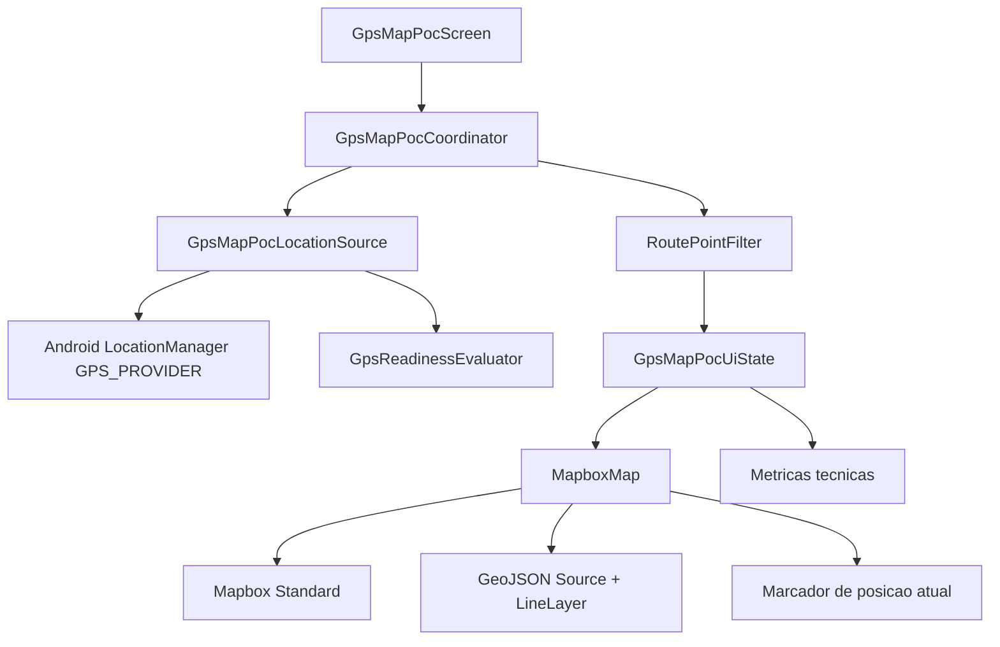
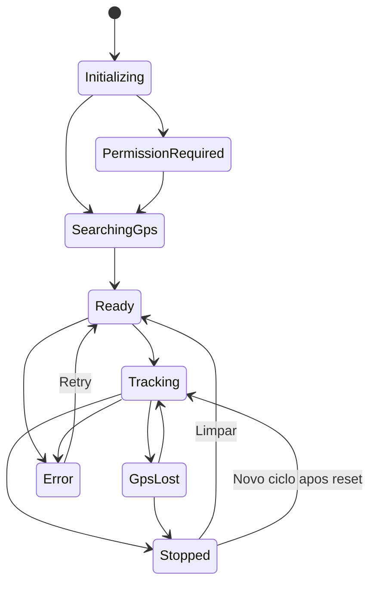

# 026 — PoC Mapbox com GPS e rota em tempo real

- **Ticker:** `026`
- **Status:** draft
- **Tipo:** prova de conceito técnica isolada
- **Roadmap:** trabalho independente; não cria nova fase
- **Escopo de distribuição:** debug only
- **Data da decisão inicial:** 2026-08-20

## Contexto

O Champion Companion é um aplicativo Android nativo em Kotlin e Jetpack Compose, de uso pessoal e atualmente com um único usuário.

A antiga Fase 013 tentou introduzir treinos iniciados pelo celular com GPS, persistência de rota, foreground service, recuperação de sessão e integração posterior ao Health Connect. Essa fase foi encerrada como `partially_delivered` por `product_reorientation`.

Parte relevante da infraestrutura técnica permaneceu no código:

- modelos `WorkoutRoute` e `WorkoutRoutePoint`;
- `WorkoutRoutePointCandidate`;
- `GpsReadiness` e `GpsReadinessEvaluator`;
- `RoutePointFilter`;
- `WorkoutRouteAccumulator`;
- contratos `WorkoutLocationSource`;
- implementação Android baseada em `LocationManager.GPS_PROVIDER`;
- infraestrutura de foreground service e persistência de sessão/rota;
- permissões de localização e foreground service no manifesto.

Entretanto, o comportamento vigente mantém treinos iniciados pelo celular explicitamente descontinuados por `PhoneWorkoutPolicy`, e `AGENTS.md` proíbe expansão de GPS, rota e mapa sem nova decisão explícita.

Esta spec representa essa nova decisão explícita, porém **somente para uma PoC técnica isolada**.

A PoC não reativa a antiga feature de treinos iniciados pelo celular e não altera a política de produto vigente. Seu objetivo é responder se Mapbox + GPS nativo conseguem produzir, no aparelho real, a experiência visual desejada:

```text
iniciar captura
      ↓
obter GPS
      ↓
filtrar pontos
      ↓
mostrar posição no mapa
      ↓
desenhar rota progressivamente
      ↓
parar captura
      ↓
enquadrar rota completa
```

O comportamento de referência é semelhante à visualização de atividade ao vivo de aplicativos esportivos como Strava, sem buscar paridade funcional.

## Objetivo

Validar fisicamente que o Champion Companion consegue:

1. renderizar mapa Mapbox dentro da UI Compose;
2. obter localização precisa pelo GPS do aparelho;
3. reutilizar os contratos puros existentes de readiness e filtragem quando aplicável;
4. representar a posição atual no mapa;
5. acumular pontos aceitos durante deslocamento real;
6. desenhar uma rota que cresça em tempo real;
7. acompanhar o deslocamento com a câmera sem impedir interação manual;
8. parar a coleta sem perder a rota em memória;
9. enquadrar a rota completa após a parada;
10. repetir o ciclo sem reiniciar o aplicativo.

Resultado esperado: evidência suficiente para decidir entre:

```text
PoC aprovada
    ↓
planejar feature real de atividades com mapa/GPS

ou

PoC rejeitada
    ↓
remover experimento sem alterar produto vigente
```

## Hipótese

A hipótese da PoC é:

> Mapbox Maps SDK para Android, integrado via extensão Jetpack Compose e alimentado pelos pontos GPS coletados pelo próprio Champion Companion, consegue renderizar de forma fluida uma rota de caminhada/corrida em tempo real e uma visão estática da rota concluída.

A hipótese é considerada validada somente por teste físico em aparelho real.

Build verde, emulador ou mapa estático isolado não encerram a PoC.

## Decisão experimental de provedor

A PoC utilizará **Mapbox Maps SDK for Android**.

Na data de criação desta spec:

- versão estável observada: `11.26.0`;
- existe extensão oficial para Jetpack Compose;
- Mapbox Standard está disponível como mapa-base;
- a franquia móvel observada é de até `25.000 MAU/mês`;
- o Champion Companion possui apenas um usuário, portanto custo operacional não é fator relevante para esta PoC.

Versão inicial prevista:

```text
com.mapbox.maps:android-ndk27:11.26.0
com.mapbox.extension:maps-compose-ndk27:11.26.0
```

Preferir os artefatos `-ndk27` para manter suporte moderno a page size de 16 KB.

Mapbox é aprovado nesta spec **somente para a PoC**.

A escolha definitiva do provedor para uma feature de produção exige nova decisão após o resultado físico.

## Documentos autoritativos

- `AGENTS.md`;
- `docs/baseline/current-baseline.md`;
- `docs/roadmap/post-phase-15-direction.md`;
- ADRs vigentes em `docs/decisions/`;
- `docs/specs/005-native-ble-poc.md`;
- `docs/specs/013-app-workouts-gps-route.md`;
- `docs/specs/024-refatoracao-visual-google-health.md`;
- `app/src/main/java/.../core/model/WorkoutRoute.kt`;
- `app/src/main/java/.../core/location/RoutePointFilter.kt`;
- `app/src/main/java/.../core/location/WorkoutLocationSource.kt`;
- `app/src/main/java/.../core/location/android/AndroidWorkoutLocationSource.kt`.

A implementação deve atualizar `AGENTS.md` e `current-baseline.md` antes ou junto do código para registrar a exceção explícita desta PoC.

## Relação com a Fase 013

A Spec 026 **não reabre a Fase 013**.

Continuam verdadeiras:

- Fase 013 permanece `closed`;
- resultado permanece `partially_delivered`;
- motivo permanece `product_reorientation`;
- `PhoneWorkoutPolicy` continua bloqueando treinos iniciados pelo celular;
- `WorkoutRecordingService` não volta a ser entrypoint de produto;
- superfícies antigas de preparação/sessão não são reativadas.

A autorização nova é estritamente:

```text
Spec 026
    ↓
debug-only
    ↓
GPS + Mapbox
    ↓
memória
    ↓
validação física
```

## Gate da PoC

A PoC terá um único gate físico.

Para aprovação, deve ser possível executar no aparelho real:

```text
abrir PoC
   ↓
obter GPS pronto
   ↓
iniciar
   ↓
percorrer trajeto real
   ↓
observar rota crescer
   ↓
interagir com mapa
   ↓
recentralizar
   ↓
parar
   ↓
visualizar rota completa
   ↓
limpar
   ↓
executar novo ciclo
```

Sem:

- crash;
- ANR;
- saltos visuais graves recorrentes;
- linha sendo desenhada com pontos rejeitados;
- rota anterior contaminando novo ciclo;
- coordenadas em Logcat;
- persistência involuntária;
- reativação da antiga feature phone.

## Limites da PoC

### Incluído

- Mapbox Maps SDK;
- Mapbox Compose;
- Mapbox Standard como mapa-base inicial;
- Activity técnica debug;
- tela Compose específica da PoC;
- solicitação de localização precisa;
- GPS via `LocationManager.GPS_PROVIDER`;
- readiness;
- precisão horizontal;
- filtragem de pontos;
- distância acumulada em memória;
- marcador da posição corrente;
- linha da rota;
- câmera de acompanhamento;
- recentralização manual;
- enquadramento da rota final;
- reset completo do ciclo;
- validação física.

### Fora do escopo

- reativar treinos iniciados pelo celular;
- `WorkoutRecordingService`;
- foreground service novo;
- tracking com tela apagada;
- tracking em background;
- recuperação após process death;
- Room;
- nova migration;
- persistência de rota;
- associação com `WorkoutActivity`;
- alteração do detalhe real de atividade;
- Health Connect;
- `ExerciseRoute`;
- Champion C001;
- BLE;
- frequência cardíaca;
- passos do relógio;
- auto-pause;
- splits;
- pace definitivo;
- calorias;
- elevação acumulada;
- navegação turn-by-turn;
- Directions API;
- Map Matching API;
- geocoding;
- busca de locais;
- mapas offline;
- GPX;
- TCX;
- FIT;
- compartilhamento de rota;
- servidor;
- upload de coordenadas;
- suporte multiusuário.

## Estratégia de isolamento

A PoC será **debug only**.

Preferir:

```text
app/src/debug/java/
└── br/com/mwconsulting/championcompanion/feature/gpspoc/
    ├── GpsMapPocActivity.kt
    ├── GpsMapPocScreen.kt
    ├── GpsMapPocUiState.kt
    ├── GpsMapPocCoordinator.kt
    └── GpsMapPocLocationSource.kt
```

E:

```text
app/src/debug/AndroidManifest.xml
```

para registrar a Activity somente na variante debug.

A Activity pode ser aberta explicitamente por ADB durante a PoC.

Não adicionar destino permanente à navegação principal.

Não adicionar CTA em Home, Saúde, Exercícios, Dispositivo ou Configurações.

A variante release não deve possuir entrypoint para a PoC.

## Arquitetura



## Fonte de localização da PoC

Não alterar `PhoneWorkoutPolicy` para obter GPS.

Não alterar o binding produtivo de `LocationModule`.

Não utilizar `WorkoutRecordingService`.

Criar uma fonte mínima debug-only utilizando:

```text
LocationManager.GPS_PROVIDER
```

com direção inicial equivalente ao código histórico:

```text
intervalo: 1.000 ms
distância mínima solicitada: 0 m
```

Essa fonte deve produzir dados suficientes para alimentar os contratos puros existentes.

Campos relevantes:

- timestamp;
- latitude;
- longitude;
- altitude quando disponível;
- precisão horizontal;
- precisão vertical quando disponível;
- velocidade quando disponível;
- bearing quando disponível;
- flag mock.

Nenhuma coordenada deve ser escrita em Logcat.

## Reutilização do legado

Reutilizar quando possível e sem modificar semântica:

- `WorkoutRoutePointCandidate`;
- `GpsReadiness`;
- `GpsReadinessEvaluator`;
- `GpsReadinessPolicy`;
- `WorkoutRoutePointFilterPolicy`;
- `RoutePointFilter`;
- `WorkoutRoutePoint`;
- IDs de rota/ponto necessários para alimentar o filtro.

Não reutilizar nesta PoC:

- `WorkoutRecordingService`;
- repositories de rota;
- Room;
- `WorkoutRouteAccumulator` se não for necessário para o fluxo simples sem pausa;
- recuperação de sessão;
- sincronização Health Connect;
- ownership BLE.

O legado é fonte de contratos úteis, não autorização para reativar o produto antigo.

## Readiness GPS

Antes do início da captura, usar a política já existente:

```text
STRONG    <= 10 m
GOOD      <= 20 m
WEAK      <= 50 m
UNUSABLE  > 50 m
```

Fix recente:

```text
<= 10 s
```

O botão `Iniciar` deve ficar habilitado somente em:

```text
READY + GOOD
ou
READY + STRONG
```

Estados mínimos apresentados:

- permissão necessária;
- localização desativada;
- procurando GPS;
- sinal fraco;
- pronto;
- GPS perdido;
- indisponível.

O usuário deve poder abrir a PoC antes de existir fix.

## Política de pontos

Durante tracking, cada fix deve passar pelo filtro existente.

Direção inicial preservada:

```text
idade máxima                  10 s
precisão horizontal máxima    50 m
velocidade humana máxima      12 m/s
deslocamento mínimo           3 m
mock                          rejeitado
duplicata                     rejeitada
ordem temporal inválida       rejeitada
```

A UI desenha somente pontos aceitos.

Manter separadamente:

```text
fixes recebidos
pontos aceitos
pontos rejeitados
```

Razões de rejeição podem ser agregadas por categoria para diagnóstico técnico, mas sem coordenadas.

## Estado da PoC

Estado conceitual:

```kotlin
GpsMapPocUiState(
    status,
    gpsReadiness,
    horizontalAccuracyMeters,
    receivedFixCount,
    acceptedPointCount,
    rejectedPointCount,
    distanceMeters,
    currentPoint,
    routePoints,
    followUser,
    error,
)
```

A implementação real pode adaptar tipos, mas deve evitar booleans concorrentes que permitam combinações inválidas.

State machine sugerida:



## Ciclo de captura

### Antes de iniciar

GPS pode aquecer e atualizar readiness.

Nenhum ponto recebido antes do toque em `Iniciar` entra na rota.

### Ao iniciar

- criar ID efêmero de rota;
- criar nova geração de runtime;
- zerar sequência;
- zerar distância;
- zerar contadores;
- limpar rota anterior;
- limpar erro anterior;
- ativar modo tracking;
- utilizar próximo ponto aceito como início da rota.

### Durante

Para cada fix:

```text
GPS fix
   ↓
candidate
   ↓
RoutePointFilter
   ├── rejected → contador
   └── accepted
          ↓
     routePoints
          ↓
       distância
          ↓
      GeoJSON
          ↓
      LineLayer
```

### Ao parar

- interromper inclusão de novos pontos na rota;
- manter pontos aceitos em memória;
- manter métricas visíveis;
- manter mapa interativo;
- remover comportamento de follow;
- enquadrar toda a rota.

### Ao limpar

- remover rota;
- remover marcador de fim da sessão;
- zerar métricas;
- zerar contadores;
- destruir identidade do ciclo anterior;
- retornar ao estado pronto ou aguardando GPS.

## Integração Mapbox

Utilizar a extensão Compose oficial.

Mapa conceitual:

```kotlin
MapboxMap(...)
```

Mapa-base inicial:

```text
Mapbox Standard
```

A rota deve ser representada como:

```text
List<WorkoutRoutePoint>
        ↓
List<Point>
        ↓
LineString
        ↓
GeoJSON Source
        ↓
LineLayer
```

Preferir `GeoJsonSource` + `LineLayer` em vez de overlays imperativos acoplados à Activity.

Não usar Mapbox Directions ou Map Matching.

A geometria vem exclusivamente do GPS recebido pelo Champion Companion.

## Fonte única da posição

Não utilizar simultaneamente:

```text
GPS do Champion Companion
+
location tracking independente do Mapbox
```

como duas fontes concorrentes de verdade.

A posição exibida no mapa deve derivar do mesmo ponto observado pelo fluxo da PoC.

Assim:

```text
GpsMapPocLocationSource
        ├── currentPoint → marcador
        └── acceptedPoints → rota
```

Isso evita divergência entre o ponto mostrado pelo mapa e os pontos usados na rota.

## Rota no mapa

Com zero pontos:

- nenhuma linha.

Com um ponto:

- somente posição corrente/início.

Com dois ou mais:

- construir `LineString`;
- atualizar source conforme pontos aceitos entram;
- desenhar `LineLayer`.

A linha deve possuir:

- cap arredondado;
- join arredondado;
- largura legível no telefone;
- cor derivada da identidade visual do Champion quando tecnicamente viável;
- contraste suficiente sobre Mapbox Standard.

Não codificar coordenadas no estilo.

## Marcadores

Durante tracking:

- posição corrente visível.

Após parada:

- início e fim podem ser diferenciados se isso não aumentar significativamente o escopo;
- caso contrário, manter somente rota e último ponto é suficiente para aprovação da PoC.

Marcadores definitivos de produto ficam para futura spec.

## Câmera durante tracking

No primeiro ponto aceito:

```text
center = primeiro ponto
zoom ≈ 16
```

Durante tracking:

- câmera acompanha novo ponto enquanto `followUser == true`;
- não animar agressivamente a cada fix;
- não rotacionar mapa automaticamente nesta PoC;
- gesto manual do usuário deve poder suspender follow;
- botão `Recentralizar` restaura follow.

A PoC deve priorizar estabilidade e legibilidade, não efeitos de navegação.

## Câmera após parada

Com dois ou mais pontos:

- calcular bounds;
- aplicar padding suficiente;
- enquadrar rota completa.

Com apenas um ponto:

- manter centro no ponto;
- utilizar zoom aproximado de atividade urbana.

Com zero pontos:

- preservar câmera atual.

## UI técnica

Tela deve ser simples, funcional e coerente com o design system atual.

Elementos mínimos:

```text
GPS + Mapbox — PoC

┌──────────────────────────────┐
│                              │
│           MAPBOX             │
│                              │
│   ●───────╮                  │
│           ╰────────📍        │
│                              │
└──────────────────────────────┘

GPS              Pronto
Precisão          7 m
Distância         0,84 km
Pontos            124 aceitos
Descartados       17

[ Recentralizar ]

[ Iniciar / Parar ]

[ Limpar ]
```

Não mostrar:

- latitude;
- longitude;
- altitude exata;
- endereço;
- identificadores internos;
- token Mapbox;
- stack trace.

## Permissões

Reutilizar as permissões já declaradas:

```text
ACCESS_FINE_LOCATION
ACCESS_COARSE_LOCATION
```

A PoC exige localização precisa.

Solicitação runtime:

- ocorre após ação explícita;
- usa Activity Result API;
- permite retry;
- não entra em loop;
- negação não vira erro interno;
- localização aproximada não libera início;
- GPS desligado deve ser estado próprio.

Não solicitar `ACCESS_BACKGROUND_LOCATION`.

## Credenciais Mapbox

Existem dois tipos de credencial relevantes.

### Downloads token

Token secreto necessário para resolver dependências do repositório Maven da Mapbox.

Regras:

- token secreto;
- escopo mínimo `Downloads:Read`;
- não versionar;
- não colocar em `local.properties` se houver risco de compartilhamento não controlado;
- preferir `~/.gradle/gradle.properties`, variável de ambiente ou secret de CI;
- nunca escrever em Logcat;
- nunca expor em `BuildConfig`.

Nome esperado:

```text
MAPBOX_DOWNLOADS_TOKEN
```

### Public access token

Token público utilizado pelo SDK no cliente.

Regras:

- criar token específico para Champion Companion;
- utilizar somente scopes públicos necessários;
- não utilizar token secreto no APK;
- não logar;
- não exibir na UI;
- evitar usar o default public token como decisão definitiva.

Para a PoC, pode ser injetado em variante debug via propriedade local e disponibilizado ao SDK como `mapbox_access_token` ou configuração equivalente.

Nome local sugerido:

```text
MAPBOX_ACCESS_TOKEN
```

Ausência de credencial deve gerar erro de configuração claro durante desenvolvimento e nunca fallback para token commitado.

## Dependências e build

Adicionar Mapbox apenas onde necessário para a variante da PoC.

Objetivo:

```text
debug → possui PoC + Mapbox
release → não possui entrypoint da PoC
```

Preferir `debugImplementation` quando a estrutura Gradle permitir sem contaminar source sets de produção.

A configuração do repositório Maven da Mapbox não pode inserir secret no repositório Git.

Continuam válidos:

```bash
./gradlew lint assembleDebug assembleRelease
```

`assembleRelease` deve permanecer possível sem keystore local, conforme comportamento atual.

Se a configuração do repositório Mapbox tornar release dependente de uma credencial que não deveria ser necessária para seu grafo, corrigir o isolamento antes de aceitar a task.

## Privacidade

A PoC manipula localização real, portanto as regras são estritas.

Proibido em Logcat:

- latitude;
- longitude;
- altitude;
- rota;
- GeoJSON;
- bounds;
- endereço;
- token;
- identificadores pessoais.

Permitido:

- estado do GPS;
- categoria de precisão;
- quantidade de pontos;
- quantidade por motivo de rejeição;
- distância agregada quando necessária ao diagnóstico;
- categorias de erro sanitizadas.

A rota permanece somente em memória.

Não escrever arquivo GeoJSON.

Não exportar rota.

Não sincronizar rota.

Não enviar rota explicitamente a API própria.

O mapa-base exige comunicação com a infraestrutura Mapbox para estilos/tiles; esta característica deve ser considerada novamente antes de promover a PoC a feature definitiva.

## Evidências

Mudança visual exige screenshot conforme `AGENTS.md`.

Entretanto, screenshot físico contendo mapa da localização real pode revelar local pessoal.

Portanto:

- não versionar screenshot com rota real ou localização residencial;
- screenshot de PR deve usar estado neutro sem localização pessoal visível;
- validação da rota real deve ser registrada textualmente de forma sanitizada;
- coordenadas nunca entram na evidência;
- não salvar gravação de tela com rota pessoal no repositório.

## Validação

Não criar ou alterar testes automatizados nesta spec, seguindo a política atual do projeto.

### Build

Executar:

```bash
./gradlew lint assembleDebug assembleRelease
```

e, para o aparelho:

```bash
./gradlew installDebug
```

### Validação física

A validação deve ocorrer em aparelho Android real.

Cenário principal mínimo:

1. instalar debug;
2. abrir Activity da PoC;
3. conceder localização precisa;
4. aguardar `READY`;
5. iniciar captura;
6. percorrer trajeto externo real de aproximadamente 500 m ou mais;
7. confirmar que a posição progride no mapa;
8. confirmar que a linha cresce durante o deslocamento;
9. mover/zoom manualmente o mapa;
10. utilizar `Recentralizar`;
11. continuar o percurso;
12. parar captura;
13. confirmar enquadramento da rota;
14. confirmar métricas finais;
15. limpar;
16. iniciar segundo ciclo sem reiniciar app.

### Casos negativos mínimos

- permissão negada;
- localização aproximada;
- GPS desligado;
- GPS ainda procurando fix;
- perda temporária de qualidade durante tracking;
- parar antes do segundo ponto;
- limpar após parada;
- executar dois ciclos consecutivos.

Background, tela apagada e process death não fazem parte do gate desta PoC.

## Critérios de aceite

1. Spec e documentação registram explicitamente que a PoC não reabre a Fase 013.
2. `PhoneWorkoutPolicy` permanece com treinos phone descontinuados.
3. `WorkoutRecordingService` não é utilizado pela PoC.
4. Nenhuma superfície de produto recebe CTA para iniciar treino.
5. Activity da PoC existe somente em debug.
6. Mapbox carrega corretamente no aparelho real.
7. Mapbox utiliza integração Compose.
8. Mapbox Standard funciona como mapa-base da PoC.
9. GPS preciso é obtido por fluxo controlado pelo Champion Companion.
10. O mesmo fluxo de GPS alimenta posição atual e rota.
11. Readiness distingue pelo menos aguardando, pronto, perdido e indisponível.
12. Início só ocorre após ação explícita e GPS aceitável.
13. Pontos anteriores ao início não entram na rota.
14. `RoutePointFilter` ou semântica existente equivalente impede pontos inválidos de entrar na rota.
15. Apenas pontos aceitos são desenhados.
16. Rota cresce visualmente durante deslocamento real.
17. Mapa permanece responsivo durante atualização da rota.
18. Câmera acompanha usuário sem impedir pan/zoom manual.
19. `Recentralizar` restaura acompanhamento.
20. Parar encerra inclusão de pontos.
21. Rota continua visível após parada.
22. Câmera enquadra rota completa após parada.
23. Limpar remove todo estado do ciclo.
24. Segundo ciclo não recebe dados do primeiro.
25. Nenhum dado de localização aparece em Logcat.
26. Nenhuma rota é persistida no Room ou em arquivo.
27. Health Connect não participa.
28. BLE não participa.
29. Nenhum token secreto Mapbox é versionado.
30. Variante release não expõe entrypoint da PoC.
31. `lint`, `assembleDebug` e `assembleRelease` concluem.
32. Validação física principal é concluída e registrada de forma sanitizada.
33. Resultado final é explicitamente classificado como `go`, `go_with_adjustments` ou `no_go`.

## Resultado esperado do gate

### `go`

Usar quando:

- mapa funciona de forma estável;
- rota cresce corretamente;
- interação é fluida;
- GPS/filtragem produzem trajetória visualmente coerente;
- nenhum bloqueio arquitetural relevante é encontrado.

### `go_with_adjustments`

Usar quando:

- conceito funciona;
- existem problemas corrigíveis de câmera, estilo, frequência de atualização, filtro ou integração Compose;
- não existe impedimento estrutural.

### `no_go`

Usar quando:

- Mapbox apresenta incompatibilidade relevante;
- integração Compose não atende ao comportamento necessário;
- rota não consegue ser atualizada com fluidez aceitável;
- custo/credencial/licença se torna inadequado;
- arquitetura exigiria acoplamento incompatível com o projeto.

## Pós-PoC

Aprovação desta spec **não autoriza automaticamente a feature de produção**.

Se resultado for `go` ou `go_with_adjustments`, criar nova spec para efetivação.

Essa futura spec poderá avaliar:

```text
treino iniciado pelo celular
        ↓
Foreground Service
        ↓
GPS persistente
        ↓
rota persistida
        ↓
tela ativa com mapa
        ↓
finalização
        ↓
WorkoutActivity
        ↓
detalhe da atividade com mapa
```

Ela deverá decidir explicitamente:

- se `PhoneWorkoutPolicy` será substituída;
- quais partes da Fase 013 serão recuperadas;
- ownership do foreground service;
- persistência Room;
- recuperação de sessão;
- tela apagada/background;
- activity detail;
- Mapbox definitivo;
- tratamento de custos;
- privacidade;
- eventual Health Connect `ExerciseRoute`;
- integração ou não com Champion C001;
- migração/remoção de legado.

Nada disso pertence ao aceite da Spec 026.

## Arquivos previstos

### Documentação

- `docs/specs/026-mapbox-gps-route-poc.md`;
- `docs/tasks/026-mapbox-gps-route-poc/026-00-overview.md`;
- `AGENTS.md`;
- `docs/baseline/current-baseline.md`;
- ADR-024 ou decisão equivalente para registrar autorização experimental e fronteira da PoC.

### Gradle

- `settings.gradle.kts`;
- `gradle/libs.versions.toml`;
- `app/build.gradle.kts`;
- `.gitignore` somente se necessário para credencial local.

### Debug

- `app/src/debug/AndroidManifest.xml`;
- `app/src/debug/java/.../feature/gpspoc/*`.

### Main

Alterações em `main` devem ser evitadas.

Se forem inevitáveis para disponibilizar contrato puro reutilizável à PoC, precisam:

- ser mínimas;
- não alterar comportamento produtivo;
- não contornar `PhoneWorkoutPolicy`;
- não reativar entrypoint antigo;
- ser documentadas no overview.

## Ordem das subtarefas

```text
026-00  Overview, checklist, escopo e gate
   ↓
026-01  Alinhamento documental + ADR da PoC
   ↓
026-02  Mapbox, credenciais e isolamento Gradle
   ↓
026-03  Activity debug + estados da PoC
   ↓
026-04  GPS debug + readiness + filtro
   ↓
026-05  Mapbox + posição + rota em tempo real
   ↓
026-06  Câmera, stop, rota final e reset
   ↓
026-07  Validação física e casos negativos
   ↓
026-08  Fechamento e decisão go/no-go
```

## Matriz de rastreabilidade

| Requisito                                   | Task     |
| ------------------------------------------- | -------- |
| Escopo, isolamento e gate                   | `026-00` |
| Exceção documental, baseline e ADR          | `026-01` |
| SDK Mapbox, Maven e tokens                  | `026-02` |
| Entry point debug e state machine           | `026-03` |
| Localização, readiness e filtragem          | `026-04` |
| Mapa, GeoJSON e LineLayer                   | `026-05` |
| Follow, recentralização, fit bounds e reset | `026-06` |
| Teste físico e cenários negativos           | `026-07` |
| Resultado, riscos e próxima decisão         | `026-08` |

## ADR

Criar `ADR-024` ou próximo número livre confirmado no momento da execução.

Tema sugerido:

```text
Mapbox como provedor experimental de mapas para PoC GPS debug-only
```

A ADR deve registrar:

- Mapbox é experimental;
- uso restrito à Spec 026;
- versão inicial;
- modelo de credenciais;
- dependência Maven;
- Mapbox Standard;
- franquia observada na data;
- implicações de privacidade/rede;
- ausência de decisão definitiva de produção;
- necessidade de revisão após gate físico.

A ADR pode ser atualizada ou sucedida caso a feature seja efetivada.

## Definition of Done

A Spec 026 termina quando:

- a PoC está isolada em debug;
- Mapbox renderiza no aparelho real;
- GPS preciso alimenta o estado da PoC;
- pontos aceitos produzem rota crescente em tempo real;
- a posição atual é derivada da mesma fonte;
- follow e recentralização funcionam;
- parada preserva a rota em memória;
- rota final é enquadrada corretamente;
- reset permite novo ciclo limpo;
- não há persistência, Health Connect ou BLE;
- treinos phone continuam descontinuados fora da PoC;
- nenhuma coordenada ou token sensível é registrado;
- builds esperados passam;
- validação física sanitizada foi documentada;
- decisão final `go`, `go_with_adjustments` ou `no_go` foi registrada;
- a PoC não depende desta conversa para ser compreendida ou executada.
